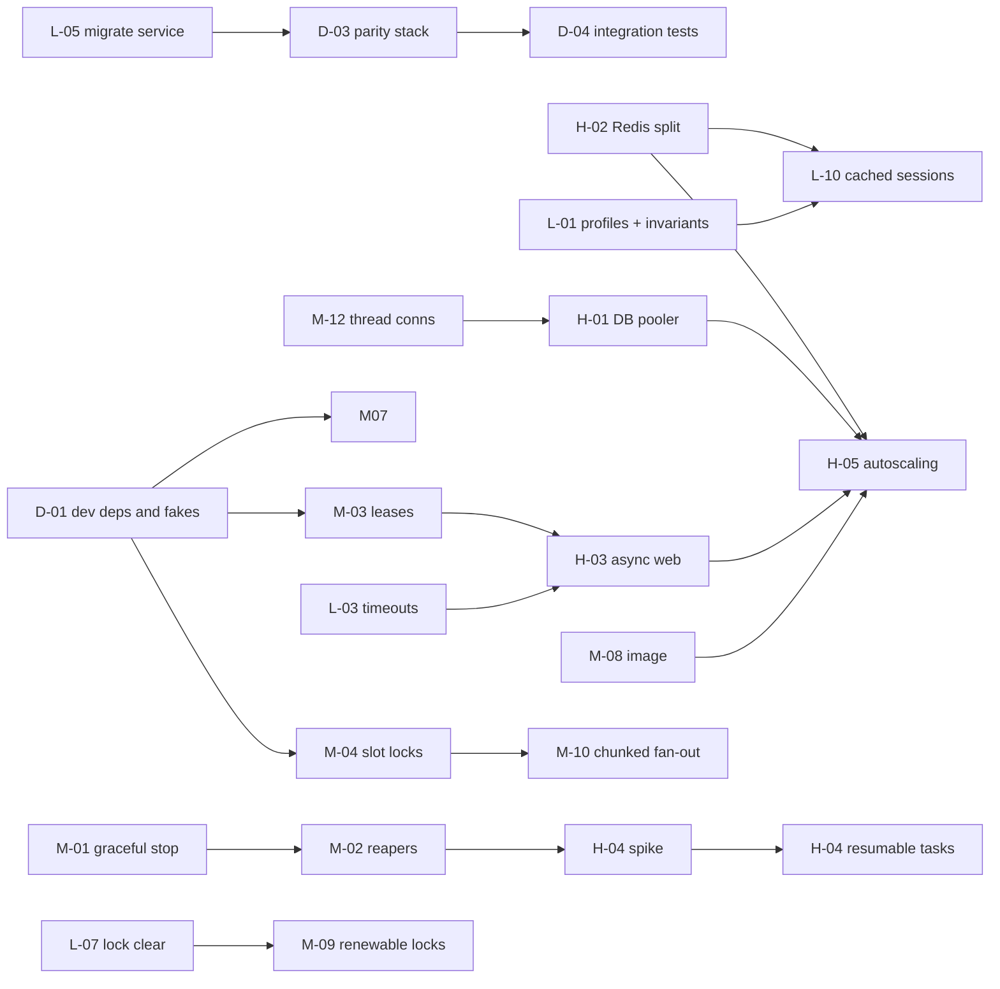

# Statelessness & Horizontal Scaling Remediation Plan

**Date:** 2026-11-08
**Revised:** 2026-11-08, after external review. Amendments are in L-02, L-03, L-04, M-04, H-02, H-03, and the H-04 gate.
**Implemented in code:** L-01 through L-10 (session engine and backup upload included), M-02 (reaper and `reap_stale_runs`), M-03 (leases), M-04 (cron-fire locks), M-05, M-06, M-12 (database connections closed on the invoke thread), and the queue-Redis lock client from H-02. Compose runs migrations once and stops Huey with SIGINT (M-01, L-05). Still to build: H-01 pooler, H-02's second Redis deployment, H-03 async AI match, H-04 checkpointing, H-05 autoscaling, M-07 per-batch extract objects, M-08 image rebuild, M-09 lock renewal, M-10 chunked fan-out, and the parity stack (D-03, D-04).
**Source:** [Statelessness & Horizontal Scaling Audit](statelessness-and-horizontal-scaling-audit.md) (findings S-01 to S-26)

**Paths.** Application code lives under `django_project/`. A work item that names `core/settings.py` means `django_project/core/settings.py`, and `resume_app/tasks.py` means `django_project/resume_app/tasks.py`. HTTP routes are absolute from the site root. The Ninja API is mounted at `/api/` (`django_project/core/urls.py`), the resume router at `/resume`, and the jobs router at `/jobs`, so job endpoints are `/api/resume/jobs/...`.
**Goal:** Run the web and Huey worker tiers as stateless containers that autoscale from 1 to 100 pods without data loss, duplicate work, or shared-infrastructure exhaustion.
**Constraint:** Local development must keep working on a Windows workstation with no new mandatory dependencies. Every production guard is scoped to an explicit production profile, and every distributed mechanism has a single-process equivalent (see §2 and §7).

---

## 1. Complexity scale

| Level | Definition | Typical effort |
| :--- | :--- | :--- |
| **Low** | One or two files, no schema change, no API contract change, no new infrastructure. Reversible with a config flag or revert. | 0.5 to 1 engineer-day |
| **Medium** | Several modules, possibly a migration or new periodic task, new deployment topology, or a behaviour change that needs careful tests. No user-facing API break. | 2 to 5 engineer-days |
| **High** | New infrastructure, cross-tier contract changes (API + frontend), or architectural change to how work executes. Needs load testing and a staged rollout. | 1 to 3 engineer-weeks |

Estimates include unit and integration tests and doc updates. They exclude infrastructure procurement lead time.

---

## 2. Runtime profiles

All work items key their behaviour on a single setting, `APP_ENV`, instead of inferring intent from `DEBUG`. Today `DEBUG` doubles as "am I in production?", which is why the safe default and the convenient default conflict.

| `APP_ENV` | Where it is set | `DEBUG` default | Guards (L-01) | Typical backing services |
| :--- | :--- | :--- | :--- | :--- |
| `development` | **Default when unset**, so a bare checkout with `runserver` works | `True` | Off | SQLite or MariaDB, local `media/`, Redis optional |
| `test` | Auto-detected for `manage.py test` / pytest (existing `_IN_TEST`) | `False` | Off | SQLite, LocMem, `fakeredis`, in-memory storage |
| `production` | `ENV APP_ENV=production` baked into the **runtime image** (M-08), and Kubernetes manifests | `False` | **On** (fail closed) | MariaDB via pooler, split Redis, S3 |

The safe default lives where production actually runs (the image), and the convenient default lives where developers run (a bare checkout). An operator who deploys the image without configuring S3 or Redis is stopped at boot. A developer who runs `runserver` with no `.env` is not.

### Local development tiers

| Tier | Use it for | Processes | Services | Command |
| :--- | :--- | :--- | :--- | :--- |
| **A — Minimal** | UI work, quick fixes, first-time setup | `runserver` only (`HUEY_IMMEDIATE=1`) | SQLite, LocMem cache, local `media/` | `.\scripts\dev.ps1 web -Minimal` |
| **B — Standard** (current setup) | Feature work with background tasks | `runserver` + `run_huey` (native Windows) | MariaDB or SQLite, one Redis (two DBs), local `media/` | `.\scripts\dev.ps1 web` and `.\scripts\dev.ps1 worker` |
| **C — Production parity** | Reproducing multi-pod bugs, validating Phase 1–3 work | Gunicorn web ×2, worker ×2, scheduler ×1 in Docker | MariaDB, queue Redis, cache Redis, MinIO (S3) | `.\scripts\dev.ps1 parity -Scale 2` |

Tier A and Tier B must keep working after every phase. Tier C is new (D-03) and opt-in.

---

## 3. Coverage matrix

Every audit finding maps to at least one work item.

| Finding | Summary | Work item(s) | Complexity | Phase |
| :--- | :--- | :--- | :--- | :--- |
| S-01 | Local-disk media default | L-01 | Low | 0 |
| S-02 | LocMem cache fallback, `DEBUG=True` default | L-01, L-02 | Low | 0 |
| S-03 | Tasks lost on SIGTERM, no optimization reaper | M-01, M-02, H-04 | Medium / High | 1, 3 |
| S-04 | MySQL connection exhaustion | M-12, H-01 | Medium / High | 1 |
| S-05 | Single 512 MB `noeviction` Redis | H-02 | High | 1 |
| S-06 | LLM concurrency slot leak | M-03 | Medium | 1 |
| S-07 | Invoke timeout not enforced | L-03 | Low | 0 |
| S-08 | Sync LLM/embedding work in web requests | H-03 | High | 2 |
| S-09 | Periodic lock not tick-keyed | M-04 | Medium | 1 |
| S-10 | Stripe check-then-act | L-04 | Low | 0 |
| S-11 | Production image shape | M-08 | Medium | 2 |
| S-12 | Health probes vs TLS / host validation | L-02 | Low | 0 |
| S-13 | Migration races, rollout safety | L-05, M-11 | Low / Medium | 0, 2 |
| S-14 | Model downloaded/loaded per pod | M-08 | Medium | 2 |
| S-15 | Expensive cold starts | M-08, H-05 | Medium / High | 2, 3 |
| S-16 | Non-atomic, O(n²) S3 extract writes | M-07 | Medium | 2 |
| S-17 | Racy, spoofable abuse throttle | M-05 | Medium | 2 |
| S-18 | Circuit breaker races, half-open stampede | M-06 | Medium | 2 |
| S-19 | Hard throughput ceilings | L-06, M-10 | Low / Medium | 0, 2 |
| S-20 | Stale per-user locks after crash | L-07, M-09 | Low / Medium | 0, 2 |
| S-21 | DB session read per request | L-10 | Low | 3 |
| S-22 | Config drift across pods (`FERNET_KEYS`) | L-01 | Low | 0 |
| S-23 | Redis TLS without verification | L-08 | Low | 0 |
| S-24 | `dbbackup` to container disk | L-09 | Low | 0 |
| S-25 | Telemetry not flushed on shutdown | L-09 | Low | 0 |
| S-26 | Headed Playwright default | L-09 | Low | 0 |

---

## 4. Low-complexity work items

### L-01 — Runtime profiles and fail-closed production invariants (S-01, S-02, S-22)
**Changes** — `core/settings.py`, `.env.example`, `Dockerfile` (runtime stage, see M-08)
- Introduce `APP_ENV` (§2):
  ```python
  APP_ENV = "test" if _IN_TEST else env("APP_ENV", default="development")
  if APP_ENV not in {"development", "test", "production"}:
      raise ImproperlyConfigured(f"APP_ENV must be development, test, or production (got {APP_ENV!r}).")
  IS_PRODUCTION = APP_ENV == "production"
  DEBUG = env.bool("DEBUG", default=APP_ENV == "development")
  ```
  A bare local checkout keeps `DEBUG=True`. The production image sets `ENV APP_ENV=production`, so a deployment that forgets `DEBUG` gets `False`.
- Re-key the existing production invariant block (SQLite, console email, Stripe secret, SECRET_KEY, ALLOWED_HOSTS) from `if not DEBUG and not _IN_TEST` to `if IS_PRODUCTION`. A developer can then run `DEBUG=False` locally to check 404 pages or static files without tripping production guards.
- Add the new guards:
  ```python
  if IS_PRODUCTION:
      if CACHES["default"]["BACKEND"].endswith("LocMemCache") and not env.bool("ALLOW_LOCMEM_CACHE_IN_PRODUCTION", default=False):
          raise ImproperlyConfigured("Production cache failure: configure Redis (DJANGO_CACHE_URL / DJANGO_CACHE_USE_REDIS=1).")
      if not AWS_STORAGE_BUCKET_NAME and not env.bool("ALLOW_LOCAL_MEDIA_IN_PRODUCTION", default=False):
          raise ImproperlyConfigured("Production storage failure: set AWS_STORAGE_BUCKET_NAME for multi-replica deployments.")
      if not FERNET_KEYS and not env.bool("ALLOW_DERIVED_FERNET_KEY", default=False):
          raise ImproperlyConfigured("Production crypto failure: set FERNET_KEYS so all pods share encryption keys.")
  ```
- **Migration note for `FERNET_KEYS`:** existing ciphertext was encrypted with the `SECRET_KEY`-derived key. Before enabling the guard, put the derived key in `FERNET_KEYS` as the **last** entry (newest first), then rotate.

**Tests** — new `test_production_settings.py`: run `python -c "import django; django.setup()"` in a subprocess with production env permutations and assert exit code and message. Settings are evaluated at import time, so in-process `override_settings` cannot cover this.

**Acceptance**
- `APP_ENV=production` with S3, Redis cache, or `FERNET_KEYS` missing aborts with a clear message. Single-node Compose still works with the explicit `ALLOW_*` flags.
- A clean checkout with **no `.env`** runs `manage.py runserver` with `DEBUG=True`, SQLite, LocMem, and local media (Tier A).
- `APP_ENV=development DEBUG=False` starts without production guards.

**Local development** — No change for Tier A or B. `.env.example` gains `APP_ENV=development` with a comment. Existing local `.env` files need no edits, because they set `DEBUG=True` and do not set `APP_ENV`.

**Risk** — Production deployments not built from the new image must set `APP_ENV=production` explicitly, or they run as `development`. Mitigation: the guard log line on startup prints the active profile, and the Kubernetes/Compose prod manifests set it explicitly as well as the image.

---

### L-02 — Health probes that work behind TLS (S-02, S-12)
**Changes** — `resume_app/middleware.py` (new `HealthCheckMiddleware`, first in `MIDDLEWARE`), `resume_app/views.py` (`health_ready_view`), `core/settings.py`, `docker-compose.prod.yml`
- The middleware answers `/health/live` and `/health/ready` before `SecurityMiddleware`. Django checks `ALLOWED_HOSTS` lazily inside `request.get_host()`, so the middleware must return its response itself and must not call `get_host()`, `build_absolute_uri()`, or anything else that does. Match the path with `request.path_info` (set by the WSGI handler from `PATH_INFO`, and safe). `health_ready_view` already avoids `get_host()`; keep it that way.
- Also set `SECURE_REDIRECT_EXEMPT = [r"^health/"]`. The middleware makes this redundant, and it stays correct if a later change reorders `MIDDLEWARE`.
- Liveness checks nothing external.
- Readiness returns `{"app_env": ..., "database": ..., "cache": ..., "cache_backend": "RedisCache"}` and returns 503 when the backend is LocMem and `IS_PRODUCTION`. In development, LocMem is reported but healthy.
- Document probe guidance: liveness `timeoutSeconds` ≥ 5 and `failureThreshold` ≥ 3, so busy sync workers are not restarted mid-request (fully fixed by H-03).

**Tests** — extend existing health tests: `Host: 10.0.0.5` with `SECURE_SSL_REDIRECT=True` and a non-empty `ALLOWED_HOSTS` returns 200, not 301 or 400. Assert the view and middleware source do not call `get_host`. Readiness reports the backend.

**Acceptance** — `curl -H "Host: 10.0.0.5" http://127.0.0.1:8000/health/ready` returns 200 JSON in a production-config container.

---

### L-03 — Enforce the LLM invoke timeout (S-07)
**Changes** — `resume_app/llm/factory.py` first, `resume_app/llm/policy.py::run_with_invoke_timeout` second.

The timeout has to close the socket. A thread-pool deadline only unblocks the caller: `shutdown(wait=False)` abandons the worker thread, which keeps running until the provider responds and holds any database connection it opened (S-04, M-12).

1. **Primary:** pass a connect and read timeout into every LangChain client built in `factory.get_llm`. The kwarg differs by provider (`timeout` for OpenAI and Anthropic, the httpx timeout for Ollama). Budget it from `LLM_INVOKE_TIMEOUT_SECONDS` so the socket dies at the same deadline as the caller. A hung provider then frees the thread and its database connection.
2. **Backstop only:** keep `run_with_invoke_timeout` for a provider that ignores its timeout, and for a wall-clock cap across retries. On timeout, shut the pool down with `wait=False` so the caller returns, and log that a thread was abandoned.

```python
pool = ThreadPoolExecutor(max_workers=1, thread_name_prefix="llm-invoke")
fut = pool.submit(fn)
try:
    return fut.result(timeout=timeout)
except FuturesTimeout as e:
    raise LLMInvokeTimeout(f"LLM invoke exceeded {int(timeout)}s wall-clock deadline.") from e
finally:
    pool.shutdown(wait=False, cancel_futures=True)
```

**Tests** — `test_llm_policy.py`: a client whose HTTP timeout is 0.2 s against a hung socket raises within about 0.5 s and leaves no running thread. A separate test covers the backstop: a `fn` that sleeps 5 s with a 0.2 s deadline raises within about 0.5 s.

**Acceptance** — The caller is released at the deadline, and the worker thread is gone once the socket timeout fires. Gateway logs record the timeout.

---

### L-04 — Atomic Stripe webhook idempotency (S-10)
**Changes** — `resume_app/subscriptions/billing.py::apply_stripe_event`

Claim the event id first, then apply effects. A failure while applying rolls the claim back, so Stripe's retry reprocesses cleanly.

The `create()` needs its own nested `atomic()` block. Django sets `needs_rollback` on the connection after an `IntegrityError` inside `atomic()`, on MariaDB as well as PostgreSQL. A later query in that same block, including one added in the `except`, raises `TransactionManagementError`. The inner block is a savepoint, so the duplicate-key failure rolls back only the `create()` and leaves the outer transaction usable. Catch `IntegrityError` only around the `create()`. An integrity error inside the effects is a real failure and must propagate.

```python
with transaction.atomic():
    try:
        with transaction.atomic():
            StripeWebhookEvent.objects.create(
                event_id=event_id, event_type=etype, payload=event
            )
    except IntegrityError:
        return False
    _apply_event_effects(etype, data)  # extracted from the current if/elif chain
return True
```

**Tests** — `TransactionTestCase` with two threads calling `apply_stripe_event` for the same ID: exactly one returns `True` and side effects apply once. An exception in the effects leaves no `StripeWebhookEvent` row. A duplicate delivery does not raise `TransactionManagementError`.

---

### L-05 — Migration execution hygiene (S-13, part 1)
**Changes** — `docker-compose.prod.yml`, `docker-entrypoint.sh`, `docs/guides/container-scaling-and-deployment.md`
- Add a one-shot `migrate` service (`command: python manage.py migrate --noinput`, `restart: "no"`). `web` and `huey` `depends_on: migrate: condition: service_completed_successfully`, and both set `RUN_MIGRATIONS: "0"`.
- Document the Kubernetes equivalent: a pre-deploy Job or Helm `pre-upgrade` hook.

**Acceptance** — `docker compose ... up --scale web=3` runs migrations exactly once.

---

### L-06 — Make throughput limits configurable and observable (S-19, part 1)
**Changes** — `core/settings.py`, `tasks.py`
- `HUEY["consumer"]["workers"] = env.int("HUEY_WORKERS", default=2)`.
- `MAX_DUE_JOB_SEARCH_TASKS_PER_TICK = settings.JOB_SEARCH_MAX_DUE_PER_TICK` (env, default 50).
- `enqueue_due_job_search_tasks` logs a warning with the remaining due count when it hits the cap. That is the backlog signal for alerting.

**Tests** — `test_task_concurrency_scalability.py`: with 60 due tasks and a cap of 50, the warning is logged and 10 remain due.

---

### L-07 — Clear stale per-user locks in the reaper (S-20, part 1)
**Changes** — `tasks.py::mark_stale_job_search_runs_failed`, lock constants
- For each stale run, also `cache.delete(get_job_search_task_lock_key(owner_id))`.
- Lower `JOB_SEARCH_TASK_LOCK_TIMEOUT` and `VETTING_MATCHING_LOCK_TIMEOUT` from 3600 s to something closer to the realistic p99 runtime, set via env (proposed 1200 s). Heartbeat renewal comes in M-09.

**Tests** — a stale run with a held lock: after the reaper runs, the lock is gone and a new run can start.

---

### L-08 — Verified Redis TLS (S-23)
**Changes** — `core/settings.py`, `llm/rate_limit.py`
- Add `REDIS_SSL_CA` (path) and `REDIS_SSL_CERT_REQS` (default `required`). Pass them consistently to the Huey connection, the Django cache `OPTIONS`, and the limiter client. Allow `none` only with an explicit flag.

**Acceptance** — TLS connections fail against a server with an untrusted certificate unless the opt-out flag is set.

---

### L-09 — Operational hygiene (S-24, S-25, S-26)
**Changes**
- `management/commands/dbbackup.py`: add `--to-storage`, which uploads the gzip to `default_storage` under `backups/` (S3 in production). Document running it as a CronJob.
- `otel.py` / `llm/factory.py`: register `atexit` handlers that call `force_flush()` / `shutdown()` on the OTel tracer provider and the Langfuse client (S-25). This only helps once shutdown is graceful (M-01).
- `core/settings.py`: `APPLY_BROWSER_HEADLESS` defaults to `True`. If no code path still imports Playwright, delete the knobs (S-26).

---

### L-10 — Cached sessions and session cleanup (S-21)
**Depends on:** H-02 (dedicated cache Redis with eviction).
**Changes** — `SESSION_ENGINE = env("SESSION_ENGINE", default="django.contrib.sessions.backends.cached_db" if IS_PRODUCTION else "django.contrib.sessions.backends.db")`. Development keeps plain DB sessions, so a Redis restart or LocMem reset never logs a developer out. Add a daily `clearsessions` periodic task guarded by the M-04 lock. Audit large session values (`JOB_LLM_MATCH_SESSION_KEY`) and move them to the cache or the DB.

**Acceptance** — Under load, `django_session` SELECTs drop by more than 80%.

---

## 5. Medium-complexity work items

### M-01 — Graceful worker shutdown (S-03, part 1)
**Changes** — `Dockerfile` (worker target), Kubernetes/Compose manifests, Gunicorn config
- Worker containers: `STOPSIGNAL SIGINT`. Huey drains running tasks on SIGINT; SIGTERM aborts them.
- `terminationGracePeriodSeconds: 600` for workers (≥ `LLM_INVOKE_TIMEOUT_SECONDS` plus margin). Compose: `stop_grace_period: 10m`.
- Web: Gunicorn `--graceful-timeout 30`, plus a `preStop: sleep 5` so the load balancer deregisters the pod before it stops accepting connections.
- Document that tasks longer than the grace period are still lost. M-02 and H-04 cover that.

**Tests** — integration script: start a Huey consumer, enqueue a 20 s task, send SIGINT, assert the task completes and the process exits 0.

**Acceptance** — Rolling restarts of workers during an optimization run do not fail the run, provided it finishes within the grace period.

---

### M-02 — Stale-run reapers for optimizations and pipeline extracts (S-03, part 2)
**Changes** — `tasks.py`, `agents.py` / optimizer task, `pipeline_llm_skill_extract.py`
- **Heartbeat:** the optimizer task already writes `status_display` per node, which bumps `OptimizedResume.updated_at`. Make sure every long step (including each LLM call) touches the row at least every `OPTIMIZER_HEARTBEAT_SECONDS` (default 60).
- **Reaper:** new periodic `mark_stale_optimizations_failed` (every 10 min, M-04 lock). It marks `STATUS_QUEUED`/`STATUS_RUNNING` rows with `updated_at` older than `OPTIMIZER_STALE_MINUTES` (default 20) as `STATUS_FAILED` with `error_message="Worker stopped before completion; please retry."` and releases any related per-user lock.
- **Pipeline extracts (lazy reaping):** extract runs exist only in storage, so `read_run_status` treats `phase == "running"` with `updated_at` older than `PIPELINE_EXTRACT_STALE_MINUTES` as `phase: "stale"` and writes the error via `write_run_error`. The UI then offers a resume, using the existing `last_processed_index`.
- Add a DB index on `(status, updated_at)` for `OptimizedResume` (migration).
- **Local development:** periodic tasks do not run under `HUEY_IMMEDIATE=1` (Tier A). Add `manage.py reap_stale_runs [--dry-run]`, which calls the same reaper functions, so a developer can unstick a run left over after stopping `run_huey`. Stale thresholds are settings, so they can be lowered locally to exercise the path.

**Tests** — reaper unit tests with frozen time; `read_run_status` stale detection; the pipeline optimizer no longer skips an entry once its stuck run is reaped.

**Acceptance** — Killing a worker with SIGKILL mid-optimization yields a `failed` row within 30 minutes, and the user can re-run.

---

### M-03 — Lease-based per-user LLM concurrency (S-06)
**Changes** — `llm/policy.py::user_llm_concurrency`
- Replace `INCR`/`EXPIRE` with a sorted set of leases that expire individually:
  ```lua
  -- KEYS[1]=zset  ARGV: now, lease_expiry, lease_id, limit
  redis.call('ZREMRANGEBYSCORE', KEYS[1], '-inf', ARGV[1])
  if redis.call('ZCARD', KEYS[1]) >= tonumber(ARGV[4]) then return 0 end
  redis.call('ZADD', KEYS[1], ARGV[2], ARGV[3])
  redis.call('EXPIRE', KEYS[1], 3600)
  return 1
  ```
- Lease TTL = `LLM_INVOKE_TIMEOUT_SECONDS + 60`. Release with `ZREM key lease_id` in `finally`. A killed process's lease expires on its own and never blocks the user permanently.
- Keep fail-open/closed semantics tied to `LLM_RATE_LIMIT_FAIL_OPEN`.
- **Local development:** `LLM_RATE_LIMIT_FAIL_OPEN` already defaults to `DEBUG`, so Tier A (no Redis) skips the limiter with a single warning per process instead of per call. Lua scripts run on any Redis ≥ 2.6, including the existing 6380 instance and Memurai on Windows.

**Tests** — `test_llm_policy.py` with `fakeredis` (Lua support): limit enforcement; an expired lease frees a slot; release removes only its own lease. Regression test reproducing the old leak (acquire without release, keep calling) now recovers after TTL.

---

### M-04 — Tick-keyed periodic locks and a single scheduler (S-09)
**Changes** — `resume_app/tasks.py::acquire_periodic_leader_lock`, deployment manifests

Key the lock on the cron's last scheduled fire time, not on `time.time() // period`. Huey does not pass the scheduled tick into the task, so a lock computed from the execution clock changes when a task starts late. A `*/15` task that starts 16 minutes late would take the next slot and run twice. `epoch // period` happens to match this repo's six crons when they start on time (every period divides 86400 and the epoch is UTC-aligned), and it still drifts once a run crosses a boundary. An hour-bucket string such as `%Y-%m-%d-%H` is worse here: the minute, 15-minute, 20-minute, and 30-minute tasks would share one lock per hour and skip runs.

```python
def scheduled_fire(cron: crontab, now: datetime) -> datetime:
    """Floor ``now`` to the latest time this crontab would have fired."""

def acquire_periodic_leader_lock(task_name: str, cron: crontab) -> bool:
    """One execution per scheduled fire, including a copy that starts late."""
    fire = scheduled_fire(cron, timezone.now())
    period = seconds_until_next_fire(cron, fire)
    key = f"periodic_leader_lock:{task_name}:{fire.strftime('%Y-%m-%dT%H:%M')}"
    return bool(cache.add(key, 1, timeout=max(period * 2, 120)))
```

A run that starts after the following fire floors to that later fire and coalesces with it. The missed tick is acceptable: every periodic task here is maintenance, and the next fire repeats the work. Pass the same `crontab(...)` the decorator uses, so the lock cannot drift from the schedule.

- **Storage:** once H-02 splits Redis, this `cache.add` must use the queue Redis client, not `django.core.cache`. The cache points at the LRU instance, and an evicted lock runs the task twice (H-02).
- **Topology:** run periodic scheduling in one dedicated `huey-scheduler` deployment (1 replica). Scale the other worker pods with periodic scheduling disabled (Huey consumer `-n` / `--no-periodic`; confirm the flag passes through `run_huey` for the installed Huey version). The slot lock stays as defense in depth during scheduler failover.
- Job-search dispatch still rechecks `next_run_at` before enqueueing, so a coalesced tick does not enqueue a task that already ran.

**Tests** — `test_task_concurrency_scalability.py`, with one case per real crontab (`*`, `*/15`, `*/20`, `*/30`, `minute=15 hour=*/6`, `minute=30 hour=1`): two calls in the same fire (one winner); a call delayed past the old TTL but still before the next fire (no second run); a call delayed past the next fire (coalesces, one run); the 01:30 task locks on `T01:30`, not on midnight.

---

### M-05 — Atomic, spoof-resistant abuse throttle (S-17)
**Changes** — `abuse.py`, `core/settings.py`
- Fixed-window counter keyed by window index: `key = f"abuse:v2:{scope}:{identity}:{now // window}"`; `cache.add(key, 0, window)`; `count = cache.incr(key)`. That is atomic on Redis.
- Client IP: new `TRUSTED_PROXY_COUNT` (default 0). With N trusted proxies, take the N-th entry from the **right** of `X-Forwarded-For`; with 0, use `REMOTE_ADDR` only.

**Tests** — concurrency test (threads hitting `is_rate_limited`; total admitted ≤ limit); spoofed leftmost XFF entries do not change identity when `TRUSTED_PROXY_COUNT=1`.

---

### M-06 — Atomic circuit breaker with a single half-open probe (S-18)
**Changes** — `sourcing/circuit_breaker.py`
- Failures: `cache.incr(f"{key}:failures")` with TTL. Trip by `cache.set(f"{key}:open_until", now + cooldown)`.
- Half-open: only the caller that wins `cache.add(f"{key}:probe", 1, probe_timeout)` may call the source. Others fast-fail until the probe records success (clears all keys) or failure (re-opens).
- Keep the `get_status()` output shape for the admin command and Staff Console.

**Tests** — `test_worker_and_scraper_resilience.py`: concurrent failures trip exactly at threshold; with 10 concurrent callers after cooldown, exactly one probes.

---

### M-07 — Append-free pipeline extract storage (S-16)
**Changes** — `pipeline_llm_skill_extract.py`, `core/settings.py`
- Write each batch as its own object: `{prefix}/skills/{batch_index:06d}.json`. `read_ndjson_skills` lists `{prefix}/skills/` via `default_storage.listdir` and still reads legacy `skills.ndjson` for in-flight runs.
- Replace delete-then-save with a single overwrite: set `AWS_S3_FILE_OVERWRITE = True` and call `default_storage.save` directly, so readers never observe a missing `progress.json` or `run_meta.json`.
- Local mode: keep atomic `tmp.replace()`. On Windows, `os.replace` raises `PermissionError` while another process (the `runserver` poller) has the target open. Wrap it in a short bounded retry (5 attempts, 50 ms backoff) and read files with a matching retry. Per-batch object names use `/` keys through `default_storage`, so `FileSystemStorage` works unchanged on Windows.

**Tests** — storage-agnostic tests using an in-memory storage double: N batches produce N objects; reader aggregation equals the legacy NDJSON result; concurrent `read_run_status` during `write_progress` never returns `None`.

**Acceptance** — The S3 request count per run is O(n). No "run not found" flicker in the UI.

---

### M-08 — Production container image (S-11, S-14, S-15 part 1)
**Changes** — `Dockerfile`, `docker-entrypoint.sh`, new `resume_app/management/commands/warm_embeddings.py`
- Multi-stage: a `builder` stage with compilers builds wheels; the `runtime` stage installs wheels only.
- Non-root `app` user (UID 10001); `HF_HOME=/opt/models/hf`; `TIKTOKEN_CACHE_DIR=/opt/models/tiktoken`.
- Bake models at build time: run the engine init and `tiktoken.get_encoding("cl100k_base")` during build, then set `HF_HUB_OFFLINE=1` at runtime.
- Targets: `web` (`CMD gunicorn core.wsgi:application --config gunicorn.conf.py`) and `worker` (`CMD python manage.py run_huey`, `STOPSIGNAL SIGINT`). Both runtime targets set `ENV APP_ENV=production`.
- **`dev` target** for the existing `docker-compose.yml`: `APP_ENV=development`, `runserver` with source bind-mounted for hot reload, model baking skipped (`ARG BAKE_MODELS=0`; uses the `hf_cache` volume as today), and the non-root UID set by `ARG APP_UID` so bind-mounted files stay writable on Linux and macOS hosts. Docker Desktop on Windows is unaffected by UID mapping.
- `warm_embeddings` loads the engine and encodes one string. The entrypoint runs it when `WARM_EMBEDDINGS=1`, before `exec`, so the pod becomes ready only once warm.
- Add `.dockerignore` entries for `scratch/`, `django_project/scratch/`, `screenshots/`, `django_project/backups/`.

**Tests** — CI builds both targets, runs `id -u` (≠ 0), runs `manage.py check --deploy` with production env, and verifies the model loads with networking disabled (`--network none`).

**Acceptance** — A new pod serves its first embedding request in under 2 s after ready. No Hugging Face egress at runtime.

---

### M-09 — Heartbeat-renewed per-user locks (S-20, part 2)
**Changes** — `tasks.py` job-search and vetting tasks
- A small `RenewableLock` helper: `cache.add(key, token, ttl=120)`, renewed every 30 s from the task loop (or a daemon thread) when the stored token still matches. Release only if the token matches (Lua compare-and-delete), so a slow task cannot release someone else's lock.
- A crashed task frees the lock within 2 minutes instead of 20–60.

**Tests** — expiry without renewal; renewal keeps the lock; release with a wrong token is a no-op.

---

### M-10 — Chunked fan-out for periodic dispatchers (S-19, part 2)
**Changes** — `tasks.py::pipeline_manager`, `cleanup_manager`, `purge_generated_resumes_periodic`
- The dispatcher enqueues `dispatch_user_chunk(start_id, end_id, kind)` tasks over primary-key ranges of 500 users and returns immediately. Each chunk task enqueues the per-user tasks.
- The dispatcher finishes in milliseconds at any user count, well inside the M-04 slot.

**Tests** — `test_cleanup_manager.py`: 1,200 users produce 3 chunk tasks and 1,200 per-user enqueues; no user is skipped or doubled at range boundaries.

---

### M-11 — Rollout-safe migration policy (S-13, part 2)
**Changes** — `docs/guides/`, CI workflow in `.github/`
- Document expand/contract: additive migrations ship first; code stops reading the old column; destructive migrations ship one release later.
- CI: add `django-migration-linter` (or an equivalent check) to flag backward-incompatible operations (`RemoveField`, `RenameField`, non-null `AddField` without default) unless they are allow-listed with a reason.

---

### M-12 — ORM connection hygiene in helper threads (S-04, part 1)
**Changes** — every `ThreadPoolExecutor` / `threading.Thread` that may touch the ORM (`llm/policy.py`, Levels.fyi enrichment in `sourcing/clients/levels_client.py`, any others found by `rg "ThreadPoolExecutor|threading.Thread"`).
- Wrap thread bodies with a helper that calls `django.db.close_old_connections()` in `finally`.
- Make `MYSQL_CONN_MAX_AGE` tier-specific: keep 60 for web, and use 0 or a short value for Huey workers, whose threads run long LLM calls between queries.

**Tests** — count `connections.all()` opened during a threaded enrichment run; all are closed afterwards.

---

## 6. High-complexity work items

### H-01 — MySQL connection pooling and capacity (S-04, part 2)
**Scope**
- Deploy ProxySQL (self-hosted) or RDS Proxy / Cloud SQL Auth Proxy (managed) in front of MariaDB. Point `MYSQL_HOST` at the pooler.
- Size backend `max_connections` from measured peak, not the 151 default. Set pooler limits per tier (web vs worker hostgroups) so a worker spike cannot starve web requests.
- Re-evaluate `CONN_MAX_AGE` with multiplexing. With transaction-level pooling, use `CONN_MAX_AGE=0` and keep `CONN_HEALTH_CHECKS=True`.
- Add read replicas only if load testing shows read saturation (dashboard and pipeline board queries).

**Dependencies** — M-12 first, so leaked thread connections do not mask pooler behaviour.

**Acceptance** — A load test at 100 web + 50 worker pods keeps backend `Threads_connected` under 70% of `max_connections`, with p95 DB connect time under 5 ms.

**Estimate** — 1 to 2 weeks including the load test.

---

### H-02 — Split and harden Redis (S-05)
**Scope**
- **Queue Redis** (`noeviction`, AOF, HA via Sentinel or managed). This instance holds anything whose loss causes duplicate or dropped work:
  - Huey queue and task results.
  - Periodic leader locks (M-04), renewable per-user task locks (M-09, L-07), and LLM concurrency leases (M-03).
  - LLM rate-limit counters. Evicting one is a limit bypass.
- **Cache Redis** (`allkeys-lru`, no persistence required). This instance holds data that can be rebuilt:
  - Django cache, used for embeddings, cached sessions (L-10), abuse throttles, circuit-breaker state, and task-progress keys.
  - Evicting a throttle or a breaker fails open (extra requests or scrapes get through). That is degraded behaviour, not a double purge or a double LLM run.
- Locks must not go through `django.core.cache` after the split, because that cache points at the LRU instance. M-04 and M-09 take their client from the queue Redis. Losing a lock to eviction lets two workers purge the same rows or run the same leader job.
- Settings: Huey connection via `HUEY_REDIS_URL` (new, alongside the existing host/port vars). `DJANGO_CACHE_URL` and `LLM_RATE_LIMIT_REDIS_URL` already exist; point the cache at the LRU instance and the limiter at the queue instance. Sentinel support via `redis.sentinel` if self-hosted.
- Shrink the embedding cache footprint: store vectors as `float16` bytes rather than pickled lists (about 768 B vs about 4 KB), lower `EMBEDDING_CACHE_TTL_SECONDS`, and persist listing embeddings in the DB where they are already computed.
- Alerts: `used_memory / maxmemory` > 75%, rejected commands > 0 on the queue instance, Huey queue length, oldest task age.
- **Local development:** the split is configuration, not code. When `HUEY_REDIS_URL` and `DJANGO_CACHE_URL` are unset, settings derive both from today's `HUEY_REDIS_HOST/PORT` (queue and locks on DB 0, cache on DB 1), so Tier B keeps using the single 6380 instance. Locks still use the queue client, so pointing DB 1 at an LRU policy later cannot drop them. Tier C runs two Redis containers to validate the split.

**Acceptance** — Filling the cache instance to `maxmemory` evicts keys without affecting enqueue or LLM limiter operations. A Redis primary failover completes with under 30 s of task-enqueue errors.

**Estimate** — 1 to 2 weeks.

---

### H-03 — Move LLM and embedding work off the request path (S-08)
**Scope**
- **`POST /api/resume/jobs/ai-match`** (`resume_app/jobs_api.py`, the handler near line 607; mounted via `core/urls.py` → `/api/` → `/resume` → `/jobs`): becomes asynchronous.
  - The POST validates, caps `job_listing_ids` (e.g. 25), enqueues a Huey task, and returns `202 {"run_id": ...}`.
  - New `GET /api/resume/jobs/ai-match/{run_id}` returns progress and results. Store the run in the DB (new `AiMatchRun` model, owner-scoped via `for_user`) so results survive cache eviction.
  - Update the calling template/JS to poll, reusing the optimizer's polling pattern.
  - Keep the synchronous behaviour behind `AI_MATCH_SYNC=1` for one release.
  - **Local development:** under `HUEY_IMMEDIATE=1` (Tier A) the task runs inline during the POST, which still returns `202` with a run that is already `completed`. The first poll returns results, so the frontend needs no special case. With `run_huey` stopped in Tier B, runs stay `queued`; the UI shows "waiting for worker" after 30 s rather than spinning silently.
  - **Gunicorn on Windows:** Gunicorn does not run natively on Windows, so local development stays on `runserver` (Tier A/B) and Gunicorn `gthread` is exercised in Tier C only.
- **Request-path embeddings** (`views.py` ~L2844, `career_profiler_views.py` ~L336/L350): read precomputed listing embeddings from the DB first. Encode only the user-provided text inline, with a strict length cap. Move bulk job encoding into the worker.
- **Dev tools** (`views.py` L1048 `llm_test`, `settings_views.py` L492 provider ping): route through `llm_gateway` with a short timeout (≤ 20 s) instead of direct `llm.invoke`.
- **Gunicorn:** `gunicorn.conf.py` with `worker_class = "gthread"`, `threads = 8`, `workers = env(WEB_CONCURRENCY)`, and a `timeout` above the longest remaining synchronous call. Remove the mismatch between `--timeout 120` and the 480 s LLM timeout.
- Update `docs/api-reference.md` and `docs/api/` with the new request/response contract and cURL examples.

**Dependencies** — M-03 (leases), L-03 (timeouts).

**Acceptance** — p99 latency of every web endpoint is under 5 s under load. No Gunicorn worker timeouts in logs. Health probes stay green while 100 AI-match runs execute.

**Estimate** — 2 to 3 weeks (API, model, frontend, tests).

---

### H-04 — Resumable, idempotent long-running tasks (S-03, part 3)
**Gate.** Before building this, spend two or three days on a spike that compares staying on Huey against moving the queue to Dramatiq. Celery is out of scope: Celery 5 does not support Windows, and Tier A/B development runs `run_huey` natively on Windows. Write the outcome down and only switch if the spike shows the migration is smaller than the work below.

An acknowledging broker does not replace this item. `acks_late` redelivers a message after a worker dies. It does not resume a LangGraph run mid-graph, so the checkpoint is what avoids repeating LLM calls, and the idempotency keys are what stop a redelivered task from charging tokens twice. The Huey dashboard, `HUEY_IMMEDIATE` (Tier A), and the existing `@db_task` call sites stay put unless that spike says otherwise.

**Scope**
- **Optimizer:** add a LangGraph checkpointer (DB-backed, keyed by `OptimizedResume.id`) so a re-enqueued run resumes from the last completed node instead of restarting and re-spending tokens.
- **Pipeline extract:** on re-enqueue, resume from `progress.last_processed_index` (already recorded) and validate `entry_ids_hash`.
- **Reaper upgrade (extends M-02):** instead of failing immediately, re-enqueue up to `TASK_MAX_RECOVERIES` (default 2) with a recovery counter on the row, then fail.
- **Idempotency audit:** every task with external side effects (pipeline promotions, emails, quota debits) must be safe to run twice. Use idempotency keys on quota/usage writes so a re-run does not double-charge tokens.

**Acceptance** — Chaos test: randomly SIGKILL worker pods during a 200-run batch. All runs reach `completed` or explicit `failed`, with no duplicate token charges.

**Estimate** — 2 to 3 weeks.

---

### H-05 — Autoscaling topology and cold-start strategy (S-15)
**Scope**
- **Split images:** `web` without torch/sentence-transformers once H-03 moves heavy encoding out, so the image shrinks from multiple GB to about 300 MB and scales out in seconds. Alternatively, put embeddings in a small internal service shared by web and worker.
- **Web HPA:** scale on CPU plus requests-per-second per pod. Set `minReplicas` ≥ 2 and a PodDisruptionBudget of `minAvailable: 1`.
- **Worker autoscaling:** KEDA Redis scaler on Huey queue length and oldest-task age. Scale-down stabilization window ≥ 10 min, and the M-01 grace period.
- **Scheduler:** separate 1-replica deployment (M-04).
- **Node readiness:** image pre-pull DaemonSet or a registry mirror close to nodes for the worker image.
- **Capacity plan:** document per-pod limits (CPU/memory requests from load testing) and the ceilings from H-01/H-02, so the HPA `maxReplicas` matches what the shared tiers can absorb.

**Acceptance** — A step-load test from 1 to 100 web pods reaches the target in under 3 minutes with zero 5xx caused by scaling. Worker pods scale on backlog and drain cleanly on scale-in.

**Estimate** — 2 weeks (infrastructure as code plus load tests).

---

## 7. Local development accommodation

### 7.1 Local development work items

#### D-01 — Developer dependencies and test doubles (Low)
**Changes** — new `requirements-dev.txt` (`-r requirements.txt`, plus `fakeredis[lua]`, `django-migration-linter`, `freezegun`, `moto[s3]`), `.github` CI installs it.
- `fakeredis[lua]` lets M-03, M-04, M-05, M-06, and M-09 tests run without a Redis server. Its `lupa` dependency ships Windows wheels.
- `moto[s3]` backs S3-mode tests for M-07 and `media_access` without network access.
- A shared `resume_app/testing.py` fixture module provides `use_fakeredis()` (patches `llm.rate_limit._get_redis` and the cache) and `use_memory_storage()`.

**Acceptance** — `.\.venv\Scripts\python.exe manage.py test resume_app` passes on Windows with no Redis, MariaDB, or network.

#### D-02 — `scripts/dev.ps1` task runner (Low)
One entry point for common local workflows, so profile details live in one script instead of tribal knowledge:

```powershell
.\scripts\dev.ps1 setup              # create .venv, install requirements-dev.txt, copy .env.example if missing
.\scripts\dev.ps1 web [-Minimal]     # migrate + runserver; -Minimal sets HUEY_IMMEDIATE=1 and ignores Redis/MySQL vars
.\scripts\dev.ps1 worker             # run_huey (periodic on)
.\scripts\dev.ps1 test [-Integration]
.\scripts\dev.ps1 reap               # manage.py reap_stale_runs (M-02)
.\scripts\dev.ps1 parity [-Scale 2]  # Tier C up; -Down to stop
.\scripts\dev.ps1 doctor             # prints APP_ENV, DEBUG, DB engine, cache backend, storage backend, Redis reachability
```

The script always invokes `.\.venv\Scripts\python.exe`, which matches the workspace rule. `doctor` is the first thing to run when "it works in Docker but not locally", because it shows which profile and fallbacks are active.

#### D-03 — Production-parity Compose stack (Medium)
**Changes** — new `docker-compose.parity.yml`, `ops/minio/init-bucket.sh`.
- Services: `mariadb`, `redis-queue` (`noeviction`), `redis-cache` (`allkeys-lru`, small `maxmemory` such as 32 MB to make eviction observable), `minio` with a one-shot `minio-init` that creates the bucket, `migrate` (L-05), `web` (Gunicorn `gthread`, scalable), `worker` (`--no-periodic`, scalable), `scheduler` (one replica).
- `APP_ENV=production`, with `AWS_S3_ENDPOINT_URL=http://minio:9000` (already supported) and a local-only `ALLOWED_HOSTS` and `SECURE_SSL_REDIRECT=False`, so production guards are exercised for real.
- Builds from the current `Dockerfile` with a Gunicorn command override until M-08 lands, then switches to the `web` / `worker` targets.
- A Caddy or nginx container in front of `web` round-robins across replicas, so the cross-pod bugs in the audit (S-01, S-02, S-16) reproduce on a laptop.

**Acceptance** — `.\scripts\dev.ps1 parity -Scale 2`, upload a resume, refresh until a different `web` replica serves it, and it downloads correctly. `docker compose kill worker-1` mid-optimization is followed by the M-02 reaper marking it failed.

#### D-04 — Integration test tier (Medium)
- Mark tests that need real services with a `@tag("integration")` decorator. The default `manage.py test` excludes them (`--exclude-tag integration`), so Tier A/B developers get fast, hermetic runs.
- `.\scripts\dev.ps1 test -Integration` brings up Tier C and runs `--tag integration` against it: two-replica media access, slot-lock dedupe with two schedulers, Huey SIGINT drain (M-01), Redis eviction isolation (H-02).
- CI runs both tiers. Integration runs only on main and release branches if runtime is a concern.

#### D-05 — Local setup documentation (Low)
- New `docs/guides/local-development-profiles.md`: the §2 profiles and tiers, `dev.ps1` usage, `doctor` output, and troubleshooting (Redis down, a Windows `PermissionError` on file replace, a run stuck after stopping the worker).
- Fix `docs/operations.md` §1: it refers to an `env/` virtualenv while the workspace rule mandates `.venv`. Standardize on `.venv` and update the commands.
- Link the guide from `docs/README.md`.

### 7.2 Work item compatibility with local development

Every work item, how it behaves in Tier A (minimal) and Tier B (standard), and how to exercise it locally.

| Item | Tier A (no Redis, `HUEY_IMMEDIATE=1`) | Tier B (`runserver` + `run_huey`) | How to exercise locally |
| :--- | :--- | :--- | :--- |
| L-01 | Guards off (`APP_ENV=development`) | Guards off | `APP_ENV=production` in a shell to see each guard fire |
| L-02 | Health middleware works | Same | `curl -H "Host: 10.0.0.5" http://127.0.0.1:8000/health/ready` |
| L-03 | Socket timeout closes the call; thread backstop still works on Windows | Same | Unit test; set `LLM_INVOKE_TIMEOUT_SECONDS=5` against a slow model and confirm the worker thread exits |
| L-04 | Works on SQLite | Same | `stripe listen --forward-to localhost:8000/billing/stripe/webhook/` and `stripe trigger checkout.session.completed` |
| L-05 | N/A: run `migrate` manually (`dev.ps1 web` does it) | Same | Tier C |
| L-06 | Defaults unchanged (`HUEY_WORKERS=2`, thread workers) | Same | Set `JOB_SEARCH_MAX_DUE_PER_TICK=1` to see the backlog warning |
| L-07 | LocMem lock, cleared by reaper | Redis lock, cleared by reaper | `dev.ps1 reap` |
| L-08 | N/A (no TLS locally) | Off unless `REDIS_USE_TLS=1` | Tier C with a TLS Redis is optional |
| L-09 | `dbbackup --to-storage` writes to `media/backups/`; headed browser opt-in via `APPLY_BROWSER_HEADLESS=0` | Same | Run the command |
| L-10 | DB sessions (dev default) | DB sessions | Tier C uses `cached_db` |
| M-01 | N/A | Ctrl+C in the `run_huey` console sends SIGINT, which already drains | Tier C: `docker compose stop worker` |
| M-02 | No periodic tasks; use `dev.ps1 reap` | Periodic reaper runs | Lower `OPTIMIZER_STALE_MINUTES=1`, stop the worker mid-run |
| M-03 | Limiter skipped (fail-open in dev) | Real Lua leases on Redis 6380 | Set `LLM_USER_MAX_CONCURRENT=1` and fire two optimizations |
| M-04 | Single process; lock floors to the cron fire, stored on LocMem | Single `run_huey`; lock on the queue Redis DB | Tier C: scheduler + 2 workers. Freeze time at 01:31 and at 00:10 for the daily task |
| M-05 | LocMem `incr` (atomic in-process); `TRUSTED_PROXY_COUNT=0` uses `127.0.0.1` | Redis `incr` | Set `ABUSE_AUTH_LIMIT=3` and retry logins |
| M-06 | LocMem state | Redis state | `manage.py source_circuit_breakers` |
| M-07 | `FileSystemStorage`, per-batch files, Windows-safe replace | Same | Tier C (MinIO) for S3 mode |
| M-08 | N/A (native) | N/A (native) | `docker compose up` uses the `dev` target with hot reload |
| M-09 | LocMem renewable lock | Redis renewable lock | Unit tests (fakeredis) |
| M-10 | Chunks run inline | Chunks fan out to `run_huey` | `dev.ps1 worker`, then trigger `cleanup_manager` from the Huey dashboard |
| M-11 | Optional pre-commit hook | Same | `manage.py lintmigrations` |
| M-12 | No-op on SQLite | Applies on MariaDB | Unit test counting connections |
| H-01 | N/A (direct DB) | Direct to MariaDB, no pooler needed | Tier C optionally adds ProxySQL |
| H-02 | N/A | One Redis: locks and limiter on DB 0, cache on DB 1 | Tier C with two Redis containers. Fill the cache container and confirm a leader lock still holds |
| H-03 | Async endpoint completes inline; first poll returns results | Real async via `run_huey` | Use the AI match UI |
| H-04 | Checkpointer on SQLite | Checkpointer on MariaDB | Stop `run_huey` mid-run, restart, `dev.ps1 reap`, confirm resume |
| H-05 | N/A | N/A | Tier C `-Scale` only; autoscaling is cluster-only |

**Rule for reviewers:** a pull request implementing any work item must state its Tier A and Tier B behaviour and include at least one test that runs without external services (D-01).

---

## 8. Phased rollout

| Phase | Work items | Effort (eng-days) | Exit criteria / safe replica count |
| :--- | :--- | :--- | :--- |
| **0 — Fail closed, quick fixes, dev tooling** (weeks 1 to 2) | D-01, D-02, D-05, L-01 to L-09 | about 10 | Misconfiguration can no longer silently create per-pod state. Tier A and B verified unchanged. Safe for **2 to 5 replicas** on S3 + Redis. |
| **1 — Crash safety & shared tiers** (weeks 2 to 4) | D-03, D-04, M-01, M-02, M-03, M-04, M-12, H-01, H-02 | about 32 | Pod churn loses no work permanently. DB and Redis no longer saturate. Tier C reproduces multi-pod behaviour locally. Safe for **about 20 replicas**. |
| **2 — Web tier & coordination correctness** (weeks 4 to 7) | H-03, M-05 to M-11 | about 35 | Web latency is independent of LLM latency. All distributed primitives are atomic. Safe for **about 50 replicas**. |
| **3 — Elastic scale** (weeks 7 to 10) | H-04 spike, then H-04, H-05, L-10, full load + chaos test | about 30 | Autoscaling from 1 to **100 replicas** validated by load and chaos tests. The spike can add a broker migration only if it is smaller than H-04 as written. |

Total: about 107 engineer-days (about 11 calendar weeks with 2 engineers, as several items run in parallel). D-01 and D-02 land first because every later item's tests depend on them.

Each phase's exit criteria include: `.\scripts\dev.ps1 web -Minimal` (Tier A) and `dev.ps1 web` + `dev.ps1 worker` (Tier B) still start and pass a smoke test of upload, optimize, and job search.

### Dependency graph



---

## 9. Risks and trade-offs

- **Profile drift (L-01):** a production host not built from the new image and not setting `APP_ENV` runs as `development` (guards off). Mitigation: set `APP_ENV=production` in every prod manifest as well as the image, and log the active profile at startup. This replaces the earlier idea of flipping the `DEBUG` default, which would have broken bare local checkouts.
- **Divergence between dev fallbacks and production (§7):** LocMem and fail-open paths can hide distributed bugs locally. Mitigation: hermetic tests use `fakeredis` rather than LocMem for coordination code (D-01), and Tier C (D-03) runs the real topology before release.
- **Windows-specific behaviour:** Gunicorn, `STOPSIGNAL`, and fork-based workers are Linux-only. Native Windows development stays on `runserver` and thread workers, and Linux-only behaviour is validated in Tier C and CI.
- **Async AI match (H-03)** changes a public API. Mitigation: one-release compatibility flag, versioned docs, and owner-scoped `AiMatchRun` so tenant isolation is unchanged.
- **Dedicated scheduler (M-04)** is a single point of failure for cron timing, but not for correctness: slot locks make failover to any worker safe. Kubernetes restarts it within seconds.
- **LangGraph checkpointing (H-04)** adds DB writes per node. Bound retention with the existing cleanup manager.
- **Smaller embedding cache values (H-02)** change the cache format. Bump the key prefix (`cand_emb_v2:`) so old entries age out.
- **Broker choice (H-04 gate):** Huey has no acknowledgement or visibility timeout. The plan keeps Huey and compensates with M-02 and H-04, because a broker migration does not remove checkpointing or idempotency, and Celery 5 does not run on Windows. A short Dramatiq spike gates H-04. Switch only if that spike shows a smaller total.

---

## 10. Documentation updates per phase

- `docs/guides/container-scaling-and-deployment.md`: probes (L-02), migrations (L-05, M-11), shutdown (M-01), topology (M-04, H-05), environment variables.
- `docs/operations.md`: new periodic tasks (M-02, L-10), alerts (H-02), backup CronJob (L-09).
- `docs/api-reference.md` and `docs/api/`: async AI match (H-03).
- `docs/guides/local-development-profiles.md` (new, D-05) and `docs/operations.md` §1 (`.venv` standardization, `dev.ps1`, tiers).
- `.env.example`: `APP_ENV`, `ALLOW_*` flags, `HUEY_WORKERS`, `JOB_SEARCH_MAX_DUE_PER_TICK`, `TRUSTED_PROXY_COUNT`, `REDIS_SSL_CA`, `HUEY_REDIS_URL`, `OPTIMIZER_STALE_MINUTES`, `PIPELINE_EXTRACT_STALE_MINUTES`, `WARM_EMBEDDINGS`.
- [Audit](statelessness-and-horizontal-scaling-audit.md): mark findings resolved with links to the merged change.
