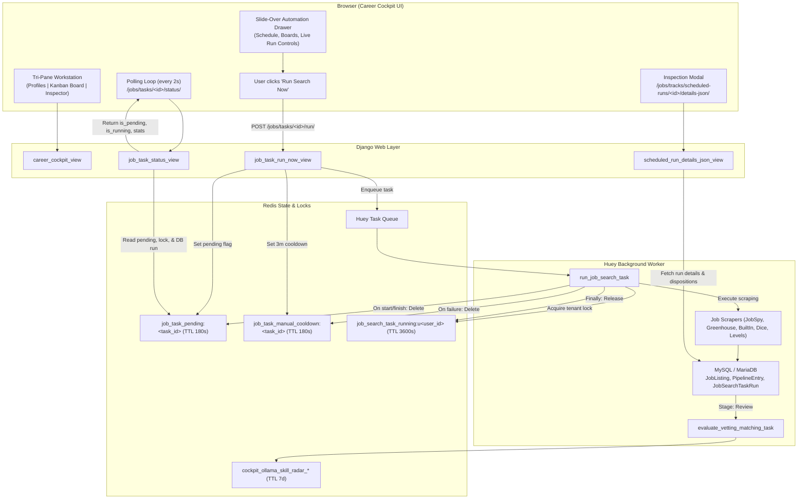

# Career Cockpit & Search Automation

The **Career Cockpit** (`/jobs/cockpit/`) is the central command center and primary daily triage workstation in HireEdge (Tab 2 in the Stitch 3-Tab Model). It unifies candidate pipeline management, background search scheduling, on-demand scraping controls, deep LLM fit evaluation, and fast keyboard triage into a single responsive, zero-clutter workstation.

It replaces the legacy `/jobs/automation/` page, moving high-density automation controls into an accessible slide-over drawer so the primary workspace remains focused on reviewing and advancing job opportunities.

---

## 1. Overview & Architecture

The Cockpit operates on a tri-pane workstation layout supported by an asynchronous Huey background worker and atomic Redis state management:



---

## 2. Core Workstation Components

### 2.1 Tri-Pane Workstation Layout
1. **Left Rail — Search Profiles (`SearchProfile`):**
   - Displays all configured search profiles with active profile indicator chip.
   - Shows associated target criteria: search query, location, and bound resume.
   - Houses the **"⚙️ Search Automation"** button which opens the slide-over drawer.
2. **Center Pane — 4-Stage Kanban Pipeline:**
   - **New (`stage=pipeline`):** Newly ingested listings waiting for candidate screening. Primary action: **"Move to Review"**.
   - **Review (`stage=vetting`):** Curated opportunities undergoing deep fit deliberation and LLM skill matching. Primary action: **"Move to Applying"**.
   - **Applying (`stage=applying`):** Active roles being tailored with the multi-agent AI resume optimizer. Primary action: **"Mark Submitted"**.
   - **Applied (`stage=done`):** Submitted applications feeding real-world interview loops (`EmployerInterviewEvent`). Primary action: **"Log Next Step"** (badges current milestone and opens drawer with next round pre-selected).
3. **Right Rail / Slide-Over — Inspection & Details:**
   - Detailed job description, requirements breakdown, salary benchmarks, and fit diagnostics.

### 2.2 Slide-Over Automation Drawer (`openAutomationDrawer()`)
To eliminate visual clutter from the primary triage pipeline, search task automation is housed in an off-canvas slide-over drawer:
- **Task Scheduling:** Configure run frequency (`daily`, `weekdays`, `weekly`, or `custom` cron) and target start times.
- **Source Configuration:** Toggle enabled job boards (Indeed, LinkedIn, Greenhouse, BuiltIn, Levels.fyi, Dice).
- **On-Demand Execution:** Trigger manual scraping runs with 3-minute cooldown timer countdowns and pending state indicators.
- **Run History & Telemetry:** Inspect the last 10 execution logs with direct links to the Run Breakdown modal.
- **Keyboard Dismissal:** Closes instantly via `Esc` or clicking outside the drawer.

### 2.3 Sandbox $\rightarrow$ Cockpit Ingestion Bridge
Candidates exploring roles in Tab 1 (Search Sandbox at `/jobs/search/`) can bridge discoveries into their daily workflow with a single click:
- **`+ Add to Review` Action:** Found on every search card. Sends a request to `POST /api/resume/jobs/{id}/save?track={active_slug}`.
- **Direct Review Admission:** Manually saved roles land immediately in the **Review (`Vetting`) stage** (`stage=vetting`), signaling active deliberation.
- **Real-Time Visual State:** The button transitions dynamically to **`✓ In Review`** with emerald styling and accessible state updates.
- **Search Profile Binding:** Saved jobs are automatically scoped to the user's active search profile.

### 2.4 Progressive Day-1 Onboarding Checklist (Empty Pipeline)
When a user visits the Cockpit and has no jobs across any stage of the pipeline (`total_pipeline_jobs == 0`), it renders an encouraging 3-step checklist container (`Get Started in 3 Simple Steps`). When jobs exist in other stages, an empty column renders a standard dashed placeholder (`No opportunities in <stage>`).

The 3 exact checklist steps rendered on the page are:
1. **Define Target & Profile** (links to `/jobs/profiler/`): *"Analyze your resume, calibrate target titles, and set salary baselines."*
2. **Discover & Ingest Roles** (links to `/jobs/search/`): *"Run queries across boards and 1-click “+ Add to Review”, or schedule automated query feeds."*
3. **Triage, Tailor & Track**: *"Review high-signal matches, tailor resumes with AI persona judges, and track outcomes."*

### 2.5 In-Funnel Resume Tailoring & Submission Loop
Candidates launch AI resume customization directly from a job card or via the `T` hotkey:
- **Navigation URL:** Card actions navigate to:
  ```text
  /resume/optimizer/?job_id=<job_id>&track=<active_profile_slug>[&resume_id=<resume_id>]
  ```
- **Contextual Opportunity Telemetry & Employer Link:** `optimizer.html` displays the target role, company, location, bound resume, and a 1-click **"Employer Post"** external link opening the official job posting in a new tab.
- **Decoupled Save vs. Submission Actions:**
  - **Save Draft (`Ctrl+S`):** Submits `action="save_draft"`. Saves edits to the optimized draft resume and stores them on `PipelineEntry.applied_resume_markdown` while **keeping the role in the Applying stage**.
  - **I Submitted This (`Ctrl+Enter`):** Submits `action="approve_and_mark_applied"`. Advances `PipelineEntry` to `stage="done"` (Applied), emits `JobMarkedApplied`, and redirects directly to `/jobs/cockpit/?track=<active_profile_slug>&stage=done`.
- **Top Action Bar Escape Hatch:** `optimizer.html` features a return link (`id="back-to-cockpit-link"`):
  - Emits: `/jobs/cockpit/?track=<active_profile_slug>&stage=<target_pipeline_stage>` (no hardcoded fallback).
  - Pressing `Esc` in the optimizer automatically returns the candidate to the exact column that job currently occupies.

### 2.6 Keyboard Triage Hotkeys
The Cockpit registers a global `keydown` listener in `career_cockpit.html` (ignored when focused in `<input>` or `<textarea>`):
- `J` / `j` / `ArrowDown` — Move focus to the next visible job card (`selectJob(nextIndex)`).
- `K` / `k` / `ArrowUp` — Move focus to the previous visible job card (`selectJob(prevIndex)`).
- `E` / `e` — Submits the focused card's action form:
  - In **New**: Advances to **Review** ("Move to Review").
  - In **Review**: Advances to **Applying** ("Move to Applying").
  - In **Applying**: Advances to **Applied** ("Mark Submitted").
- `L` / `l` — Toggles like/unlike on the focused card by submitting `action="like"` or `action="unlike"`, updating the preference centroid.
- `X` / `x` — Submits the focused card's dislike form (`action="dislike"`), deprioritizing similar roles.
- `T` / `t` — Opens the resume optimizer for the focused card.
- `Escape` — Closes inspector (`closeInspector()`), active profile drawer (`closeProfileDrawer()`), and slide-over automation drawer (`closeAutomationDrawer()`).

### 2.7 Sort Order Persistence Across Triage & Mutation Actions
The Cockpit remembers the candidate's active sort criterion (`Highest Score`, `Latest / Fresh`, `Interview Prob.`, `Oldest`) across all card mutations, profile switches, and page refreshes:
- **Session & URL State:** Sort choices are persisted in Django session (`request.session["pipeline_sort_by"]`) and reflected in URL parameters (`sort_by`).
- **Mutation Resilience:** All action forms (Remove/Delete, Dislike, Like, Move to Review, Move to Applying, Bulk Actions) carry the active sort parameter (`sort_by` and in `next` redirect target).
- **Client-Side Sync:** When selecting a sort criterion via `#cockpit-sort-select`, DOM cards reorder instantly, `history.replaceState` updates the address bar, `localStorage` caches the preference, and all action forms dynamically synchronize their `next` and `sort_by` inputs.

---

## 3. Automation Execution & State Lifecycle

### 3.1 On-Demand Execution with 3-Minute Cooldown
Users can trigger an immediate search for any configured task by clicking **"Run Search Now"**:
- **Cooldown Enforcement:** Manual execution sets a 3-minute cooldown key (`job_task_manual_cooldown:<task_id>`, 180s TTL).
- **Live Countdown Timer:** The button transitions into a disabled state displaying a live countdown (`Cooldown: MM:SS`).
- **Single Concurrent Search per Tenant:** Prevents scraping conflicts or IP rate limit exhaustion while allowing other tenants to run concurrently.

### 3.2 Atomic Redis Pending State (Anti-Race Condition)
To eliminate race conditions between HTTP request dispatch and background Huey worker consumption:
1. When the trigger endpoint (`job_task_run_now_view`) queues the job, it immediately sets an atomic Redis key:
   ```python
   cache.set(f"job_task_pending:{task_id}", True, timeout=180)
   ```
2. The browser status polling endpoint (`/jobs/tasks/<id>/status/`) checks:
   ```python
   is_running = is_pending or bool(cache.get(lock_key)) or has_running_run
   ```
3. If the worker has not yet picked up the task from Redis, the UI displays **"Queued in Worker..."** and maintains its polling loop instead of prematurely exiting with stale run data.
4. As soon as the worker creates `JobSearchTaskRun(status='running')`, the pending flag is cleared and the UI shifts to **"Search in progress..."**.

### 3.3 Automatic Cooldown Reset on Failure
If a job run encounters an error, timeout, or concurrency skip:
- The worker `finally` block and exception handler automatically delete the cooldown key:
   ```python
   cache.delete(f"job_task_manual_cooldown:{task_id}")
   ```
- The status API and Cockpit view check if the most recent run ended in `status == 'failed'`. If so, any lingering cooldown is purged and `task_cooldown_remaining_seconds = 0`.
- **Result:** The user is **never locked out after a failed run** and can immediately retry.

### 3.4 Run Inspection Modal, Disposition Analytics & Manual Rescue ("+ Add to Review")
Clicking on the stats pill or "View Breakdown" button opens an interactive modal showing the exact disposition of every fetched job:
- **Saved to Pipeline (New):** Fresh postings admitted to the user's pipeline.
- **Reposted to Pipeline:** Previously expired roles revived after the 14-day cooldown.
- **Already in Pipeline:** Skipped because they already exist in `Pipeline`, `Vetting`, `Applying`, or `Done`.
- **Expired / Not Reposted:** Roles retired by retention policies.
- **Eliminated (Duplicates / Preference / Disqualifiers / LLM Guard):** Screened out by negative preference embeddings, keyword disqualifiers, or duplicate detection.
- **Previously Removed:** Explicitly archived/dismissed by the user in past sessions.

#### Human-in-the-Loop Job Rescue ("+ Add to Review")
To correct false-positive eliminations (e.g. over-aggressive preference margin filtering or keyword matches):
- Every eliminated, skipped, or unsaved row provides an active **`+ Add to Review`** action button.
- Clicking the button invokes `POST /api/resume/jobs/<id>/save?track=<slug>`, which:
  1. Clears any conflicting legacy negative sentiment (`DISLIKED` or `HIDDEN` actions and embeddings) on the target track.
  2. Creates or restores the `PipelineEntry` directly in the **Review (`stage="vetting"`)** stage.
  3. Enqueues background Skill Radar fit evaluation (`evaluate_vetting_matching_task`).
  4. Dynamically transitions the row button to **`✓ In Review`** and increments filter counts.
  5. Upon closing the modal, automatically reloads the Cockpit board so rescued cards immediately populate the Review column.

Users can also download the raw run breakdown as **CSV** (`/jobs/tracks/scheduled-runs/<run_id>/download-csv/`) or view the structured **JSON** (`/jobs/tracks/scheduled-runs/<run_id>/details-json/`).

---

## 5. Review-Stage Deep Analysis & Two-Pass Batch Architecture

To optimize system responsiveness and eliminate GPU memory/KV-cache thrashing, deep evaluation runs **only for jobs in Review (`vetting`) and Applying (`applying`) stages** via the optimized Candidate Fit & Skill Radar engine:

### 5.1 Resume Match Radar & Candidate Fit Probability
The worker evaluates candidate resume fit using local LLM inference with prompt prefix caching:
- **Consolidated Analysis Service (`SkillRadarService.analyze`):** Extracts `domain_alignment`, `seniority_alignment`, `match_score`, `interview_probability`, `core_competencies`, `stretch_skills`, and `fit_summary`. (For full details on the contextual 4-tier gap engine and incidental tool dampening, see [Skill Radar Diagnostics Spec](features/skill-radar-diagnostics.md)).
- **KV Prefix Caching Speedup:** The prompt orders `Candidate Resume` ahead of `Job Description`. Across sequential calls for a candidate, Ollama reuses the cached prompt prefix, cutting per-job latency from ~6.95s (cold) to ~2.06s (warm—a ~70% speedup).
- **Zero-Latency Heuristic JD Cleansing:** The vetting pipeline uses fast regex cleansing (`use_llm=False`) to strip EEO/boilerplate in 0ms, preventing extraneous free-form LLM queries from invalidating the warm Ollama KV cache.
- **Dual-Tier Persistence:**
  1. **Redis Cache:** Stored at `cockpit_ollama_skill_radar_{user_id}_{resume_id}_{job_id}` with a 7-day TTL for instant modal loading.
  2. **Database:** Persisted to `PipelineEntry` (`vetting_match_score`, `vetting_interview_probability`, `vetting_interview_reasoning`, `vetting_core_competencies`, `vetting_stretch_skills`, `vetting_interview_resume_id`, `vetting_interview_scored_at`).
- **Cockpit Slide Drawer Presentation:**
  - **Match Score & Status Pills:** Clear visual display of candidate match percentage, callback probability, and verified count (`85% Match (4 Verified)`).
  - **Core Competencies & Stretch Skills:** Pinpoints verified matching skills alongside targeted skill gaps.
  - **Interview Prep Engine:** Instant generation and editing of STAR questions tailored to the role.

---

## 6. Redis Key Lifecycle Reference

| Key Pattern | Type | TTL | Purpose | Created In | Reset / Cleared In |
|-------------|------|-----|---------|------------|---------------------|
| `job_task_pending:{task_id}` | Boolean string | 180s | Bridges HTTP enqueue to Huey execution; keeps UI polling active | `job_task_run_now_view` | `run_job_search_task` start/skip/fail, or 180s TTL |
| `job_task_manual_cooldown:{task_id}` | Timestamp string | 180s | Enforces 3-minute wait between manual triggers | `job_task_run_now_view` | Auto-deleted on run failure; auto-expires after 3m |
| `job_search_task_running:u{user_id}` | Integer lock | 3600s | Prevents overlapping concurrent searches for the same user | `run_job_search_task` | `finally: cache.delete(lock_key)` in worker |
| `cockpit_ollama_skill_radar_{u}_{r}_{job_id}` | JSON dict | 7 days (604800s) | Caches consolidated deep analysis diagnostics & skill radar | `SkillRadarService.analyze` | Overwritten on force-refresh; auto-expires after 7 days |
| `vetting_matching_task_running:u{user_id}` | Integer lock | 1800s | Enforces sequential vetting matching per user for prefix caching | `evaluate_vetting_matching_task` | `finally: cache.delete(lock_key)` in worker |

---

## 7. Key Endpoints

| Method | Path | Name | Description |
|--------|------|------|-------------|
| `GET` | `/jobs/cockpit/` | `career_cockpit` | Main Career Cockpit tri-pane workstation view |
| `GET` | `/jobs/cockpit/api/skill-radar/` | `cockpit_skill_radar_api` | Skill frequency radar analytics |
| `POST` | `/jobs/tasks/<id>/run/` | `job_task_run_now` | Enqueue manual search run with pending flag & cooldown |
| `GET` | `/jobs/tasks/<id>/status/` | `job_task_status` | Status endpoint polled by browser during active search |
| `POST` | `/jobs/tasks/<id>/toggle/` | `job_task_toggle_active` | Toggle task active/inactive status |
| `GET/POST` | `/jobs/tasks/new/` | `job_task_new` | Create a new scheduled search task |
| `GET/POST` | `/jobs/tasks/<id>/edit/` | `job_task_edit` | Edit an existing scheduled search task |
| `GET` | `/jobs/tracks/scheduled-runs/<id>/details-json/` | `scheduled_run_details_json` | Ingestion breakdown JSON for inspection modal |
| `GET` | `/jobs/tracks/scheduled-runs/<id>/download-csv/` | `download_scheduled_run_csv` | Export run job dispositions as CSV |
| `POST` | `/api/resume/jobs/<id>/save` | `save_job` | Bridge job from Sandbox to Cockpit Review (`stage=vetting`) |
| `GET` | `/jobs/automation/` | `job_automation` | Legacy URL; permanently redirects to `/jobs/cockpit/` |
