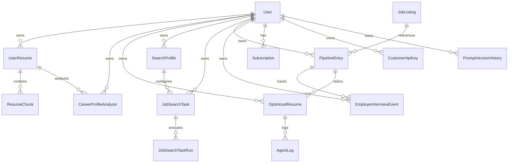

# Data Model

The data layer is defined primarily in `django_project/resume_app/models.py`. It consists of Django domain models partitioned into a shared global job catalog and tenant-owned entities scoped to individual users.

---

## 1. Multi-Tenant Ownership Model

Tenant isolation is enforced via the `resume_app.tenancy` helpers:
- `OwnedManager.for_user(user)`: Filters rows by `owner = user`.
- `get_owned_or_404(model, user, **lookup)`: Retrieves tenant-scoped rows safely, returning HTTP 404 on cross-tenant access attempts.
- `api_user(request)` & `get_active_user(request)`: Resolves the tenant context (including during staff impersonation).

---

## 2. Model Taxonomy

### 2.1 Shared Global Models (No Tenant Owner)
- **`JobListing`**: Deduplicated catalog of external job postings aggregated across JobSpy (Indeed, LinkedIn), Greenhouse, BuiltIn, Levels.fyi, and Dice. Contains posting title, company, location, salary, description, posted date, source URL, and hash fingerprints.
- **`JobDescription`**: Reusable job description text for optimizer runs.
- **`SystemPromptProfile`**: Singleton admin-managed prompt templates (empty fields fall back to `prompts.py` defaults). Templates support safe interpolation via `inject_variables_into_template`.
- **`AtsJudgeProfile`**: Reusable ATS scoring prompt templates (`owner = null` for global presets).

---

### 2.2 Resumes & AI Optimization
- **`UserResume`**: User-uploaded source resume PDFs, parsed text, and optional default `SearchProfile` association.
- **`ResumeChunk`**: Chunked text and vector embeddings generated from `UserResume` for dense retrieval (RAG).
- **`CareerProfileAnalysis`**: Output of the AI Resume Profiler (`/jobs/profiler/`). Stores executive positioning, core competencies, target job titles, market salary bands, and raw LLM extraction JSON linked to a `UserResume`.
- **`OptimizedResume`**: Core output of the resume optimizer. Stores generated markdown/text, ATS fit score, recruiter fit score, token usage, cover letter, and `optimizer_context_snapshot` (char budgets for writer/judge JD and resume inputs).
- **`AgentLog`**: Execution trace logging intermediate outputs from Writer, ATS Judge, and Recruiter Judge nodes.
- **`OptimizerWorkflow`**: Configurable multi-step optimization workflows (system-wide when `owner = null`).

---

### 2.3 Job Discovery, Search Profiles & Automation
- **`SearchProfile`**: Primary user-facing job search context. Combines search query (`search_term`), target location, enabled boards (`site_names`), target resume, and scheduling parameters.
  - *Note on Model Aliasing:* `SavedJobSearch` is defined directly in `models.py` as `SavedJobSearch = SearchProfile` for backward compatibility during Phase 1 consolidation.
- **`Track`**: Legacy track bucket model (`ic`, `mgmt`, `general`), currently retained and dual-written alongside `SearchProfile` during Phase 1 consolidation.
- **`JobSearchTask`**: Scheduled search automation task. Stores execution schedule (`daily`, `weekdays`, `weekly`, `custom` cron), start time, and active toggle.
- **`JobSearchTaskRun`**: Execution record of a search task. Stores run timestamps, completion status (`running`, `completed`, `failed`), `jobs_fetched`, `jobs_added_to_pipeline`, and `details` JSON (categorized disposition breakdown).
- **`JobListingAction`**: Records per-user actions on job listings: likes, dislikes, saves (favourites), hides, and applied flags.
- **`JobListingEmbedding`**: Dense vector representation of listings for preference calculations.
- **`JobListingTrackMetrics`**: Stores the user's learned preference centroid vector for a specific search profile.
- **`UserDisqualifier`**: User-defined exclusion keywords (titles, companies, or locations) used to screen incoming jobs.

---

### 2.4 Pipeline, Matching & Interview Tracking
- **`PipelineEntry`**: Core Kanban board entry linking a tenant `User` to a global `JobListing`. Stores current stage (`pipeline`, `vetting`, `applying`, `done`), fit score, interview probability, generated interview prep, and persistent Skill Radar diagnostics:
  - `vetting_match_score` (Integer): Reconciled technical requirements match percentage (0–100%).
  - `vetting_interview_probability` (Integer): Calibrated screening callback odds (0–100%).
  - `vetting_interview_reasoning` (TextField): 1-sentence executive fit diagnosis.
  - `vetting_core_competencies` (JSONField): Substantiated candidate core competencies verified against resume text.
  - `vetting_stretch_skills` (JSONField): Reconciled job requirements missing from candidate history.
  - `vetting_interview_resume_id` / `vetting_interview_scored_at`: Associated resume and evaluation timestamp.
- **`JobMatchResult`**: Semantic and keyword fit score between a specific resume and job description.
- **`EmployerInterviewEvent`**: Tracks real-world interview progression for a pipeline opportunity:
  - `round_type`: Screenings, hiring manager interview, technical assessment, on-site, offer, rejection (`PipelineEntry.PostApplySubstatus`).
  - `status`: Scheduled, completed, cancelled.
  - `scheduled_at` / `completed_at`: Timestamps.
  - `interviewer_info`, `notes`, `feedback`: Post-interview notes.

---

### 2.5 LLM Configuration, Governance & Prompts
- **`LLMProviderConfig`**: Stores user-encrypted API keys (Fernet) and default model choices for OpenAI, Anthropic, Groq, Google, and Ollama.
- **`LLMProviderPreference`**: Ordered list of fallback models and optional RPM/TPM limits.
- **`TenantPromptModelPreference`**: Per-tenant model assignments for specific prompts (e.g. assigning local `ollama::qwen2.5:7b` to `resume_judge` or `matching`).
- **`SystemPromptProfile`**: Global singleton storing customizable system, user, and legacy combined prompts across active platform prompts:
  - *Optimization Pipeline:* `writer` (Resume Writer), `resume_judge` (Unified Resume Judge), `pipeline_resume_refine` (Pipeline Resume Refine).
  - *Evaluation & Vetting:* `skill_radar` (Dedicated Pipeline Skill Radar & Fit Diagnostics), `matching` (Job Matching Scorer), `insights` (Batch Job Insights), `jd_cleanse` (JD Cleanser & Parser).
  - *Candidate & Career Tools:* `career_profiler` (Universal Career Profiler), `pipeline_skill_extract` (Pipeline LLM Skill Extractor), `cover_letter` (Cover Letter Architect), `interview_prep` (Interview Prep Coach).
- **`AtsJudgeProfile`**: Customizable ATS evaluation rule profiles with custom scoring weights and system/user prompts.
- **`PromptVersionHistory`**: Version control audit log for prompt modifications made in Prompt Studio (`/resume/prompts/`). Stores `prompt_key`, `version_number`, `system_prompt`, `user_prompt`, `legacy_combined`, and `change_summary`.
- **`LLMAppUsageTotals`**: Lifetime token and request count rollups per user.
- **`LLMUsageByModel`**: Token consumption aggregated by provider and model.
- **`LLMUsageByQuery`**: Token consumption aggregated by functional query type (e.g. `optimizer_writer`, `resume_judge`, `pipeline_vetting`).
- **`LLMDailyUsageBreakdown`**: Daily token ledger segmented by date and model.

---

### 2.6 SaaS, Billing, Identity & Removed Features
- **`Plan`**: Commercial subscription tiers (`free`, `pro`, `unlimited`) defining daily quotas (`llm_tokens_per_day`, `llm_requests_per_day`, `job_searches_per_day`, `storage_mb`, `api_access`).
- **`Subscription`**: Tenant plan binding, Stripe customer ID, subscription ID, and billing status (`active`, `past_due`, `canceled`).
- **`UsageCounter`**: Durable per-day metric ledger tracking daily quota consumption.
- **`CustomerApiKey`**: Hashed API keys (HMAC prefix lookup) for authenticating to the Django Ninja REST API.
- **`StripeWebhookEvent`**: Webhook idempotency log preventing duplicate transaction processing.
- **`ImpersonationAuditLog`**: Audit ledger recording staff impersonation sessions via `django-hijack`.
- **`UserExperienceSettings`**: Controls UI mode (`normal` vs `power`), onboarding completion, and email verification status.
- **`AppAutomationSettings`**: Per-user automation toggles and the global `stop_llm_requests` emergency kill-switch.
  - *Apply-Agent Status:* Autonomous form-filling application attempts and browser agent fields (`apply_agent_enabled`, `apply_automation_mode`, `apply_browser_show_window`, etc.) were **permanently removed in migration `0038`**. Applications now terminate at candidate approval ("Approve & Mark Applied"), followed by post-application tracking via `EmployerInterviewEvent`.
- **`ApplicantProfile`**: General applicant contact details and demographic information.
- **`UserPromptProfile`**: Legacy model retained for schema compatibility (unused at runtime).

---

## 3. Pipeline Stages & Stage Transitions

The candidate journey transitions rows in `PipelineEntry` across 4 explicit stages:

| Trigger / Action | Origin Stage | Destination Stage | DB Fields Written & Side Effects |
|------------------|--------------|-------------------|-----------------------------------|
| **Automated Sourcing Run** (Huey worker `run_job_search_task`) | *None (New Job)* | `pipeline` (New) | Creates `PipelineEntry(owner, job, track, stage='pipeline', focus_score, focus_percent)`. |
| **Sandbox `+ Add to Review`** (`POST /api/resume/jobs/{id}/save?track={slug}`) | *None* or External | `vetting` (Review) | Creates/updates `PipelineEntry(stage='vetting', is_saved=True, saved_at=now())`; writes `JobListingAction(action_type='save')`. |
| **Shortlist / Advance from New** (`action="shortlist"` or `E` hotkey on New card) | `pipeline` | `vetting` (Review) | Updates `PipelineEntry.stage = 'vetting'`, sets `shortlisted_at = now()`. |
| **Advance from Review** (`action="ready"` or `E` hotkey on Review card) | `vetting` | `applying` (Applying) | Updates `PipelineEntry.stage = 'applying'`. |
| **Save Draft (Optimizer)** (`action="save_draft"` or `Ctrl+S`) | `applying` | `applying` (stays) | Persists edited draft markdown to `OptimizedResume.optimized_markdown` and `PipelineEntry.applied_resume_markdown`. Keeps card in Applying for user review and PDF/DOCX downloads. |
| **I Submitted This / Mark Applied** (`action="approve_and_mark_applied"` or `Ctrl+Enter` in Optimizer, or `mark-applied` API) | `applying` (or `vetting`) | `done` (Applied) | Updates `PipelineEntry.stage = 'done'`, sets `is_applied = True`, `applied_at = now()`, associates `optimized_resume_id`; writes `JobListingAction(action_type='applied')`. |
| **Like / Unlike** (`POST /api/resume/jobs/{id}/like` or `L` hotkey) | Any stage | *No stage change* | Writes `JobListingAction(action_type='like')`; recalculates `JobListingTrackMetrics.centroid_embedding`. |
| **Dislike / Exclude** (`POST /api/resume/jobs/{id}/dislike` or `X` hotkey) | `pipeline` / `vetting` | *Removed from Pipeline* | Deletes `PipelineEntry`; writes `JobListingAction(action_type='dislike')`; updates preference centroid. |
| **Hide** (`POST /api/resume/jobs/{id}/hide`) | Search / Sandbox | *Hidden from view* | Writes `JobListingAction(action_type='hide')` without updating preference centroid. |
| **Unsave** (`POST /api/resume/jobs/{id}/unsave`) | Any stage | *Removed from Pipeline* | Deletes `PipelineEntry`; deletes `JobListingAction(action_type='save')`. |

---

## 4. Migration & Schema Integrity Rules

1. **Email Uniqueness:** Migration `0025_user_email_unique` enforces a unique index on non-blank `auth_user.email` values.
2. **Multi-Tenant Ownership:** Migration `0014_multi_tenant_owner` established the baseline tenant model across domain entities.
3. **Search Profile Consolidation:** Migration `0020_search_profile_phase1` introduced `SearchProfile` and dual-writing alongside legacy `Track` rows.
4. **Apply-Agent Deprecation:** Migration `0038_remove_applicationattemptstep_attempt_and_more` removed all headless browser apply-agent models and settings.
5. **Posting Authenticity & Compliance:** Migration `0055_joblisting_authenticity_audit_trail_and_more` added structured labor compliance audit fields and audit trail JSON to `JobListing`.
6. **Prompt Studio & Library Migration:** Migrations `0054_promptversionhistory` and `0056_systempromptprofile_fit_check_and_more` added revision history and extended `SystemPromptProfile` across all 14 platform prompts.
7. **Adding New Entities:** When introducing new models, always explicitly declare whether the entity is shared globally, directly owner-scoped (`owner = ForeignKey(User)`), or indirectly owner-scoped through a parent entity.
