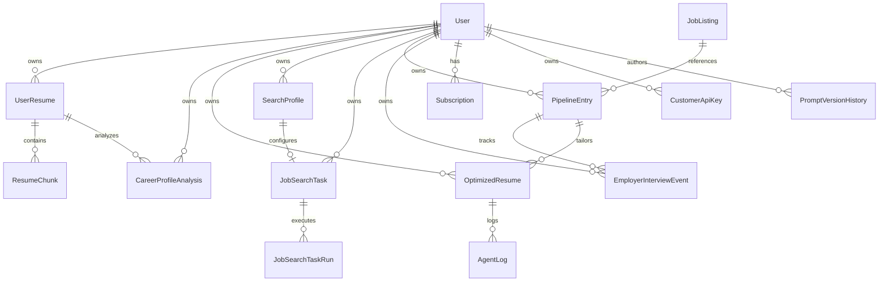

# Data Model

The data layer is defined primarily in `django_project/resume_app/models.py`. It consists of Django domain models partitioned into a shared global job catalog and tenant-owned entities scoped to individual users.

---

## 1. Multi-Tenant Ownership Model

Tenant isolation is enforced via the `resume_app.tenancy` helpers:
- `OwnedManager.for_user(user)`: Filters rows by `owner = user`.
- `get_owned_or_404(model, user, **lookup)`: Retrieves tenant-scoped rows safely, returning HTTP 404 on cross-tenant access attempts.
- `api_user(request)` & `get_active_user(request)`: Resolves the tenant context (including during staff impersonation).

---

## 2. Model Taxonomy

### 2.1 Shared Global Models (No Tenant Owner)
- **`JobListing`**: Deduplicated catalog of external job postings aggregated across JobSpy (Indeed, LinkedIn), Greenhouse, BuiltIn, Levels.fyi, and Dice. Unique on `(source, external_id)`. Columns include title, company, location, description, `url`, `posted_at`, `fetched_at`, `raw_json`, and the authenticity audit fields from migration `0055`. Salary is not a column.
- **`JobDescription`**: Reusable job description text for optimizer runs.
- **`SystemPromptProfile`**: Singleton admin-managed prompt templates (empty fields fall back to `prompts.py` defaults). Templates support safe interpolation via `inject_variables_into_template`.
- **`PromptVersionHistory`**: Global Prompt Studio revision log. `author` is an optional staff user (`SET_NULL`), not a tenant `owner`.
- **`Plan`**, **`StripeWebhookEvent`**, **`FailedTaskQuarantine`**: Global rows with no `owner`. `FailedTaskQuarantine` is the Huey dead-letter queue (`status` is `quarantined`, `replayed`, or `dismissed`) and stores `task_name`, `task_id`, arg/kwarg reprs, error class, message, traceback, `created_at`, and `resolved_at`.
- **`ImpersonationAuditLog`**: Staff impersonation ledger with `hijacker` and `target`, not `owner`.
- **`AtsJudgeProfile`**: Runtime presets are rows with `owner` null. The nullable `owner` column remains so legacy per-user rows can exist; those rows are ignored at runtime.

---

### 2.2 Resumes & AI Optimization
- **`UserResume`**: Uploaded PDF plus `original_filename`, a legacy `track` slug, and `is_library`. The profile binding is `SearchProfile.resume`, not a foreign key on `UserResume`.
- **`ResumeChunk`**: Chunked text and vector embeddings generated from `UserResume` for dense retrieval (RAG).
- **`CareerProfileAnalysis`**: Output of the AI Resume Profiler (`/jobs/profiler/`). One `resume` foreign key plus `analysis_data` JSON. Named profiler sections live inside that JSON, not as columns.
- **`OptimizedResume`**: Core output of the resume optimizer. The generated body is `optimized_content`. Also stores `ats_score`, `recruiter_score`, token totals, `cover_letter`, and `optimizer_context_snapshot`. Status is `queued`, `running`, `completed`, or `failed`.
- **`AgentLog`**: Execution trace logging intermediate outputs from Writer, ATS Judge, and Recruiter Judge nodes.
- **`OptimizerWorkflow`**: Configurable multi-step optimization workflows (system-wide when `owner = null`).

---

### 2.3 Job Discovery, Search Profiles & Automation
- **`SearchProfile`**: Primary user-facing job search context. Combines `name`, per-owner `slug`, `search_term`, `location`, `site_names`, optional `resume`, `min_score`, `results_wanted`, `llm_model`, and `is_default`. Schedule lives here: `schedule_interval` (`off`, `daily`, `weekdays`, `weekly`, `custom`), `schedule_time`, `schedule_cron`, `schedule_is_active`, `schedule_next_run_at`.
  - *Note on Model Aliasing:* `SavedJobSearch = SearchProfile` in `models.py`.
- **`Track`**: Legacy per-user slug bucket, dual-written with `SearchProfile`. `ensure_baseline` seeds `general`. `ic` and `mgmt` are examples, not a closed enum.
- **`JobSearchTask`**: One-to-one `saved_search` → `SearchProfile` (`related_name="scheduled_task"`). The execution copy is its own row: `search_term`, `location`, `track` (default `ic`), `jobs_to_fetch`, `site_name`, `frequency` (validated 5-field cron), `start_time`, `is_active`, `next_run_at`.
- **`JobSearchTaskRun`**: Execution record. Status is `running`, `completed`, or `failed`. Counts are `jobs_fetched`, `jobs_after_filter`, and `jobs_added_to_pipeline`. `jobs_eliminated` is computed (`jobs_fetched - jobs_after_filter`). `details` is a list audit log, plus `error_message` and `finished_at`.
- **`JobListingAction`**: Per-user feedback. `action` is `liked`, `disliked`, `hidden`, or `saved`. There is no `applied` action. Scoped by `owner`, `search_profile`, and the legacy `track` slug.
- **`JobListingEmbedding`**: Owner-scoped liked or disliked vector for one listing and profile (`embedding_type` `liked` or `disliked`). Preference centroids are computed from these rows. This is not a shared catalog embedding.
- **`JobListingTrackMetrics`**: Per-job, per-profile score cache: `focus_percent`, `focus_after_penalty`, `preference_margin`, `last_scored_at`. It does not store a centroid.
- **`UserDisqualifier`**: One exclusion `phrase` per row (unique per owner). There is no title/company/location type.

---

### 2.4 Pipeline, Matching & Interview Tracking
- **`PipelineEntry`**: Core Kanban board entry linking a tenant `User` to a global `JobListing`. Board tabs use `pipeline`, `vetting`, `applying`, and `done` (normal UI: New, Review, Applying, Applied). `Stage` also includes `deleted` and `expired`. A blank `stage` means pipeline. Soft removal sets `stage='deleted'` and `removed_at`. There is no `is_saved`, `saved_at`, `shortlisted_at`, `is_applied`, or `focus_score` column. Also stores `search_profile`, legacy `track`, `applied_at`, `applied_resume_markdown`, `applied_optimized_resume`, `interview_prep`, `post_apply_substatus`, and `next_interview_at`. Skill Radar columns:
  - `vetting_match_score` (Integer): Reconciled technical requirements match percentage (0–100%).
  - `vetting_interview_probability` (Integer): Calibrated screening callback odds (0–100%).
  - `vetting_interview_reasoning` (TextField): 1-sentence executive fit diagnosis.
  - `vetting_core_competencies` (JSONField): Substantiated candidate core competencies verified against resume text.
  - `vetting_stretch_skills` (JSONField): Reconciled job requirements missing from candidate history.
  - `vetting_interview_resume_id` / `vetting_interview_scored_at`: Associated resume and evaluation timestamp.
- **`JobMatchResult`**: Semantic and keyword fit score between a specific resume and job description.
- **`EmployerInterviewEvent`**: Tracks real-world interview progression for a pipeline opportunity:
  - `round_type`: `PipelineEntry.PostApplySubstatus`, default `recruiter_call`.
  - `status`: `scheduled`, `completed`, or `cancelled` (`max_length=16`).
  - `scheduled_at`, `duration_minutes` (default 45), `interviewer_names`, `location_or_link`, `notes`. There is no `completed_at`, `interviewer_info`, or `feedback` column.

---

### 2.5 LLM Configuration, Governance & Prompts
- **`LLMProviderConfig`**: One Fernet-encrypted key row per `(owner, provider)`. Providers in `LLM_PROVIDERS`: OpenAI, Anthropic, Groq, Google AI Studio, Ollama Cloud, Ollama Local, OpenRouter.
- **`LLMProviderPreference`**: Ordered list of fallback models and optional RPM/TPM limits.
- **`TenantPromptModelPreference`**: Per-tenant model assignments for specific prompts (e.g. assigning local `ollama::qwen2.5:7b` to `resume_judge` or `matching`).
- **`SystemPromptProfile`**: Global singleton storing customizable system, user, and legacy combined prompts across active platform prompts:
  - Prompt Studio keys (14, from `_PROMPT_SPEC`): `writer`, `resume_judge`, `pipeline_resume_refine`, `ats_judge`, `recruiter_judge`, `skill_radar`, `matching`, `insights`, `jd_cleanse`, `fit_check`, `career_profiler`, `pipeline_skill_extract`, `cover_letter`, `interview_prep`.
  - `job_authenticity*` columns exist on the singleton and are not Prompt Studio keys.
- **`AtsJudgeProfile`**: Customizable ATS evaluation rule profiles with custom scoring weights and system/user prompts.
- **`PromptVersionHistory`**: Version control audit log for prompt modifications made in Prompt Studio (`/resume/prompts/`). Stores `prompt_key`, `version_number`, `system_prompt`, `user_prompt`, `legacy_combined`, and `change_summary`.
- **`LLMAppUsageTotals`**: Lifetime token and request count rollups per user.
- **`LLMUsageByModel`**: Token consumption aggregated by provider and model.
- **`LLMUsageByQuery`**: Token consumption aggregated by functional query type (e.g. `optimizer_writer`, `resume_judge`, `pipeline_vetting`).
- **`LLMDailyUsageBreakdown`**: Daily token ledger segmented by date and model.

---

### 2.6 SaaS, Billing, Identity & Removed Features
- **`Plan`**: Commercial subscription rows. Seeded slugs are `free`, `byok`, `pro`, and `power` (data, not a model enum). Daily caps are `llm_requests_per_day`, `llm_tokens_per_day`, and `job_searches_per_day` (`0` means unlimited, except token resolution in `plan_limit()` — see the plans doc). Also `storage_mb`, `api_access`, `byok_required_for_completion`, `price_display`, `stripe_price_id`, `is_active`, `is_default`, and `sort_order`. `apply_runs_per_day` was removed in migration `0068`. Migration `0066` deleted slug `unlimited` and moved those subscriptions to `power`.
- **`Subscription`**: Tenant plan binding, Stripe customer ID, subscription ID, and billing status (`trialing`, `active`, `past_due`, `canceled`, `unpaid`). `past_due_since` was added in `0068`; `0069` backfills existing `past_due` rows from `updated_at`.
- **`UsageCounter`**: Durable per-day metric ledger tracking daily quota consumption.
- **`CustomerApiKey`**: Hashed API keys (HMAC prefix lookup) for authenticating to the Django Ninja REST API.
- **`StripeWebhookEvent`**: Webhook idempotency log preventing duplicate transaction processing.
- **`ImpersonationAuditLog`**: Audit ledger recording staff impersonation sessions via `django-hijack`.
- **`UserExperienceSettings`**: Controls UI mode (`normal` vs `power`), onboarding completion, and email verification status.
- **`AppAutomationSettings`**: Per-user automation toggles, including `weekly_target_applications` and the per-user `stop_llm_requests` kill switch. The switch is not a process-wide singleton; `llm/policy.py` reads `get_for_user(user)`.
  - *Removed:* Migration `0038` deleted `ApplicationAttempt`, `ApplicationAttemptStep`, `AtsAutoSubmitStats`, and `SiteCredential`, and removed the `apply_agent_*` / `apply_automation_mode` / `apply_browser_show_window` settings. Submit stops at “Approve & Mark Applied” (`mark_done`).
- **`ApplicantProfile`**: One-to-one contact and application answers: name, email, phone, location, links, work authorization, sponsorship, salary expectation, cover-letter template, `custom_qa_pairs`, and `include_eeo`. It is not an apply-agent attempt log.
- **`UserPromptProfile`**: Legacy model retained for schema compatibility (unused at runtime).

---

## 3. Pipeline Stages & Stage Transitions

Board tabs (`BOARD_STAGES`) are `pipeline`, `vetting`, `applying`, and `done` (normal UI: New, Review, Applying, Applied). `PipelineEntry.Stage` also includes `deleted` and `expired`. A blank `stage` means pipeline. Leaving the board calls `mark_deleted()` (`stage='deleted'`, `removed_at` set). `can_move_to_vetting()` allows blank or pipeline. `can_move_to_applying()` allows pipeline or vetting. `can_mark_done()` allows any active row.

Cockpit advance posts `action="save"`. `_apply_save_action` maps the current board: pipeline → `move_to_vetting()`, vetting → `move_to_applying()`, applying → `mark_done()`. The `E` hotkey submits that same form (the card’s `.shortlist-btn`).

| Trigger / Action | Origin Stage | Destination Stage | DB Fields Written & Side Effects |
|------------------|--------------|-------------------|-----------------------------------|
| **Automated Sourcing Run** (`run_job_search_task`) | *None (New Job)* | `pipeline` (New) | Upserts `PipelineEntry` with `stage='pipeline'` (or restores a soft-deleted row). Preference scores are `JobListingTrackMetrics.focus_percent`, `focus_after_penalty`, and `preference_margin`. |
| **Find jobs Save to Cockpit** (`POST /api/resume/jobs/{id}/save`) | *None*, soft-deleted, or an existing active row | `vetting` for a new or restored row that is not already Applying or Done; an active row keeps its stage | Writes `JobListingAction.action='saved'`. Query params are `track` and/or `profile`. |
| **Advance (`action="save"`, or `E`)** | `pipeline` | `vetting` | `move_to_vetting()`. No `shortlisted_at`. |
| **Advance (`action="save"`, or `E`)** | `vetting` | `applying` | `move_to_applying()`. |
| **Advance (`action="save"`, or `E`)** | `applying` | `done` | `mark_done()` sets `applied_at`, snapshots `applied_resume_markdown` / `applied_optimized_resume`, and records `JobListingAction.action='liked'`. |
| **Save Draft** (`action="save_draft"` or `Ctrl+S`) | existing row, or none | unchanged, or new row at `applying` | Writes `OptimizedResume.optimized_content` and `PipelineEntry.applied_resume_markdown`. Does not change stage when the entry already exists. |
| **I Submitted This** (`action="approve_and_mark_applied"`) | any active stage | `done` | Calls `mark_done()` (liked action, not an `applied` action). |
| **`POST /api/resume/jobs/{id}/mark-applied`** | unchanged | unchanged | Updates `JobMatchResult.status='applied'` for the given resume. Does not move `PipelineEntry`. |
| **Like** (`POST .../like` or `L`) | any | unchanged | `action='liked'` and a `JobListingEmbedding` row. Centroids are computed from embeddings, not stored on `JobListingTrackMetrics`. |
| **Dislike API** (`POST .../dislike`) | unchanged | unchanged | `action='disliked'` and a dislike embedding. The pipeline row stays. |
| **Dislike on the board** (`action="dislike"`) | any board stage | soft-removed | Dislike action, then `mark_deleted()`. |
| **Remove (`action="delete"`, or `X`)** | any board stage | soft-removed | `mark_deleted()` only. `X` submits the delete form when it is present, otherwise the dislike form. |
| **Hide** (`POST .../hide`) | search results | hidden from search | `action='hidden'`. No embedding. |
| **Unsave** (`POST .../unsave`) | any | soft-removed only when the row is not Applying or Done | Deletes `action='saved'`. Applying and Done rows stay. |

---

## 4. Migration & Schema Integrity Rules

1. **Email Uniqueness:** Migration `0025_user_email_unique` enforces a unique index on non-blank `auth_user.email` values.
2. **Multi-Tenant Ownership:** Migration `0014_multi_tenant_owner` established the baseline tenant model across domain entities.
3. **Search Profile Consolidation:** Migration `0020_search_profile_phase1` introduced `SearchProfile` and dual-writing alongside legacy `Track` rows.
4. **Apply-Agent Deprecation:** Migration `0038_remove_applicationattemptstep_attempt_and_more` removed all headless browser apply-agent models and settings.
5. **Posting Authenticity & Compliance:** Migration `0055_joblisting_authenticity_audit_trail_and_more` added structured labor compliance audit fields and audit trail JSON to `JobListing`.
6. **Prompt Studio & Library Migration:** Migrations `0054_promptversionhistory` and `0056_systempromptprofile_fit_check_and_more` added revision history and extended `SystemPromptProfile` across all 14 platform prompts.
7. **Adding New Entities:** When introducing new models, always explicitly declare whether the entity is shared globally, directly owner-scoped (`owner = ForeignKey(User)`), or indirectly owner-scoped through a parent entity.
