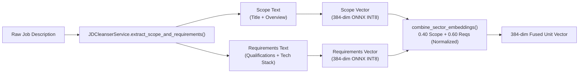

# Dual-Sectored Job Embeddings & ResumeChunk Hierarchical RAG

## Overview

This feature modernizes HireEdge's vector embedding and document retrieval architecture:
1. **Dual-Sectored Job Description Embeddings**: Solves the 256-token truncation limitation in `all-MiniLM-L6-v2` by decomposing job descriptions into two focused semantic sectors (**Scope** vs **Requirements**) and fusing them into a normalized 384-dimensional unit vector.
2. **Hierarchical Section-Aware Resume RAG (`ResumeChunk`)**: Activates the previously dormant `ResumeChunk` model by parsing resumes into context-prepended semantic units (`[Experience | Title @ Company]`), computing dense embeddings, and executing hybrid dense (75%) + BM25 (25%) retrieval during resume optimization.

---

## 1. Dual-Sectored Job Embeddings

### Problem
In `embeddings.py`, the ONNX INT8 embedding runtime sets `max_length=256` tokens (~180–200 words). Because typical job descriptions span 600–1,200 words, naive truncation discarded 50%–75% of the posting—specifically the requirements and technical qualifications located in the bottom half.

### Solution Architecture


### Python API

```python
from resume_app import embeddings

# Fused 384-dim unit vector representing the full job posting without truncation
fused_vec = embeddings.embed_full(title="Lead DevOps Architect", description=jd_text)

# Granular dual vectors for independent scoring guardrails
scope_vec, reqs_vec = embeddings.embed_full_sectors(title="Lead DevOps Architect", description=jd_text)

# Batch processing with length-sorted grouping and Redis SHA-256 caching
batch_vecs = embeddings.embed_full_batch([
    ("Lead DevOps Architect", jd_text_1),
    ("Senior Data Engineer", jd_text_2),
])
```

---

## 2. Hierarchical Resume Chunking & RAG Retrieval

### Context Prepending Pattern
Rather than embedding isolated, ambiguous bullet points (e.g., *"Built microservices with Go"*), `ResumeChunker` prepends parent metadata to every chunk:
`"[Experience | Senior Backend Engineer @ Stripe (2021-2024)] Built microservices with Go handling 50k req/s."`

This ensures that the dense vector encodes:
- **Seniority tier** (Intern vs Senior vs Staff Architect)
- **Company domain** (Enterprise Fintech vs Consumer App)
- **Time recency**

### Data Flow & Retrieval Pipeline

```mermaid
sequenceDiagram
    participant User as Candidate
    participant Upload as Resume Upload (View/API)
    participant Chunker as ResumeChunker
    participant DB as ResumeChunk Table
    participant Opt as Resume Optimizer
    participant LLM as Writer LLM

    User->>Upload: Upload resume.pdf
    Upload->>Chunker: sync_resume_chunks(user_resume)
    Chunker->>Chunker: Parse sections + Prepend metadata
    Chunker->>DB: Bulk insert ResumeChunk rows (384-dim unit vectors)
    
    Opt->>Chunker: retrieve_relevant_chunks(user_resume, target_jd, top_k=8)
    Chunker->>Chunker: Dense cosine (0.75) + BM25 keyword (0.25)
    Chunker-->>Opt: Top 8 matching career achievements
    Opt->>LLM: Injected into <retrieved_resume_bullets>
```

### Retrieval Integration in Resume Optimizer
In `optimizer_budget.py`, when chunks are retrieved:
- `retrieval_context` is populated with formatted markdown bullets matching the prompt contract in `prompts.py`.
- `resume_text_for_writer` is automatically shrunk from 14,000 characters to `OPTIMIZER_WRITER_RESUME_MAX_CHARS_WITH_RAG` (8,000 characters).
- **Result:** Saves ~1,500 prompt tokens per loop (~4,500–6,000 tokens per full tailored resume run) while grounding the model in authentic past achievements.

### Python API

```python
from resume_app.resume_chunker import (
    sync_resume_chunks,
    retrieve_relevant_chunks,
    format_retrieval_context,
)
from resume_app.models import UserResume

# Ensure chunks exist and are synced with the resume file
resume = UserResume.objects.get(pk=1)
chunks = sync_resume_chunks(resume)

# Execute hybrid retrieval for a target JD
relevant = retrieve_relevant_chunks(
    user_resume=resume,
    query_text="Looking for Senior Django developer with Celery and Docker",
    top_k=8,
    dense_weight=0.75,
    keyword_weight=0.25,
)

# Format for LLM prompt injection
context_markdown = format_retrieval_context(relevant)
print(context_markdown)
# Output:
# - [Experience | Senior Backend Engineer @ Stripe (2021-2024)] Built Django APIs...
# - [Skills] Python, Django, Celery, Redis, Docker, PostgreSQL
```

---

## 3. Configuration Knobs (`core/settings.py`)

| Setting | Default | Description |
|---|---|---|
| `OPTIMIZER_RETRIEVAL_ENABLED` | `True` | Master toggle for local hybrid RAG retrieval |
| `OPTIMIZER_RETRIEVAL_TOP_K` | `8` | Number of relevant chunks retrieved per target JD |
| `OPTIMIZER_RETRIEVAL_DENSE_WEIGHT` | `0.75` | Weight for dense semantic cosine similarity |
| `OPTIMIZER_RETRIEVAL_KEYWORD_WEIGHT` | `0.25` | Weight for sparse BM25 keyword score |
| `OPTIMIZER_RETRIEVAL_MAX_PACK_CHARS` | `12000` | Maximum character budget for formatted retrieval context |
| `OPTIMIZER_WRITER_RESUME_MAX_CHARS_WITH_RAG` | `8000` | Shrunk resume payload when RAG chunks are present (down from 14,000) |

---

## 4. Verification & Testing

Run the dedicated test suite:
```powershell
.\env\Scripts\python.exe django_project\manage.py test resume_app.test_chunking_and_rag
```
Tests cover:
- Dual-sector parsing with and without explicit JD headers
- 384-dimensional unit L2 normalization of fused vectors
- Section-aware resume chunking with context prepending
- Idempotency and fingerprinting in `sync_resume_chunks`
- Hybrid retrieval ranking and prompt context formatting
- Context budget shrinking in `optimizer_budget.py`
