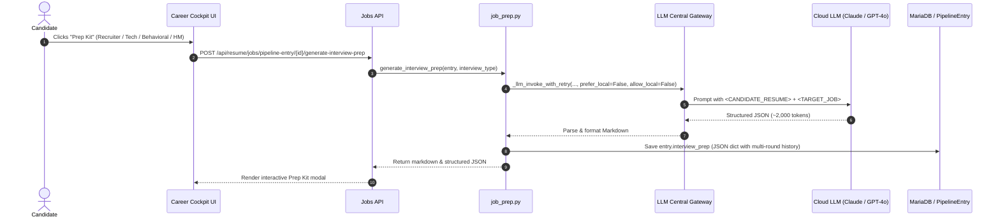

# Interview Prep Coach (Cloud LLM Intelligence)

The **Interview Prep Coach** subsystem generates high-yield, round-tailored interview preparation kits for candidate jobs in the **`Done` (Applied)** stage.

---

## 1. Overview & Architectural Policy

Unlike high-volume batch scraper tasks or intake filters (which process hundreds of un-vetted jobs and benefit from local SLM batch inference), **Interview Prep** is a high-stakes, low-volume candidate asset:

* **Trigger Condition:** Executed on demand when a candidate enters interview stages (Recruiter Screen, Hiring Manager, Behavioral STAR, or Technical / Architecture).
* **Execution Engine:** **Frontier Cloud LLMs only** (`prefer_local=False`, `allow_local=False`).
* **Fallback Priority:** Anthropic (`claude-3-5-sonnet-latest`), OpenAI (`gpt-4o`), Groq (`llama-3.3-70b-versatile`), Google AI Studio (`gemini-2.0-flash`), `gpt-4o-mini`.

### Why Cloud LLMs are Required
1. **Output Density (1,500–2,500 Tokens):** The prompt generates 8–10 round-specific questions, 3–5 strategic themes, 8–10 complete answer blueprints (talking points, verified resume evidence quotes, sample spoken answers), and 3–5 reverse-interviewer questions. Local 4B–8B SLMs frequently truncate nested JSON or cut off mid-payload.
2. **Deep Semantic Evidence Linking & Gap Analysis:** Frontier cloud models accurately distinguish verified resume achievements from unverified keyword mentions, surfacing honest pivot strategies for technical gaps.
3. **Latency:** Cloud LLMs complete the full 2,000-token generation in **3–6 seconds**, compared to 45–90 seconds on local SLMs.

### Strict On-Demand Execution Policy (Zero Automatic Token Waste)
To prevent unexpected token consumption and sluggish UI transitions:
* **Zero LLM Calls on Page Load or Row Selection:** Selecting a job in the Career Cockpit or loading the job inspector invokes only `GET /api/resume/jobs/pipeline-entry/{id}/interview-prep`, which performs a fast DB read from `PipelineEntry.interview_prep`. If prep was previously generated, it instantly displays the cached markdown. If no prep exists, it displays an empty state with a "Generate Prep" button.
* **Zero LLM Calls on Milestone Logging:** Recording employer callbacks, screens, or status changes via `_log_interview_drawer.html` (`POST /api/resume/jobs/pipeline-entry/{id}/log-interview`) is strictly decoupled from LLM inference.
* **On-Demand Invocation Only:** Cloud LLM generation is executed **exclusively** when the user explicitly clicks the **"Generate Prep"** or **"Regenerate"** button in the AI Interview Prep Kit card.

---

## 2. Anti-Hallucination & Verbatim Evidence Architecture

### A. The "Double-Bind" Traps in Generic Prompts
Earlier interview prep prompts forced models into two severe double-bind traps:
1. **Logistical Metric Shoehorning:** Requiring strictly cited resume evidence for *every* question, including questions where resumes inherently have no data (e.g. salary expectations, reasons for leaving, company motivation). Under this rule, models cited irrelevant past achievements (such as P95 latency reduction or budget size) as justification for salary expectations.
2. **Fabricated Project Synthesis for Bare Keywords:** When a target JD required a technology (e.g., Azure or AWS) that only existed on the resume as an isolated keyword in a skills list with zero associated bullets or metrics, prompts instructing "cite 2–3 specific achievements from the resume" caused models to synthesize fabricated projects (e.g. *"Architected cloud-native solutions on GCP and Azure for financial services"*).

### B. The Scoped Evidence & Escape Valve Solution
The prompt architecture implements strict evidence classification:

1. **`technical_or_experience` (Substantiated Work):**
   - Requires verbatim quotes or direct factual excerpts from the resume under `resume_evidence`.
   - Synthesis of fictional achievements is strictly prohibited.
2. **Bare-Keyword Skills (No Associated Projects/Metrics):**
   - If a skill requested by the JD is only listed as a keyword under Core Competencies without project context, the model explicitly outputs:
     `["Listed under Core Competencies / Skills only; no project metrics or bullets provided in resume."]`
3. **Missing Skills / Absolute Gaps:**
   - If a vendor platform or hard requirement (e.g. Genesys, Telephony) is completely absent from the resume text, the model explicitly outputs:
     `["Not found in resume text (Qualification Gap)."]`
4. **`logistical_or_behavioral` (HR / Motivation):**
   - Provides strategic framing under `talking_points` and natural phrasing under `sample_answer`.
   - `resume_evidence` is strictly set to an empty list `[]`.

### C. Dynamic Markdown Rendering
When `resume_evidence` is empty (`[]`), `interview_prep_to_markdown` automatically suppresses the `**Resume evidence**` heading, avoiding empty bullets or formatting noise in the candidate's UI kit. When keyword-only or gap notices are provided, they render cleanly under the evidence header to alert the candidate.

---

## 3. Exact Count Alignment (8–10 Total)

Previous versions suffered from a mathematical constraint conflict where the system prompt specified `suggested_answers: 6–8` while the user instructions demanded 5 foundational questions + 3–5 role-specific checks (8–10 total).

This conflict is unified across all templates:
* **`likely_questions`:** Exactly 8–10 questions.
* **`suggested_answers`:** Exactly 8–10 entries matching 1:1 every question generated in `likely_questions`.
* **Question Composition:** 5 foundational round questions + 3–5 role-specific qualification checks and gap probes.

---

## 4. Proactive Qualification Gap Surfacing & Strategic Pivot Strategy

In real recruiter screens and hiring manager rounds, interviewers actively probe candidate gaps against mandatory requirements. If an interview prep kit avoids these weak spots, the candidate is left unprepared.

The prompt mandates **Gap Bridging**:
* **Proactive Gap Discovery:** The coach identifies 1–2 crucial hard requirements from the JD where the candidate has no project experience or only bare-keyword mentions (e.g. Genesys telephony, AWS/Azure, proprietary platforms).
* **Mandatory Gap Questions:** The coach must generate explicit screening questions addressing these missing elements in both `likely_questions` and `suggested_answers`.
* **Actionable Pivot Strategy:** In `talking_points` and `sample_answer`, the coach crafts a 3-part bridge:
  1. *Acknowledge Boundary:* Transparently state hands-on depth without faking experience.
  2. *Bridge to Analogous Mastery:* Connect transferable concepts and architectural equivalents (e.g., bridging from GCP enterprise streaming to AWS, or event-driven voice systems to Genesys).
  3. *Commitment to Rapid Ramp-up:* Articulate a concrete, fast ramp-up plan backed by past history of rapid tech adoption.

---

## 5. Supported Interview Rounds & Schema Alignment

The engine dynamically injects round-specific coaching directives based on `interview_type`:

| Round Type | Focus Area | Mandatory Questions Included |
| :--- | :--- | :--- |
| `recruiter` | Culture fit, career narrative, salary expectations, gap qualification | "Tell me about yourself", "Why {company}?", "Why are you looking?", "Salary expectations & start date", plus 1–2 gap bridging questions |
| `hiring_manager` | Team impact, leadership, domain ownership, execution | "Walk me through your most impactful project", "30-60-90 day plan", "Handling ambiguity & stakeholder trade-offs", plus tech leadership deep-dives |
| `behavioral` | STAR format situational leadership | Conflict resolution, failure/learning, high-stakes decisions under incomplete data |
| `technical` | Systems architecture, scalability, tradeoffs | Architecture whiteboarding, tech stack tradeoffs, production bug diagnosis, code quality |

### JSON Schema & Alias Normalization
```json
{
  "likely_questions": ["..."],
  "themes_to_emphasize": ["..."],
  "suggested_answers": [
    {
      "question": "...",
      "question_type": "technical_or_experience | logistical_or_behavioral",
      "talking_points": ["..."],
      "resume_evidence": ["..."],
      "sample_answer": "..."
    }
  ],
  "questions_to_ask": ["..."]
}
```

* **Candidate Reverse Questions (`questions_to_ask`):** Required in both the system schema and round instructions so reverse questions are always generated.
* **Alias Normalization:** The Pydantic model (`InterviewPrepResult`) features a `model_validator(mode="before")` that automatically maps `questions_for_candidate_to_ask` $\rightarrow$ `questions_to_ask` if returned by alternative prompt formulations.

---

## 6. Data Flow & Storage



---

## 7. API Endpoints

### Generate Interview Prep
* **Endpoint:** `POST /api/resume/jobs/pipeline-entry/{id}/generate-interview-prep`
* **Payload:**
  ```json
  {
    "interview_type": "recruiter"
  }
  ```
* **Response:**
  ```json
  {
    "ok": true,
    "interview_type": "recruiter",
    "markdown": "## Themes to emphasize\n\n- FinTech Scale\n...",
    "interview_prep_generated_at": "2026-10-20T12:00:00Z"
  }
  ```

### Retrieve Persisted Preps
* **Endpoint:** `GET /api/resume/jobs/pipeline-entry/{id}/interview-prep?interview_type=recruiter`
* **Response:** Returns round-specific markdown and all cached rounds (`recruiter`, `technical`, `hiring_manager`, `behavioral`) stored in `PipelineEntry.interview_prep`.
