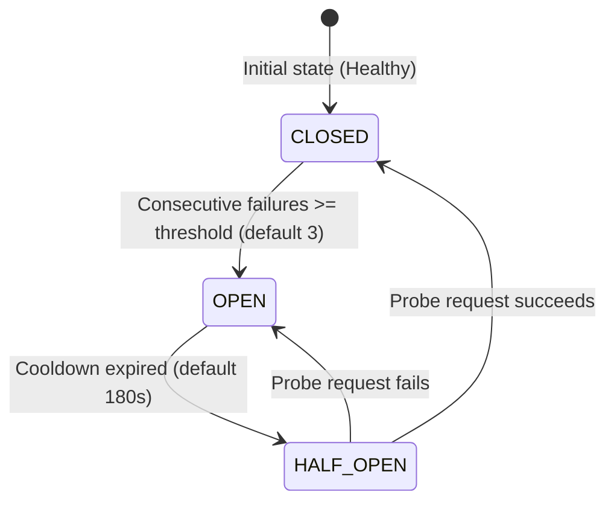

# Job Source Resilience & Circuit Breakers

This document specifies the resilience architecture, circuit breaker mechanics, and administrative controls governing multi-channel job discovery in HireEdge.

---

## 1. Architectural Motivation

HireEdge queries multiple external job boards (JobSpy Indeed/LinkedIn, Dice, Levels.fyi, Built In, Greenhouse). Third-party scrapers and APIs are inherently susceptible to transient network timeouts, Cloudflare anti-bot blocks, rate limits (HTTP 429), and schema changes.

Previously, a failure or timeout on one source could crash the entire search or waste user time in repeated exponential retries. The **Source Circuit Breaker** and **Graceful Partial Aggregation** patterns isolate failures, protect search latency, and maximize yield.

---

## 2. Circuit Breaker Mechanics

Every job source is wrapped by a dedicated [`SourceCircuitBreaker`](../../django_project/resume_app/sourcing/circuit_breaker.py).



### States & Transitions

1. **CLOSED (Healthy):**
   - Normal operation. Requests pass through directly to the scraper/client adapter.
   - Successes reset the consecutive failure counter to zero.
2. **OPEN (Tripped):**
   - Tripped when a source reaches `JOB_SOURCE_CB_FAILURE_THRESHOLD` consecutive failures (default: `3`).
   - All subsequent calls for this source **fast-fail immediately** with zero network overhead, sparing the worker from wasting time on dead endpoints.
3. **HALF_OPEN (Testing Probe):**
   - After `JOB_SOURCE_CB_COOLDOWN_SECONDS` has elapsed (default: `180` seconds / 3 minutes), the circuit breaker permits a single trial probe call.
   - If the trial probe succeeds, the circuit breaker resets to **CLOSED**.
   - If the trial probe fails, the circuit trips back to **OPEN** for another full cooldown period.

### Cache-Backed State
Circuit breaker state is backed by Django's shared cache (`circuit_breaker:job_source:<name>`). In Redis-backed environments, state is instantly synchronized across all web and worker containers.

---

## 3. Graceful Partial Aggregation

When a user triggers an unbiased search or automated cockpit scan across multiple boards (e.g. `['indeed', 'dice', 'levels']`):

1. **Availability Pre-Check:**
   - Any requested board that is currently **OPEN** or administratively disabled is skipped immediately with a diagnostic log warning.
2. **Isolated Execution:**
   - Each active source executes within an isolated `try...except` boundary.
   - If Indeed times out or is blocked, the failure is recorded on Indeed's circuit breaker without terminating the search.
   - Results from Dice and Levels are aggregated, deduplicated, and returned to the candidate.
3. **Yield Guarantee:**
   - As long as at least one source returns results, the search succeeds. A candidate is never presented with an error page due to a single third-party board outage.

---

## 4. Administrative Controls & Management Command

### Static Environment Toggles
Disable unstable or legally pending sources globally via `.env` or system environment without redeploying code:

```bash
# Comma-separated list of disabled sources
DISABLED_JOB_SOURCES="levels,greenhouse"

# Threshold before tripping
JOB_SOURCE_CB_FAILURE_THRESHOLD=3

# Cooldown duration in seconds
JOB_SOURCE_CB_COOLDOWN_SECONDS=180
```

### CLI Inspection & Reset

Operators can inspect and force-reset circuit breakers using the `source_circuit_breakers` command:

```powershell
# Inspect status of all job sources
python manage.py source_circuit_breakers

# Output:
# === Job Source Circuit Breaker Status ===
# Source       | State      | Available  | Admin Off  | Failures | Cooldown   | Last Error
# --------------------------------------------------------------------------------
# indeed       | CLOSED     | YES        | NO         | 0        | —          | —
# linkedin     | CLOSED     | YES        | NO         | 0        | —          | —
# dice         | CLOSED     | YES        | NO         | 0        | —          | —
# levels       | OPEN       | NO         | NO         | 3        | 142.0s     | HTTP 429 Too Many Requests

# Manually reset a specific tripped source to CLOSED
python manage.py source_circuit_breakers --reset indeed

# Manually reset all sources to CLOSED
python manage.py source_circuit_breakers --reset all
```
