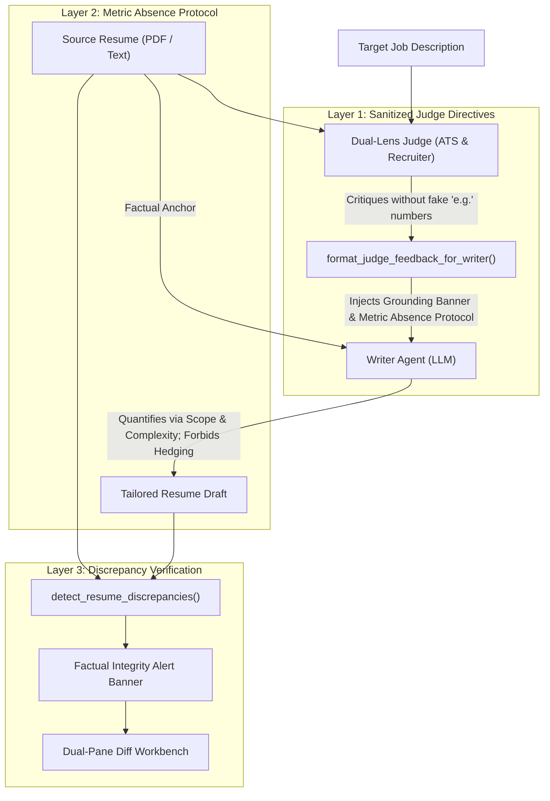

# Resume Factual Integrity & Discrepancy Verification

## Overview

In executive resume tailoring, LLM pipelines often suffer from a subtle but fatal failure mode: **mistaking instruction obedience for truthfulness**. When a reviewer or ATS judge critique says *"Add AWS and quantify impact with % (e.g. Led a team of 12 engineers and cut validation time by 30%)"*, standard LLMs will often fabricate those exact percentages, invent hypothetical team sizes, or hedge unverified technologies (*"Evaluated AWS options alongside Azure..."*) to satisfy the prompt instructions.

In a production SaaS platform, this leads to candidate interview disqualification for claiming unverified metrics and technologies.

HireEdge solves this through a three-layer factual grounding architecture:
1. **Upstream Judge Sanitization:** Prohibiting illustrative fake metrics in judge critiques.
2. **Metric Absence Protocol:** Explicit fallback rules in the Writer prompt for handling requested metrics that do not exist in candidate source facts.
3. **Automated Discrepancy Detector & Workbench Callout:** Real-time fact-checking that scans tailored drafts against source documents and alerts candidates with actionable discrepancy callouts rather than costly, blocking re-runs.

---

## Architecture & Enforcement Layers



---

## 1. Upstream Judge Sanitization

In `resume_app/prompts.py`, `DEFAULT_RESUME_JUDGE_SYSTEM` and `DEFAULT_RECRUITER_JUDGE_SYSTEM` enforce the **Anti-Hypothetical Rule for Judges**:
* Judges must **never** output illustrative examples containing fictional numbers or placeholder metrics (e.g., `e.g. Led a team of 12 engineers and cut costs by 30%`).
* Judges identify the *structural dimension* needing attention (e.g. *"omits latency or throughput outcome if achieved"*, *"strengthen active ownership phrasing"*), preventing the injection of fake metric templates into the downstream context.

---

## 2. Boundaries of Tailoring: The 3-Tier Permissibility Matrix (`DEFAULT_WRITER_SYSTEM`)

To prevent model paralysis while guaranteeing truthfulness, HireEdge establishes a clear boundary: **Concepts and Methodologies are Open; Factual Anchors are Locked.**

### The Three Tiers:
* **Tier 1: The Red Zone (Absolute Integrity — Zero Liberty):**
  * *Quantified Metrics:* Never invent percentages, dollar amounts, headcounts, or SLA figures. (Follow Metric Absence Protocol: quantify via verified scope/complexity).
  * *Credentials & Certifications:* Never add degrees, licenses, or formal certifications (TOGAF, PMP, CISSP, AWS Certified) unless present in candidate facts.
  * *Formal Regulatory Regimes:* Never claim compliance with formal regulatory mandates (SOC2, HIPAA, FedRAMP, PCI-DSS) unless verified in candidate facts.
  * *Proprietary Platform Usage:* Never claim to have "built," "deployed," "administered," or "configured" a proprietary vendor tool the candidate never touched (e.g. Salesforce Agentforce, Snowflake).
  * *No Hedging Verbs:* Never launder unverified tools with phrases like *"evaluated AWS options"* or *"familiar with TOGAF"*.
  * *No Negative Declarations or Disclaimers:* Resumes are strictly affirmative documents of proven competence. Never output disclaimers or negative statements (e.g. *"US military service: none"*, *"AWS: None"*, *"No clearance"*, *"TOGAF: Not held"*). Unheld preferred qualifications are simply omitted.
* **Tier 2: The Yellow Zone (Conceptual Bridging — Controlled Liberty):**
  * *Methodologies & Frameworks:* Map verified work to JD standards where mechanically grounded (e.g. CI/CD automation $\to$ *"DevSecOps"*; GenAI agent testing $\to$ *"AI Development Lifecycle (AI DLC)"*).
  * *Architectural Equivalents:* Frame distributed Kafka/queues as *"enterprise event-driven data streaming"* or *"decoupled pub/sub architecture"*.
  * *Tool Categorization:* Categorize verified tools (e.g. LangGraph, Gemini, Devin) under industry terms like *"agentic AI orchestration"* and *"multi-agent systems"*.
* **Tier 3: The Green Zone (Full Creative Liberty):**
  * *Active Executive Phrasing:* Direct ownership verbs (`Architected`, `Engineered`, `Consolidated`, `Operationalized`). Zero passive voice.
  * *Narrative Synthesis:* Executive Summary career trajectory framing (e.g. *"Enterprise AI & CRM Systems Leader"*).
  * *Cadence & Voice:* Implied third-person style (never use "I", "me", "my", "we"). No artificial sentence-opener quotas.

### The Adjacent Framing Rule (Unmatched Proprietary Tech):
When a JD demands a proprietary tool the candidate lacks (e.g. Salesforce Agentforce):
* **DO NOT say:** `"Architected and deployed Salesforce Agentforce solutions."` (Tier 1 Violation)
* **DO say:** `"Architected enterprise agentic AI orchestration platforms and standardized governance across enterprise Salesforce CRM ecosystems."`

---

## 3. Discrepancy Detection Engine (`fact_checker.py`)

The module [`resume_app/fact_checker.py`](file:///D:/Workshop/JobApp-Main/django_project/resume_app/fact_checker.py) deterministically compares the tailored resume against the original source resume and supplemental accomplishments:

```python
from resume_app.fact_checker import detect_resume_discrepancies

report = detect_resume_discrepancies(
    source_text=original_resume_text,
    optimized_text=tailored_draft_text,
    supplemental_text=optional_notes_or_highlights,
)
```

### Detection Scope:
* **Unverified Percentages:** Scans all percentages (`\d+(?:\.\d+)?%`) and flags any not present in source text.
* **Unverified Team Sizes & Headcounts:** Scans phrases like `team of \d+ engineers`, `directed \d+ developers`, or `\d+ direct reports`.
* **Unverified Financial Metrics:** Scans dollar metrics (`\$\d+(?:\.\d+)?(?:K|M|MM|B)?`).
* **Hedged Technologies & High-Risk Acronyms:** Scans hedging verbs before proper nouns (`evaluated <Tech>`, `familiar with <Cert>`) and unverified high-risk tools (`AWS`, `TOGAF`, `Kubernetes`, `GCP`, etc.).

---

## 4. Dual-Pane Workbench Integration

Rather than automatically failing or retriggering expensive model runs, HireEdge alerts the candidate directly in the Workbench:

* **Visual Alert Banner:** An amber status banner is rendered above the Dual-Pane Diff Workbench in both initial SSR (`_optimizer_status_inner.html`) and live polling JS (`optimizer.html`).
* **Itemized Discrepancy Cards:** Each discrepancy displays the token, severity (`high` or `medium`), context bullet snippet, and clear explanation.
* **In-Place Editing:** Candidates can immediately review the discrepancies and edit the draft in the right-hand reactive editor to align with their true experience before saving or exporting.
* **Verified State:** When zero discrepancies exist, a green verification chip confirms factual grounding: `✓ Factual Grounding Verified: Zero unverified metrics or high-risk technologies detected`.

---

## 5. Deterministic ATS Text Sanitizer (`sanitize_ats_text`) & Pre-Sanitization Pipeline

To protect candidates from parser corruption without relying solely on LLM obedience, [`resume_app/parsers.py`](file:///D:/Workshop/JobApp-Main/django_project/resume_app/parsers.py#L1129) executes a deterministic two-sided sanitization strategy:

1. **Unicode Non-Breaking Hyphen (`U+2011`) & Dash Cleansing:** Converts all Unicode dashes and non-breaking hyphens (`\u2010`–`\u2015`, `\u2212`) to standard ASCII hyphens (`-`). This prevents ATS token corruption on compound phrases like `cloud‑native` and `enterprise‑scale`.
2. **Unicode Space Normalization (`\u00A0`, `\u202F`):** Normalizes non-breaking spaces, narrow non-breaking spaces (`\u202F`), and typographical whitespace (`\u2000`–`\u200A`) into standard ASCII spaces (`\u0020`), while stripping zero-width spaces/BOM (`\u200B`–`\u200D`, `\uFEFF`).
3. **Quotation Cleansing:** Converts curly double and single quotes (`“`, `”`, `‘`, `’`, `«`, `»`) to standard single quotes (`'`), preventing Workday and Taleo Mojibake encoding bugs (e.g. `“Devinâ€`).
4. **Angle Bracket Normalization:** Normalizes `<` and `>` into plain-text words (`under 250 ms`, `over 10 years`), adhering to Workday character blacklists.
5. **Inline Bold Stripping & Bullet Normalization:** Strips markdown bold tokens (`**text**`) within bullet points to prevent parser token concatenation, while normalizing all bullet indicators to standard `- `.
6. **Input Pre-Sanitization (`writer_node`):** To prevent LLMs from attending to and echoing corrupted Unicode tokens present in job descriptions or recruiter feedback, all prompt interpolation variables are pre-sanitized before prompt assembly.

---

## 6. Word Count Precedence & Scope Preservation

To resolve conflicts between static system prompt guidelines and variable candidate seniority:
* The dynamic `{length_guardrail}` directive in `resume_app/agents.py` scales proportionally to `±10%` of the candidate's actual source document (e.g. 1004–1276 words for an executive 1200-word career).
* The directive explicitly states: **`This target range (min–max words) SUPERCEDES all general word limits.`**
* This prevents the model from panicking and collapsing high-seniority resumes down to brief stubs.
