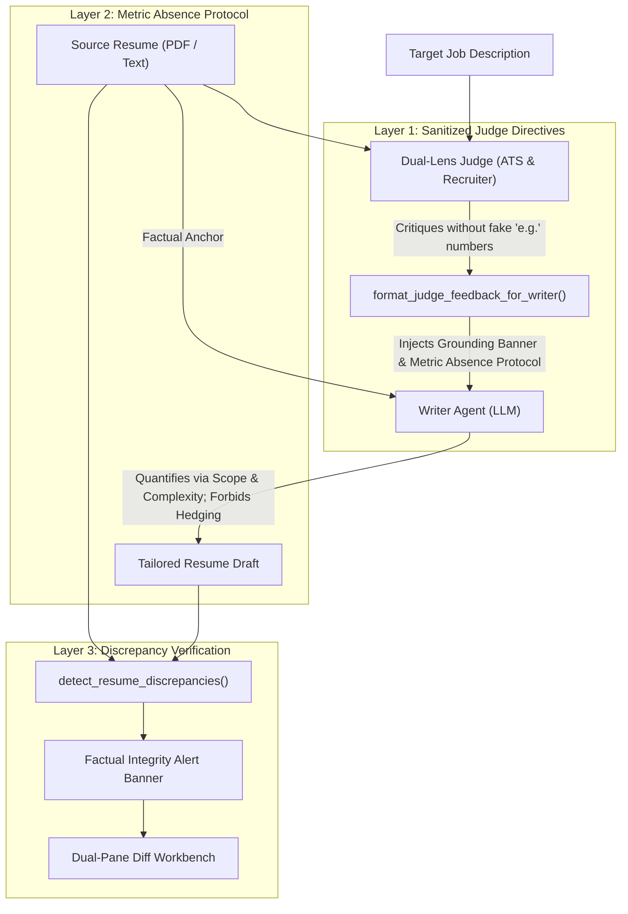

# Resume Factual Integrity & Discrepancy Verification

## Overview

In executive resume tailoring, LLM pipelines often suffer from a subtle but fatal failure mode: **mistaking instruction obedience for truthfulness**. When a reviewer or ATS judge critique says *"Add AWS and quantify impact with % (e.g. Led a team of 12 engineers and cut validation time by 30%)"*, standard LLMs will often fabricate those exact percentages, invent hypothetical team sizes, or hedge unverified technologies (*"Evaluated AWS options alongside Azure..."*) to satisfy the prompt instructions.

In a production SaaS platform, this leads to candidate interview disqualification for claiming unverified metrics and technologies.

HireEdge solves this through a three-layer factual grounding architecture:
1. **Upstream Judge Sanitization:** Prohibiting illustrative fake metrics in judge critiques.
2. **Metric Absence Protocol:** Explicit fallback rules in the Writer prompt for handling requested metrics that do not exist in candidate source facts.
3. **Automated Discrepancy Detector & Workbench Callout:** Real-time fact-checking that scans tailored drafts against source documents and alerts candidates with actionable discrepancy callouts rather than costly, blocking re-runs.

---

## Architecture & Enforcement Layers



---

## 1. Upstream Judge Sanitization

In `resume_app/prompts.py`, `DEFAULT_RESUME_JUDGE_SYSTEM` and `DEFAULT_RECRUITER_JUDGE_SYSTEM` enforce the **Anti-Hypothetical Rule for Judges**:
* Judges must **never** output illustrative examples containing fictional numbers or placeholder metrics (e.g., `e.g. Led a team of 12 engineers and cut costs by 30%`).
* Judges identify the *structural dimension* needing attention (e.g. *"omits latency or throughput outcome if achieved"*, *"strengthen active ownership phrasing"*), preventing the injection of fake metric templates into the downstream context.

---

## 2. Metric Absence Protocol (`DEFAULT_WRITER_SYSTEM`)

When a judge critique requests quantification or skills that do not exist in the candidate's verified history, the Writer agent must follow strict fallback rules:

* **Zero Hallucination Overrides All Reviewer Requests:** If a requested technology (e.g. `TOGAF`, `AWS`), certification, or metric is absent from `source_resume_text` or `Supplemental accomplishments`, the model must omit it entirely.
* **Metric Absence Protocol:** When quantification is demanded for a bullet with no numerical data in the source facts:
  1. **Do not invent numbers:** Strictly forbidden from inventing percentages (`30%`, `22%`), team counts (`12 engineers`), or dollar figures.
  2. **Quantify via scope & complexity:** Cite concrete architectural scale verified in the source facts (e.g. number of integrated enterprise systems, high-availability SLAs, regulatory compliance mandates, or transaction scale).
* **Strict Prohibition on Soft Hallucinations / Hedging:** The model is strictly prohibited from laundering missing technologies using defensive verbs (e.g., *"evaluated AWS options"*, *"familiar with TOGAF"*, *"collaborated with GCP teams"*).

---

## 3. Discrepancy Detection Engine (`fact_checker.py`)

The module [`resume_app/fact_checker.py`](file:///D:/Workshop/JobApp-Main/django_project/resume_app/fact_checker.py) deterministically compares the tailored resume against the original source resume and supplemental accomplishments:

```python
from resume_app.fact_checker import detect_resume_discrepancies

report = detect_resume_discrepancies(
    source_text=original_resume_text,
    optimized_text=tailored_draft_text,
    supplemental_text=optional_notes_or_highlights,
)
```

### Detection Scope:
* **Unverified Percentages:** Scans all percentages (`\d+(?:\.\d+)?%`) and flags any not present in source text.
* **Unverified Team Sizes & Headcounts:** Scans phrases like `team of \d+ engineers`, `directed \d+ developers`, or `\d+ direct reports`.
* **Unverified Financial Metrics:** Scans dollar metrics (`\$\d+(?:\.\d+)?(?:K|M|MM|B)?`).
* **Hedged Technologies & High-Risk Acronyms:** Scans hedging verbs before proper nouns (`evaluated <Tech>`, `familiar with <Cert>`) and unverified high-risk tools (`AWS`, `TOGAF`, `Kubernetes`, `GCP`, etc.).

---

## 4. Dual-Pane Workbench Integration

Rather than automatically failing or retriggering expensive model runs, HireEdge alerts the candidate directly in the Workbench:

* **Visual Alert Banner:** An amber status banner is rendered above the Dual-Pane Diff Workbench in both initial SSR (`_optimizer_status_inner.html`) and live polling JS (`optimizer.html`).
* **Itemized Discrepancy Cards:** Each discrepancy displays the token, severity (`high` or `medium`), context bullet snippet, and clear explanation.
* **In-Place Editing:** Candidates can immediately review the discrepancies and edit the draft in the right-hand reactive editor to align with their true experience before saving or exporting.
* **Verified State:** When zero discrepancies exist, a green verification chip confirms factual grounding: `✓ Factual Grounding Verified: Zero unverified metrics or high-risk technologies detected`.

---

## 5. Deterministic ATS Text Sanitizer (`sanitize_ats_text`)

To protect candidates from parser corruption without relying solely on LLM obedience, [`resume_app/parsers.py`](file:///D:/Workshop/JobApp-Main/django_project/resume_app/parsers.py#L1129) executes a deterministic post-processing pass:

1. **Unicode Non-Breaking Hyphen (`U+2011`) & Dash Cleansing:** Converts all Unicode dashes and non-breaking hyphens (`\u2010`–`\u2015`, `\u2212`) to standard ASCII hyphens (`-`). This prevents ATS token corruption on compound phrases like `cloud‑native` and `enterprise‑scale`.
2. **Quotation Cleansing:** Converts curly double and single quotes (`“`, `”`, `‘`, `’`, `«`, `»`) to standard single quotes (`'`), preventing Workday and Taleo Mojibake encoding bugs (e.g. `“Devinâ€`).
3. **Angle Bracket Normalization:** Normalizes `<` and `>` into plain-text words (`under 250ms`, `over 10 years`), adhering to Workday character blacklists.
4. **Inline Bold Stripping & Bullet Normalization:** Strips markdown bold tokens (`**text**`) within bullet points to prevent parser token concatenation, while normalizing all bullet indicators to standard `- `.

---

## 6. Word Count Precedence & Scope Preservation

To resolve conflicts between static system prompt guidelines and variable candidate seniority:
* The dynamic `{length_guardrail}` directive in `resume_app/agents.py` scales proportionally to `±10%` of the candidate's actual source document (e.g. 1004–1276 words for an executive 1200-word career).
* The directive explicitly states: **`This target range (min–max words) SUPERCEDES all general word limits.`**
* This prevents the model from panicking and collapsing high-seniority resumes down to brief stubs.
