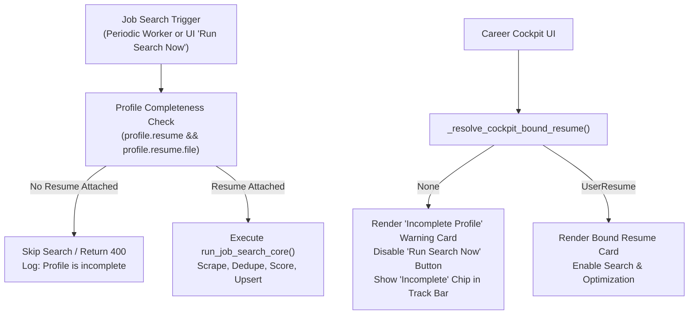

# Search Profile Strict Resume Binding & Incomplete Profile Search Guards

## Overview

This feature establishes strict, deterministic data integrity between **Search Profiles** and **User Resumes**, eliminates dynamic fallback guessing, introduces visual UI warnings for incomplete search profiles, and gates background/manual job search execution to prevent wasteful scraping.

---

## 1. Core Principles

1. **Strict 1:1 Profile Binding**:
   - Each search profile links to exactly one `UserResume` via `SearchProfile.resume`.
   - If `SearchProfile.resume` is not set or missing a file, the profile resolves strictly to `None`.
2. **Zero Fallbacks**:
   - Dynamic fallbacks (`latest uploaded resume`, `track heuristic guessing`, and template default filename fallbacks) have been completely removed.
   - What is in the database is what is shown on screen and evaluated by background workers.
3. **Incomplete Profile Indicators**:
   - Any profile lacking a bound resume is visually flagged with an amber warning badge (`Incomplete Profile — No Resume Attached`) across the Career Cockpit, track switcher tabs, and inspector drawers.
4. **Waste-Free Job Search Gating**:
   - Background periodic scraping and manual on-demand searches are blocked for incomplete profiles. Scraping jobs without a target resume burns network quota, JobSpy rate limits, and LLM budget without ability to score or optimize.

---

## 2. Architecture & Control Flow



---

## 3. Implementation Details

### Strict Resolver (`resume_app/pipeline_board.py` & `resume_app/tasks.py`)
- `_resolve_cockpit_bound_resume(user, track_slug)`: Looks up `SearchProfile.objects.filter(owner=user, slug=track_slug).first()`. Returns `active_prof.resume` if present, else `None`. No latest-by-date fallbacks.
- `_resolve_user_resume_for_track(user, track_slug)`: Looks up `SearchProfile.objects.filter(owner=user, slug=track_slug).first()`. Returns `sp.resume` if present, else `None`.

### Search Gating (`resume_app/tasks.py` & `resume_app/huey_views.py`)
- `_run_job_search_task_impl(user_id, task_id)`: Checks linked profile before executing `run_job_search_core`. If incomplete, clears locks and skips execution with a descriptive reason.
- `enqueue_due_job_search_tasks()`: Periodic cron runner skips scheduling tasks for incomplete profiles.
- `job_task_run_now_view(request, task_id)`: Validates that the profile has an attached resume before setting task cooldowns or enqueuing Huey jobs, returning HTTP 400 JSON on AJAX calls.

### UI Badges (`templates/resume_app/career_cockpit.html`)
- **Track Switcher Tabs**: Displays an amber warning pill (`⚠ Incomplete`) next to unattached profiles.
- **Bound Resume Card**: Renders an alert box with warning icon, explanatory copy, and a direct `[+ Attach Resume]` CTA button.
- **Run Search Action**: Displays a disabled button labeled `Resume Required to Search` with guidance text.

---

## 4. Verification & Testing

Verify that strict resolution, UI indicators, and search blocking function as expected:

```python
from resume_app.models import SearchProfile, JobSearchTask
from resume_app.pipeline_board import _resolve_cockpit_bound_resume
from resume_app.tasks import _run_job_search_task_impl

# 1. Unbound profile strictly returns None
sp_incomplete = SearchProfile.objects.filter(resume__isnull=True).first()
assert _resolve_cockpit_bound_resume(sp_incomplete.owner, sp_incomplete.slug) is None

# 2. Search execution safely skips without hitting external job boards
task = JobSearchTask.objects.filter(saved_search=sp_incomplete).first()
if task:
    res = _run_job_search_task_impl(task.owner_id, task.id)
    assert res["status"] == "skipped"
```
