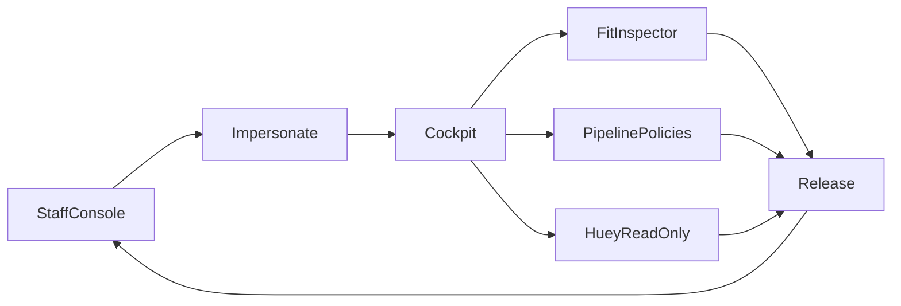

# Staff Console & Support Workflows

**Persona:** Staff (`is_staff`) and support (`can_impersonate_users`).  
**Related:** [Tenant Experience Simplification](tenant-experience-simplification.md), [Subscription Plans](subscription-plans-and-capabilities.md).

## Axes (do not conflate)

| Axis | Meaning | UI label |
|------|---------|----------|
| `is_staff` | Admin Console, Fit Inspector, plan catalog | Admin Console |
| `can_impersonate_users` | Staff Console + hijack | Staff Console |
| Experience mode (`POWER` in code) | Denseness / diagnostics for the **staff account** | **Advanced** (never “Power” in UI — collides with plan slug) |

## Support loop (canonical)

1. **Staff Console** (`/staff/users/`) — find tenant, adjust plan/status/trial/quotas, **Impersonate** (lands on Career Cockpit).
2. While hijacked: one sticky banner (`_hijack_banner.html`) offers **Cockpit · Automation · Release**. It is included from `_top_nav.html` (Cockpit, Profiler, Tracker, and every page that extends `base.html`), and also from the public shells and Django admin so those pages keep **Release**. django-hijack’s stock bottom card is off (`HIJACK_INSERT_BEFORE = None`). Product chrome shows tenant data; **Fit Inspector** and **Huey (read-only)** plus **Pipeline Policies** remain available (gated on `get_real_user().is_staff`).
3. **Release** from the sticky banner; return to Staff Console or Billing as needed.

## Navigation rules

| State | Plan / billing link | Admin Console |
|-------|---------------------|---------------|
| Staff as self | Single **Billing** (plan catalog / Stripe Price IDs) | Full (Fit, Workflows, Huey, Prompts, Staff Console if permitted, Billing) |
| Hijacked | **Plan & usage** (tenant meters) | Fit Inspector + Huey read-only (global mutations stay staff-as-self) |
| Tenant | **Plan & usage** | Hidden |

Staff Console link appears only when the real user has `can_impersonate_users`.

## Billing split

| Surface | Owns |
|---------|------|
| **Billing** (`/billing/`, staff-as-self) | Plan catalog, Stripe Price IDs, platform token telemetry, impersonation audit strip. Deep-links to Staff Console for per-user ops. |
| **Staff Console** (`/staff/users/`) | Assign plan, set status, extend/clear trial, reset daily quotas, suspend/activate, impersonate. |

Legacy POST actions `update_user_subscription` / `reset_user_quotas` on `/billing/` redirect to Staff Console with an info flash.

## Account automation defaults

Settings tab **Account defaults** (staff-as-self only) edits `AppAutomationSettings` for the **staff account** (dogfooding). While hijacked, Settings `?tab=app` redirects to Cockpit `?drawer=automation` so support does not silently edit their own settings when intending the tenant.

## Experience mode

Settings → Account → **Simple | Advanced** (real staff only). Persists on `get_real_user()` so hijack cannot change the tenant’s mode. Nav shows an **Advanced** badge when the staff account is Advanced and not hijacked.

## Huey Monitor

- Filter recent runs by **owner** (username/email) and **Failed only**.
- During hijack: GET allowed for real staff; Pause / Run Now / Flush / Cleanup are hidden and POST mutations redirect with an error until Release.

## Global save warnings

Prompt Library and Workflow editors confirm before save: **Affects all tenants** (system-wide rows).

## Tenancy helpers

- `get_active_user(request)` — data scope (tenant during hijack).
- `get_real_user(request)` — permission / staff chrome gate.

## Deferred

- Full `/staff/` ops hub homepage.
- Soft-deprecating Django prompt ModelAdmins.
