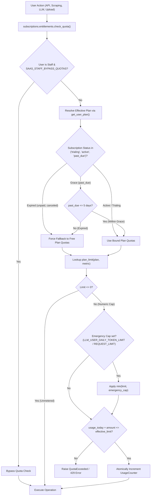

# Subscription Plans, Quotas & Capability Matrix

> [!IMPORTANT]
> **Enforcement Source of Truth:**
> This document details the commercial tier specifications and packaging intended for candidates and billing operators. For the exact, code-level enforcement reality, call-site inspection maps, and remediation backlog, refer to the authoritative audit document: **[`docs/architecture/entitlement-enforcement-audit.md`](../architecture/entitlement-enforcement-audit.md)**.
> 
> *Key Enforcement Distinctions:*
> - **Quota-gated actions, not route gates:** Authenticated users on any tier can open all core workspaces (Cockpit, Optimizer, Find Jobs, Interview Prep). Denials occur at action execution time when quotas are consumed.
> - **Monthly allowances are derived daily caps:** "Monthly token allowances" represent 30× the daily token cap (`llm_tokens_per_day`) resetting at midnight; there is no cumulative monthly ledger or rollover.
> - **Apply runs decommissioned:** The legacy `apply_runs_per_day` column has been permanently deleted from `Plan` via migration `0068`.
> - **API Access vs. Web REST:** `api_access` restricts programmatic `CustomerApiKey` generation and headless `/api/resume/llm/complete`. Standard browser session-authenticated Ninja REST endpoints remain open to all active tiers.

## Overview

HireEdge implements a multi-tier SaaS commercial model governing daily AI consumption, automated job scraping, cloud media storage, and developer REST API access. Model choice is the gateway fallback in `SYSTEM_DEFAULT_MODELS` plus the tenant’s own keys: OpenAI `gpt-4o` / `gpt-4o-mini`, Google AI Studio, Anthropic, Groq, and Ollama Local. There is no GPT-5 route in the Python gateway.

Tenant subscriptions and entitlements are managed through three foundational entities in `resume_app.models`:
- **`Plan`**: Defines commercial plan templates, default daily quota ceilings, storage allocations, and feature flags.
- **`Subscription`**: Binds an individual tenant user to a `Plan`, tracks Stripe customer and subscription IDs, and records payment status (`active`, `trialing`, `past_due`, `canceled`, `unpaid`).
- **`UsageCounter`**: Maintains durable daily atomic usage counters keyed to `(owner, metric, period_date)` for quota tracking and midnight resets.

---

## 1. Capability & Quota Comparison Matrix

The commercial ladder is calibrated around realistic human job-search patterns, protecting scraping infrastructure and platform margin while maintaining an attractive upgrade path.

| Capability / Resource | Free (`free`) | BYOK Rails (`byok`) | Pro (`pro`) | Power (`power`) *(formerly Unlimited)* | Enterprise / Custom (Admin Configurable) | Enforcement Status |
| :--- | :--- | :--- | :--- | :--- | :--- | :--- |
| **Commercial Price** | **$0 / mo** | **$15 / mo** | **$29 / mo** | **$99 / mo** | Custom negotiated display (e.g. `$299 / mo`) | **Display Only** |
| **Primary Value Prop** | Evaluation & Discovery | Self-Funded Orchestration Rails | Active High-Velocity Search | Power Candidate / Coach / Agency | Multi-seat / Custom Contract | **Commercial Copy** |
| **Default on Signup** | **Yes** (`is_default=True`) | No | No | No | No | **Enforced** |
| **Monthly OpenAI Token Allowance** | **1,500,000** tokens / mo | **Unmetered** (Direct Provider Billing) | **5,000,000** tokens / mo | **15,000,000** tokens / mo | Custom Contract | **Derived (Daily ×30)** |
| **Enforced Daily Token Cap (`llm_tokens_per_day`)** | **50,000** tokens / day | **0** (Unmetered on personal keys) | **167,000** tokens / day | **500,000** tokens / day | Dynamic (e.g. `1,000,000+` or `0` for fallback) | **Enforced** |
| **Daily LLM Request Budget** | **50** requests / day | **0** (Unmetered pipeline runs) | **250** requests / day | **1,000** requests / day | Dynamic | **Enforced** |
| **Default model chain** | Gateway `SYSTEM_DEFAULT_MODELS` (local Ollama, Gemini, `gpt-4o-mini` / `gpt-4o`, Claude, Groq) | **User BYOK keys** (OpenAI, Anthropic, Groq, Google AI Studio, Ollama) | Same gateway chain; cloud calls need a user key for `/llm/complete` | Same gateway chain; platform keys allowed on `/llm/complete` | Tenant or staff model prefs | **Gateway, not a fixed GPT-5 pair** |
| **Daily Job Searches** | **5** searches / day | **15** searches / day | **25** searches / day | **100** searches / day | Dynamic (e.g. `500+`) | **Enforced** |
| **Storage Allocation (Media & Resumes)** | **250 MB** | **2,000 MB** (2 GB) | **5,000 MB** (5 GB) | **20,000 MB** (20 GB) | Dynamic (e.g. `50,000 MB`) | **Enforced (100% of Upload Paths)** |
| **Developer API Access (`api_access`)** | ❌ **Disabled** (`False`) | ✅ **Enabled** (`True`) | ✅ **Enabled** (`True`) | ✅ **Enabled** (`True`) | Configurable boolean toggle | **Enforced (API Keys + Complete)** |
| **Headless Completion (`/llm/complete`)** | ❌ Blocked (403) | 🔑 **BYOK Required** (Requires own API key) | 🔑 **BYOK Required** (Requires own API key) | ✅ **Platform Keys Allowed** (Up to daily 500k cap) | Dependent on tier policy | **Enforced** |
| **Customer API Key Provisioning** | ❌ Blocked (`EntitlementDenied`) | ✅ Can generate `re_` keys | ✅ Can generate `re_` keys | ✅ Can generate `re_` keys | Dependent on `api_access` | **Enforced** |
| **REST API Bearer Authentication** | ❌ Rejected (`401 / 403` with API Key) | ✅ Permitted (`Bearer <token>`) | ✅ Permitted (`Bearer <token>`) | ✅ Permitted (`Bearer <token>`) | Dependent on `api_access` | **Enforced (Bearer Only)** *(1)* |
| **Stripe Checkout & Billing Portal** | N/A (Free default) | ✅ Self-service Stripe Checkout | ✅ Self-service Stripe Checkout | ✅ Self-service Stripe Checkout | Stripe or custom invoicing | **Enforced** |
| **Payment Grace Policy** | Baseline tier | **5-Day Grace** on `past_due` | **5-Day Grace** on `past_due` | **5-Day Grace** on `past_due` | **5-Day Grace** on `past_due` | **Enforced (`past_due_since` + backfill)** |
| **Degradation Target** | Baseline tier | Degrades to **Free** on grace expiry, `unpaid`, or `canceled` | Degrades to **Free** on grace expiry, `unpaid`, or `canceled` | Degrades to **Free** on grace expiry, `unpaid`, or `canceled` | Degrades to **Free** | **Enforced** |

*(1) Browser session authentication (`SessionOrApiKeyAuth`) permits all logged-in users regardless of plan tier to access product REST endpoints driving the UI (`/api/resume/optimize`, `/api/resume/jobs/search`, etc.). `api_access` controls headless customer API key generation and bearer token access.*

> [!NOTE]
> Seeded daily token caps are `50,000` (free), `0` (byok), `167,000` (pro), and `500,000` (power) in `ensure_default_plans()` (migration `0070` raises existing free rows still at the legacy `8,300`). `plan_limit()` uses `llm_tokens_per_day` when it is non-zero. When the column is `0`, a slug in `LLM_DAILY_TOKEN_LIMIT_BY_PLAN` (`free` 50,000, `byok` 0, `pro` 2,000,000, `power` 10,000,000 by default) uses that map. Any other slug with `0` is unlimited. `0` on requests and job searches is unlimited. `LLM_USER_DAILY_TOKEN_LIMIT` is an optional hard ceiling.

---

## 2. In-Depth Plan Specifications

### 2.1 Free Plan (`free`)
- **Target Audience:** Individual candidates exploring the platform, setting up their career profile, and testing AI tailoring.
- **Assignment:** Automatically assigned to every newly registered user upon account creation when `SAAS_DEFAULT_PLAN_SLUG="free"`.
- **LLM Capabilities:**
  - 1,500,000 monthly OpenAI tokens (enforced strictly at 50,000 tokens per calendar day; resets daily at midnight).
  - 50 cloud LLM requests per day.
  - Skill Radar, JD cleanse, matching, and writing follow `SYSTEM_DEFAULT_MODELS` (local Ollama first for several jobs, then Gemini, `gpt-4o-mini`, Claude, and Groq).
- **Job Discovery & Application:**
  - 5 multi-channel job scrapes per day (`job_searches_per_day = 5`).
- **Storage:**
  - 250 MB storage for uploaded master resumes (`UserResume`) and skill extraction artifacts (`pipeline_llm_extract`). Uploads exceeding this threshold on main paths are blocked with a `400 / QuotaExceeded` error.
- **Developer API Access:**
  - Customer API key creation is strictly blocked (`EntitlementDenied`). Calls to `/api/resume/llm/complete` return `403 EntitlementDenied`. Browser session-authenticated UI REST endpoints remain accessible.

### 2.2 BYOK Rails Plan (`byok`)
- **Target Audience:** Developers, AI engineers, and technical job seekers who prefer paying OpenAI, Anthropic, or Groq directly for model tokens while using HireEdge's orchestration engine (Career Cockpit, multi-channel scrapers, and resume tailors).
- **Pricing:** `$15 / month` via Stripe Checkout (pure software margin with zero platform model COGS).
- **LLM Capabilities:**
  - **Unmetered Model Tokens:** No platform daily token ceilings (`llm_tokens_per_day = 0`). Users bring their own encrypted API keys in Settings → LLM.
  - **Platform Key Guard:** Strictly blocked from consuming platform-subsidized API keys. If a BYOK user attempts a cloud LLM call without configuring personal keys, the gateway fails closed with an informative advisory to connect keys or use local Ollama models.
- **Job Discovery & Application:**
  - 15 multi-channel job searches per day across Indeed, LinkedIn, Greenhouse, BuiltIn, Levels.fyi, and Dice.
- **Storage:**
  - 2,000 MB (2 GB) media and extraction cache storage.
- **Developer API Access:**
  - Fully enabled (`api_access = True`).
  - Users can generate scoped customer API keys (`re_<prefix>_<secret>`) for integration into external scripts and automation workflows.
  - Headless completion (`POST /api/resume/llm/complete`) requires Bring-Your-Own-Key (`byok_required_for_completion = True`).

### 2.3 Pro Plan (`pro`)
- **Target Audience:** Active job seekers and senior professionals executing a high-velocity job search across multiple targeted job tracks.
- **Pricing:** `$29 / month` via Stripe Checkout (~92% gross margin after Stripe processing).
- **LLM Capabilities:**
  - 5,000,000 monthly OpenAI tokens (enforced strictly at 167,000 tokens per calendar day).
  - 250 cloud LLM requests per day.
  - The same gateway model chain as Free. Headless `/llm/complete` requires a user key.
- **Job Discovery & Application:**
  - 25 job search runs per day across Indeed, LinkedIn, Greenhouse, BuiltIn, Levels.fyi, and Dice.
  - *Priority Scraper Sync & 5 Target Profiles:* Marketed capabilities; currently unenforced in application code (see Audit Gap Backlog).
- **Storage:**
  - 5,000 MB (5 GB) quota for multiple resume variants, targeted cover letters, and extraction cache trees.
- **Developer API Access:**
  - Enabled for programmatic API keys (`api_access = True`).
  - Candidates can generate scoped API keys (`re_<prefix>_<secret>`) in Settings → API Keys for automated tracking integrations.
  - **BYOK Policy for Headless Completion:** To prevent subsidized API proxy drain, `POST /api/resume/llm/complete` requires Bring-Your-Own-Key (`byok_required_for_completion = True`). Callers must supply `llm_provider` with a user-configured key in Settings → LLM.

### 2.4 Power Plan (`power`) *(Formerly "Unlimited")*
- **Target Audience:** Power candidates, career coaches, executive recruiters, and agency power users managing high-volume pipelines.
- **Pricing:** `$99 / month` via Stripe Checkout (~93% gross margin after Stripe processing).
- **LLM Capabilities:**
  - 15,000,000 monthly OpenAI tokens (enforced strictly at 500,000 tokens per calendar day cost ceiling).
  - 1,000 cloud LLM requests per day.
  - The same gateway model chain. Platform keys are allowed on `POST /api/resume/llm/complete` up to the plan’s daily token cap (seeded 500,000).
- **Job Discovery & Application:**
  - 100 job search runs per day.
  - *Unlimited Target Profiles & Continuous Scraper Daemon:* Marketed capabilities; currently unenforced in application code (see Audit Gap Backlog).
- **Storage:**
  - 20,000 MB (20 GB) media and extraction cache storage.
- **Developer API Access:**
  - Fully enabled (`api_access = True`, `byok_required_for_completion = False`).
  - Permitted to use platform-managed credentials on `POST /api/resume/llm/complete` up to the daily 500,000 token budget.

### 2.5 Enterprise & Custom Plans
- **Configuration:** Created dynamically by staff users via `/billing/` (Admin Control Center) or Django Admin (`/admin/resume_app/plan/`).
- **Customizable Attributes:**
  - Unique slug and commercial name (e.g., `enterprise`, "Enterprise Tier").
  - Custom price display string.
  - Fine-grained quota numbers for each daily metric and storage limit.
  - Developer API toggle (`api_access`) and headless BYOK policy (`byok_required_for_completion`).
  - Binding to specific Stripe Price IDs (`stripe_price_id`) for checkout automation.

---

## 3. Enforcement Architecture & Lifecycle



### 3.1 Metered Metrics
Daily consumption is tracked per calendar day using server local time (`timezone.localdate()`):
1. `METRIC_LLM_REQUESTS = "llm_requests"`: Tracks total cloud AI tool invocations. Local models bypass this meter.
2. `METRIC_LLM_TOKENS = "llm_tokens"`: Consumed cumulatively across input and output tokens for cloud LLMs (OpenAI, Anthropic, Gemini, Groq). Local models are unmetered. Daily cap resets at midnight; no monthly rollover.
3. `METRIC_JOB_SEARCHES = "job_searches"`: Consumed on every manual or automated job scrape invocation (`run_job_search_core` and cached API search).
4. `METRIC_STORAGE = "storage_bytes"`: Enforced on upload (`assert_upload_allowed`) measuring `UserResume` files plus `pipeline_llm_extract/<track>/<run_id>/` disk consumption across 100% of upload entry points (direct resume upload, pipeline board profile upload, and career profiler upload).
*(Note: `apply_runs_per_day` and `METRIC_APPLY_RUNS` were permanently removed from the schema and code via migration `0068`).*

### 3.2 Involuntary Churn Protection & 5-Day Grace Clock
When a user subscribes to a paid plan (`pro`, `power`) and their payment later fails:
- Stripe emits `invoice.payment_failed` and sets `Subscription.status = "past_due"`.
- The customer enters a **5-day active grace period** (`SAAS_PAST_DUE_GRACE_DAYS = 5`) and **retains their paid entitlements** while Stripe executes automated card retries.
- The UI displays an amber advisory banner:
  > *Payment failed or overdue. Your subscription is currently in a grace period while automatic payment retries occur. Please update your payment method to ensure uninterrupted service.*
- When 5 days elapse without successful payment recovery, or when status transitions to `unpaid` or `canceled`, `get_user_plan` degrades entitlements to **Free (`free`)**.
- The paid subscription foreign key and Stripe subscription identifier (`stripe_subscription_id`) are preserved on the `Subscription` row, enabling 1-click recovery via the Stripe Customer Portal.

---

## 4. Developer API Access & BYOK Policy

### 4.1 Key Generation & Bearer Authentication
- **Generation:** `resume_app.api_keys.generate_api_key(user)` invokes `require_api_access(user)`. If `plan.api_access` is false, it raises `EntitlementDenied`.
- **Runtime Authentication:** `SessionOrApiKeyAuth` authenticates incoming requests. If a Bearer token belongs to a user whose subscription downgraded or whose plan lacks `api_access`, authentication fails immediately (`401 / 403`).
- **Web App REST Usage:** Calls made from the browser using Django session cookies do not require `api_access` and are available across all tiers.

### 4.2 Programmatic LLM Completion API (`POST /api/resume/llm/complete`)
Enables direct headless prompt completion:
- **Authorization:** Requires an active `api_access` entitlement (BYOK, Pro, or Power).
- **Pro & BYOK Tier BYOK Guard:** Pro and BYOK users calling `/api/resume/llm/complete` must specify `llm_provider` and connect their own API key in Settings → LLM. Calling without a provider on Pro returns HTTP 400:
  ```json
  {
    "detail": "The Pro plan requires Bring-Your-Own-Key (BYOK) for programmatic API completions. Specify 'llm_provider' with a configured API key in Settings → LLM, or upgrade to Power."
  }
  ```
- **Power Tier Platform Completion:** Power users can call `/api/resume/llm/complete` using platform credentials up to their plan's daily 500,000 token budget.

---

## 5. Configuration & Environment Variables

| Variable | Default | Purpose / Behavior |
| :--- | :--- | :--- |
| `SAAS_DEFAULT_PLAN_SLUG` | `"free"` | Plan assigned automatically to new registrations. |
| `SAAS_ENFORCE_QUOTAS` | `True` | Master kill switch for daily quota checks. |
| `SAAS_STAFF_BYPASS_QUOTAS` | `False` | When True, staff/superusers bypass daily quotas. |
| `SAAS_PAST_DUE_GRACE_DAYS` | `5` | Active grace window (days) for `past_due` status before downgrading to Free. (See Audit Gap Backlog regarding settings declaration). |
| `LLM_DAILY_TOKEN_LIMIT_FREE` | `50000` | Fallback daily token allowance for Free when plan row token field is 0. |
| `LLM_DAILY_TOKEN_LIMIT_PRO` | `2000000` | Fallback daily token allowance for Pro when plan row token field is 0. |
| `LLM_DAILY_TOKEN_LIMIT_POWER` | `10000000` | Fallback daily token allowance for Power when plan row token field is 0. |
| `LLM_PLATFORM_DAILY_TOKEN_LIMIT` | `50000000` | Global platform key safety pool across all users (50M tokens/day). |
| `LLM_USER_DAILY_TOKEN_LIMIT` | `0` | Universal emergency ceiling across all plans (`0` = disabled). Overrides DB values when > 0. |
| `LLM_USER_DAILY_REQUEST_LIMIT` | `0` | Universal emergency ceiling for requests (`0` = disabled). |
| `LLM_COMPLETE_REQUIRE_BYOK_FOR_PRO` | `True` | Forces Pro API users to supply their own API keys for `/llm/complete`. |
| `STRIPE_SECRET_KEY` | `""` | Stripe API Secret Key (enables billing routes and checkout). |
| `STRIPE_PUBLISHABLE_KEY` | `""` | Stripe Publishable Key for frontend elements. |
| `STRIPE_WEBHOOK_SECRET` | `""` | Stripe Webhook Signing Secret for cryptographic signature verification. |

---

## 6. Billing Surfaces (Tenant + Staff)

### 6.0 Tenant Plan & usage (`/billing/`, non-staff)

Tenants should keep this page — it is the honest answer to “why did AI stop?” and mirrors **Settings → Usage**.

| Surface | When shown | Behavior |
| :--- | :--- | :--- |
| **Current plan + meters** | Always | Live `Plan` name, `price_display`, status, daily LLM/search meters, storage. |
| **Stripe Checkout / Portal** | `STRIPE_SECRET_KEY` set | Upgrade cards with live quotas; Manage billing portal when a Stripe customer exists. |
| **Compare plan limits** | Stripe offline | Collapsed reference table only — no Upgrade buttons (plan changes are staff-assigned). |

Tenant / hijack nav label is **Plan & usage**. Staff-as-self use a single Admin Console entry labeled **Billing** (same `/billing/` URL). Preview the tenant page with `?view=candidate`.

`ensure_default_plans()` creates missing built-in slugs (`free` / `byok` / `pro` / `power`) from code defaults and fills blank `price_display`/`description`. All staff quota edits (such as custom `llm_tokens_per_day`) made in the admin console are strictly preserved and never overwritten.

### 6.1 Billing Plans & Quotas Admin Console (`/billing/`)
Accessible to all staff users (`request.user.is_staff` and not hijacked) and linked under **Tools &rarr; Admin Console &rarr; Billing**:

1. **Commercial Tier & Quota Editor (Dropdown Plan Selector):**
   - **Single-Pane Dropdown Selector:** An interactive dropdown selector lets administrators choose one plan to inspect and configure at a time, synchronized with the URL parameter (`?plan=<slug>`).
   - Configure public display names, commercial price strings (e.g. `$29 / mo`), and Stripe Price IDs (`stripe_price_id`).
   - Calibrate daily quota ceilings for LLM requests (`llm_requests_per_day`), OpenAI tokens (`llm_tokens_per_day`), job scraping runs (`job_searches_per_day`), and disk storage (`storage_mb`). Quota inputs support raw numbers, comma-formatted digits (`200,000`), or metric abbreviations (`200k`, `1.5M`), with live monthly allowance calculation badges (`~6.0M/mo`).
   - Toggle **Developer API Access** (`api_access`) and **BYOK Policy Enforcement** (`byok_required_for_completion`).
   - Designate default onboarding tiers (`is_default`) and activate/deactivate tiers.
   - Dynamic creation modal for bespoke enterprise plans (`create_plan`).
   - Safe plan deletion for non-default tiers with zero active subscribers (`delete_plan`).
2. **Tenant Operations deep-link:** Card summarizing subscriber counts with a primary CTA to **Staff Console** for per-user plan/status/trial/quota work (no duplicate inline editor on Billing).
3. **Candidate View Preview:**
   - Staff users can preview the candidate-facing billing interface by clicking **Preview Candidate View** (`/billing/?view=candidate`) or return to the admin console with the top-level staff banner.

### 6.2 Staff Support Users Directory (`/staff/users/`)
Canonical home for **per-user** billing ops (plan assign, status, trial extend/clear, quota reset, suspend, impersonate). Accessible to staff with impersonation privileges (`can_impersonate_users`):
- Displays live today-usage metrics (LLM, Search, Storage) alongside user account info.
- Inline plan selector dropdown (`assign_plan`) allowing immediate assignment of Free, Pro, Power, or custom plans to any tenant or staff account.
- Status selector dropdown (`set_sub_status`) allowing support operators to transition customer status to `active`, `trialing`, `past_due`, `canceled`, or `unpaid`.
- **Trial** (`extend_trial` / `clear_trial`) to set or clear `trial_ends_at`.
- **Reset Quotas** button to clear today's consumption counters directly from the user row.
- Support impersonation flow (`hijack:acquire`) with mandatory audit logging (lands on Career Cockpit).

### 6.3 Django Admin Console (`/admin/`)
Low-level database administration via Django ModelAdmin:
1. **`SubscriptionAdmin` (`/admin/resume_app/subscription/`):** List display, status badges, Stripe customer ID, trial end timestamps, and bulk actions (`assign_free_plan`, `assign_pro_plan`, `assign_power_plan`, `mark_active`, `mark_canceled`, `reset_quotas_today`).
2. **`PlanAdmin` (`/admin/resume_app/plan/`):** Quota ceilings, token limits, search caps, storage limits, API access, BYOK toggles, and bulk activation/deactivation.
3. **`UsageCounterAdmin` (`/admin/resume_app/usagecounter/`):** Granular daily usage records per owner, metric, and date for audit and diagnostics.

---

## 7. Verification & Automated Tests

The recalibrated subscription plans, BYOK guards, grace periods, and emergency ceilings are verified by automated test suites in `django_project/resume_app/`:

- `test_saas_phase2.py`:
  - `test_past_due_grace_and_unpaid_degradation`: Verifies that `past_due` status retains paid plan during grace, while `unpaid` and `canceled` degrade to Free.
  - `test_past_due_grace_expires_after_five_days`: Verifies that `past_due` status degrades to Free once the 5-day grace clock expires.
  - `test_subscription_deleted_retains_plan_and_stripe_id`: Verifies that cancellation preserves plan FK and Stripe subscription ID while resolving entitlements to Free.
  - `test_payment_failed_sets_past_due`: Verifies Stripe webhook `invoice.payment_failed` transitions customer to grace without instant cutoff.
  - `test_search_quota_enforced` & `test_llm_quota_enforced`: Validates quota enforcement against calibrated values.
- `test_llm_policy.py`:
  - `test_pro_plan_requires_byok`: Validates that Pro users calling `/api/resume/llm/complete` without their own key are blocked with a clear BYOK error.
  - `test_power_plan_allowed`: Validates that Power plan users can complete via platform credentials up to their token ceiling.
  - `test_emergency_ceiling_caps_all_plans`: Validates that `LLM_USER_DAILY_TOKEN_LIMIT` universally caps all plans.
  - `test_check_token_budget_allows_local_provider_even_when_exhausted`: Validates that local models remain unmetered even when daily cloud quotas are exhausted.
  - `test_plan_database_tokens_take_precedence_over_env`: Validates that database plan row values take precedence over environment settings.

Run the test suite:
```powershell
python django_project/manage.py test resume_app.test_llm_policy resume_app.test_saas_phase2
```

---

## 8. Public Marketing Presentation (Landing Page Alignment)

The public marketing landing page (`django_project/resume_app/templates/resume_app/landing.html`) reflects commercial positioning. Engineers and operators should note the enforcement status of marketed points:

1. **Monthly Token Allowances:** Marketed as 1.5M (Free), 5M (Pro), 15M (Power). In application code, these are strictly enforced as daily ceilings of 50,000 / 167,000 / 500,000 tokens resetting at midnight.
2. **Target Profiles & Scraper Sync:** Marketing references "5 target profiles" (Pro) and "continuous scraping daemon / unlimited profiles" (Power). These features are currently commercial copy and unenforced in runtime code (tracked in [Gap Backlog GAP-04](../architecture/entitlement-enforcement-audit.md#gap-04-unenforced-landing-page-claims-profiles--scrapers)).
3. **Apply Runs:** Mentioned in historical packaging; currently omitted from public marketing cards and decommissioned in code.
