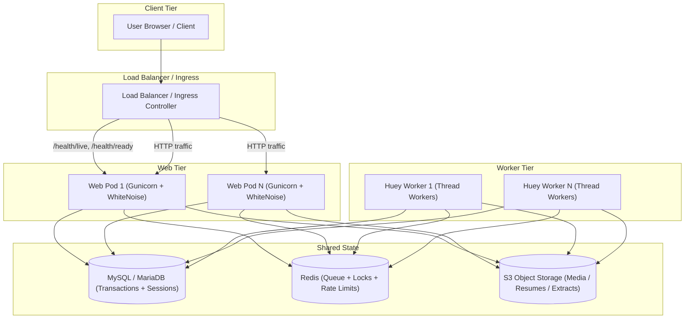

# Container Scaling and Deployment Guide

This guide details the deployment architecture, container configuration, and horizontal scaling capabilities of HireEdge across the web tier and Huey background task workers.

---

## 1. Architecture & Deployment Tiers



---

## 2. Capabilities & Scaling Posture

| Component | Single-Node (Compose) | Multi-Replica Horizontal | Storage Configuration & Invariants |
| :--- | :--- | :--- | :--- |
| **Web Tier** | Supported out of the box | Supported behind LB | Requires `AWS_STORAGE_BUCKET_NAME` for remote media; WhiteNoise serves static assets directly. |
| **Huey Workers** | Supported out of the box | Supported | Redis queue broker; periodic task leader locks deduplicate crons across workers. |
| **Sessions** | Database-backed | Database-backed | No sticky sessions required; fully stateless over HTTP. |
| **Health Probes** | `/health/ready` | `/health/live` & `/health/ready` | Excluded from login middleware; probes web responsiveness and DB/Redis health. |
| **Database** | SQLite or MySQL | External MySQL / MariaDB | SQLite fail-closed in production (`ALLOW_SQLITE_IN_PRODUCTION=1` only for dev/demo). |

---

## 3. Storage Dual-Mode (Local Disk vs S3)

HireEdge supports two distinct storage modes without requiring code changes:

### A. Local Disk Mode (Default / Development)
When `AWS_STORAGE_BUCKET_NAME` is unset (or empty):
- Uploaded resumes reside under `MEDIA_ROOT/resumes/`.
- Pipeline skill extracts reside under `MEDIA_ROOT/pipeline_llm_extract/{track}/{run_id}/`.
- Single-node Docker Compose shares this directory between `web` and `huey` via a host bind-mount (`./django_project/media`).

### B. Remote S3 Mode (Horizontal Production)
When `AWS_STORAGE_BUCKET_NAME` is set:
- **Resumes & PDF Parsing:** All PDF parsing routes pass the file object (e.g. `resume.file`) to `parse_pdf(...)` via `local_file_or_temp`. On S3, the file is safely streamed to a temporary file created with `delete=False`, closed prior to parsing, and unlinked in a `finally` block (preventing Windows file-lock collisions).
- **Owner-Gated Media Serving:** `serve_media_view` validates tenant authorization via `user_may_access_media(user, path)`. If remote storage is active, it issues a `302 Found` redirect to a short-lived presigned URL (`AWS_QUERYSTRING_EXPIRE=120`), completely offloading binary streaming from Gunicorn.
- **Pipeline Skill Extracts:** [`pipeline_llm_skill_extract.py`](../../django_project/resume_app/pipeline_llm_skill_extract.py) routes all progress updates, NDJSON batch records, stop signals, and consolidated outputs through `default_storage`. Web pods on host A and Huey workers on host B read and write to the same S3 keys without requiring an RWX volume.

---

## 4. Health & Readiness Probes

HireEdge exposes dedicated, unauthenticated health endpoints (exempted via `LOGIN_EXEMPT_URL_PREFIXES`):

| Endpoint | Purpose | Target | Checks |
| :--- | :--- | :--- | :--- |
| `GET /health/live` | Liveness probe | ALB / Kubernetes Kubelet | Verifies Gunicorn / Django process is alive and accepting connections (HTTP 200). |
| `GET /health/ready` | Readiness probe | ALB target group / Ingress | Verifies `default` database connection (`SELECT 1`) and Redis cache read/write (HTTP 200 or 503). |
| `GET /health/` | Root health alias | General monitoring | Aliased to `health_live_view`. |

In `docker-compose.prod.yml`, the web healthcheck queries:
```bash
python -c "import urllib.request; urllib.request.urlopen('http://127.0.0.1:8000/health/ready', timeout=5)"
```

---

## 5. Static Assets with WhiteNoise

Gunicorn does not serve static files by default when `DEBUG=False`. HireEdge embeds WhiteNoise into the application pipeline:
- **Build Step:** `RUN python manage.py collectstatic --noinput` is executed during `docker build`.
- **Middleware:** `whitenoise.middleware.WhiteNoiseMiddleware` is registered immediately following `SecurityMiddleware` in [`core.settings`](../../django_project/core/settings.py).
- **Storage Backend:** Uses `whitenoise.storage.CompressedManifestStaticFilesStorage` in production for hashed filenames, gzip, and Brotli pre-compression.

---

## 6. Startup Migrations (`RUN_MIGRATIONS`)

To prevent multiple web pods or worker containers from competing and causing migration race conditions at rollout:
- [`docker-entrypoint.sh`](../../docker-entrypoint.sh) checks `RUN_MIGRATIONS`:
  - `RUN_MIGRATIONS=1`: Executes `python manage.py migrate --noinput`.
  - `RUN_MIGRATIONS!=1`: Skips migrations.
- **Compose Multi-Container:**
  - `web` has `RUN_MIGRATIONS: "1"`.
  - `huey` has `RUN_MIGRATIONS: "0"`.
- **Horizontal Scaling & Kubernetes:**
  - Scaled web pods must **not** all run with `RUN_MIGRATIONS=1`.
  - Set `RUN_MIGRATIONS: "0"` across all deployment pods.
  - Run migrations in an isolated pre-deploy Helm Job or CI/CD rollout step.

---

## 7. Operational Capacity & Host Boundaries

### Database Connection Budget
[`core.settings`](../../django_project/core/settings.py) sets `MYSQL_CONN_MAX_AGE = 60` to keep connections persistent for performance.
- **Connection Calculation:**
  $$\text{Total Connections} = (N_{\text{web pods}} \times N_{\text{gunicorn workers}}) + (N_{\text{huey pods}} \times N_{\text{threads}}) + \text{Buffer}$$
- **Example:**
  - 4 web pods $\times$ 2 workers = 8 connections
  - 2 Huey pods $\times$ 2 threads = 4 connections
  - Total persistent pool = 12 connections (well within MySQL default `max_connections = 151`).
- If scaling web pods or workers beyond 50+ total processes, verify `max_connections` on MySQL/MariaDB or deploy an intermediate pooler (ProxySQL or AWS RDS Proxy).

### Ollama & Local LLM Locality
- By default, Ollama endpoints default to `http://127.0.0.1:11434`.
- On multi-host worker deployments, worker pods on remote nodes cannot reach a local Ollama instance on node 1.
- **Remedy:** Either configure `OLLAMA_BASE_URL` to point to a centralized cluster service (e.g. `http://ollama-service:11434`), or leave `OPTIMIZER_JUDGES_PREFER_LOCAL=False` (the codebase default) so evaluation judges use cloud LLMs.

---

## 8. Production Environment Configuration

Add the following variables to `.env` when deploying in production with horizontal scaling:

```ini
# Production core
DEBUG=False
SECRET_KEY=<unique-unpredictable-secret>
ALLOWED_HOSTS=hireedge.yourdomain.com

# Database (MySQL / MariaDB)
MYSQL_DATABASE=hireedge_prod
MYSQL_USER=hireedge_user
MYSQL_PASSWORD=<strong-db-password>
MYSQL_HOST=db.internal.lan
MYSQL_PORT=3306
MYSQL_CONN_MAX_AGE=60

# Redis (Huey broker + Django cache locks)
HUEY_REDIS_HOST=redis.internal.lan
HUEY_REDIS_PORT=6379
DJANGO_CACHE_USE_REDIS=1

# S3 Object Storage for Media & Pipeline Extract
AWS_STORAGE_BUCKET_NAME=hireedge-media-prod
AWS_S3_REGION_NAME=us-east-1
AWS_ACCESS_KEY_ID=<your-access-key>
AWS_SECRET_ACCESS_KEY=<your-secret-key>
AWS_QUERYSTRING_AUTH=True
AWS_QUERYSTRING_EXPIRE=120

# Optional Centralized Ollama Service (if using local models across cluster)
# OLLAMA_BASE_URL=http://ollama-service.internal.lan:11434
```
