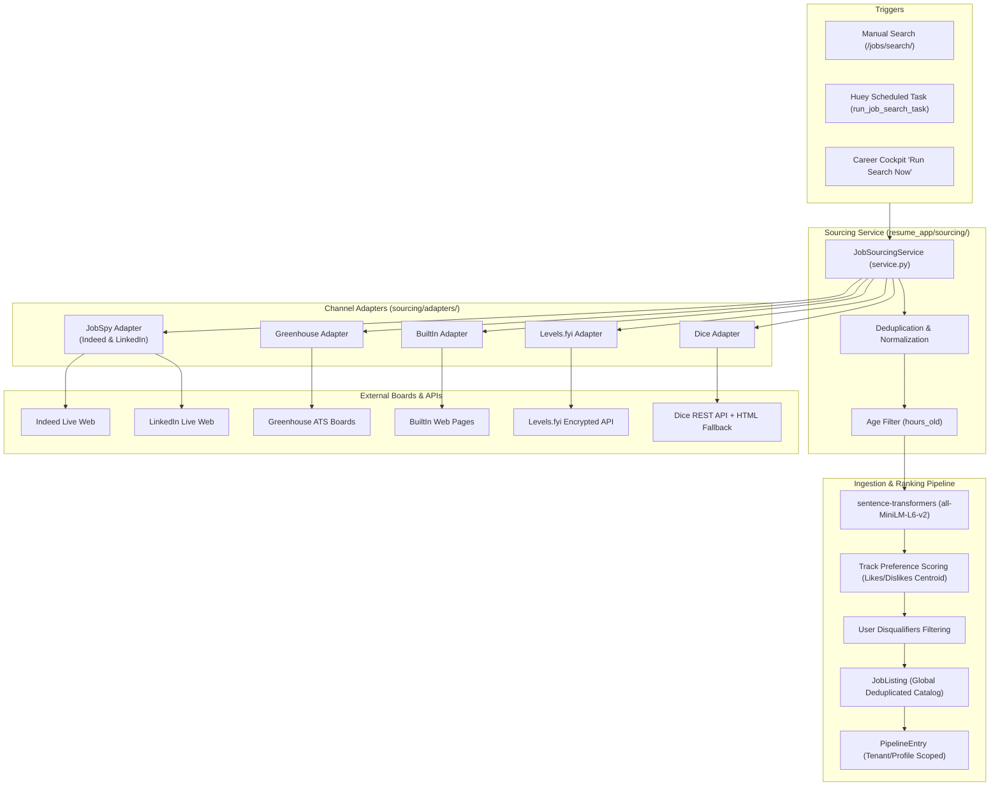

# Job Sourcing & Scraping Architecture

HireEdge aggregates live job postings from six major recruitment channels using a modular, hexagonal architecture located in `django_project/resume_app/sourcing/` and `resume_app/job_sources.py`.

---

## 1. High-Level Sourcing Architecture



---

## 2. Supported Sourcing Channels

The system defines supported channels in `resume_app/job_sources.py`:

```python
JOBSPY_SITE_NAMES = ["indeed", "linkedin"]
CUSTOM_SCRAPER_SITE_NAMES = ["dice", "levels", "builtin", "greenhouse"]
ALLOWED_SITE_NAMES = JOBSPY_SITE_NAMES + CUSTOM_SCRAPER_SITE_NAMES
```

### 2.1 Greenhouse (`greenhouse`)
- **Implementation:** `sourcing/clients/greenhouse_client.py` and `sourcing/adapters/greenhouse_adapter.py`.
- **Mechanism:** Queries direct Greenhouse ATS boards across top tech employers. Extracts title, company, clean HTML job description, location, application URLs, and department tags.
- **Benefits:** Cleanest metadata and direct ATS links without aggregator redirects.

### 2.2 BuiltIn (`builtin`)
- **Implementation:** `sourcing/clients/builtin_client.py` and `sourcing/adapters/builtin_adapter.py`.
- **Mechanism:** Multi-page web scraper targeting BuiltIn's national and regional tech hubs (NYC, Austin, Seattle, Chicago, remote).
- **Features:** Parses company profile, salary transparency bands when present, location modality (Remote, Hybrid, In-Office), and freshness timestamps.

### 2.3 Levels.fyi (`levels`)
- **Implementation:** `sourcing/clients/levels_client.py` and `sourcing/adapters/levels_adapter.py`.
- **Mechanism:** Consumes Levels.fyi's encrypted jobs API endpoint. Decrypts payloads, maps seniorities (`LEVELS_FYI_STANDARD_LEVELS`), and traverses pages using offset steps.
- **Configurable Settings:**
  - `LEVELS_FYI_STANDARD_LEVELS`: Seniority level filters.
  - `LEVELS_FYI_OFFSET_STEP`: Page step size.
  - `LEVELS_FYI_PAGE_DELAY`: Throttle between requests.
  - `LEVELS_FYI_MAX_SCAN_PAGES`: Maximum traversal depth per search run.

### 2.4 Dice (`dice`)
- **Implementation:** `sourcing/clients/dice_client.py` and `sourcing/adapters/dice_adapter.py`.
- **Mechanism:** Direct REST JSON search API with an automatic HTML scraper fallback if the API is throttled or alters payload formatting.
- **Detail Enrichment:** Supports on-demand full JD enrichment from detail URLs (`POST /api/resume/jobs/fetch-description`).

### 2.5 Indeed & LinkedIn (`indeed`, `linkedin`)
- **Implementation:** Powered by `python-jobspy` (`_fetch_jobs_jobspy`).
- **User Agent Rotation:** Utilizes `DEFAULT_JOBSPY_USER_AGENT` to mitigate anti-bot challenges.
- **Location & Country:** Defaults to `USA` with country-level normalization (`DEFAULT_COUNTRY_INDEED`).

---

## 3. Deduplication & Ingestion Pipeline

To prevent duplicate job records across multiple boards or recurring searches:

1. **External ID Hashing (`_external_id`):**
   ```python
   def _external_id(row: dict) -> str:
       raw = f"{row.get('title')}|{row.get('company')}|{row.get('job_url')}"
       return hashlib.sha256(raw.encode('utf-8')).hexdigest()
   ```
2. **Title + Company Normalization:**
   Postings of the exact same role across multiple aggregator URLs are collapsed to the highest-scoring listing.
3. **Database Upsert (`upsert_job_listing_from_fetch`):**
   Writes or updates the global `JobListing` record without duplicating rows in the database.
4. **Tenant Pipeline Admissions:**
   When ingesting for a scheduled task or manual search, the system evaluates:
   - Is the role already in the user's pipeline (`PipelineEntry`)?
   - Was the role previously archived/deleted by the user?
   - Does it match any `UserDisqualifier` patterns?
   - Was it previously expired and now revived after the 14-day repost cooldown?
   Every decision is logged and categorized in `JobSearchTaskRun.details` for review in the Career Cockpit.

---

## 4. Preference Scoring & Semantic Ranking

Once listings are normalized:
1. **Dense Vector Embeddings:** Generated using `sentence-transformers` with model `all-MiniLM-L6-v2` (cached locally).
2. **Preference Learning Centroid:** The user's past likes and dislikes on the active `SearchProfile` update a centroid vector (`JobListingTrackMetrics`). New jobs are ranked by cosine similarity against this preference vector.
3. **Fit Score vs Pref Score:**
   - **Fit %**: Semantic similarity between the candidate's active resume and the job description.
   - **Pref %**: Alignment with user feedback signals (liked/disliked job types and companies).
