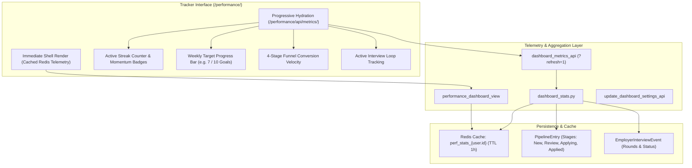

# Tab 3: Tracker — Career Momentum & Application Outcomes

The **Tracker** (`/performance/`) is the outcome and accountability hub in HireEdge (Tab 3 in the Stitch 3-Tab Model). It provides visibility into weekly job search momentum, application conversion velocity, and real-world employer interview progression.

HireEdge explicitly replaces punitive sprint deficit alerts with positive habit reinforcement, helping candidates build consistent job search velocity without cognitive fatigue.

---

## 1. Career Momentum Dashboard (`/performance/`)



---

## 2. Core Capabilities & Momentum Philosophy

### 2.1 Positive Momentum vs. Punitive Deficits (Cognitive Ease Architecture)
Legacy job tracking dashboards often borrow agile software sprint metrics that display red warnings when users miss arbitrary quotas (e.g., "5 applications behind schedule"). HireEdge replaces deficit alerts with constructive telemetry anchored in Daniel Kahneman's **System 1 (Intuitive Calm)** and **System 2 (Analytical Precision)** cognitive frameworks:
- **Hero Focal Anchor ("Today's Recommended Focus"):** Governed by Hick's Law, the top hero card gives the user exactly one unambiguous priority action (`Tailor Application: VP of Engineering at Linear →`), eliminating choice paralysis.
- **Accurate Pipeline Information Scent:** Clearly distinguishes between opportunities deemed a good fit that are ready to be tailored versus already submitted applications, eliminating false assumptions about pending sign-offs.
- **100% Information Scent:** To combat Ambiguity Aversion, the queue contents are exposed upfront (`"Linear, Figma, Retool"`), allowing instant execution without checking backlogs first.
- **Interviews & Milestones Bar:** Anchored prominently with 42px touch-target `Prep Brief →` buttons, displaying upcoming interview milestones with direct preparation access.
- **Kahneman's Peak-End Rule ("All Caught Up" State):** When the queue is empty, the dashboard transforms into a rewarding confirmation state (`"Today's high-impact batch is complete. 7 of 8 submitted. Next: Stripe Deep Dive on Thursday."`) ensuring the user exits on an emotional high note.
- **Active Streak Telemetry:** Encourages consistency by tracking consecutive days of active job hunting (evaluating jobs, tailoring resumes, or recording interview notes).
- **Positive Momentum Signals:** Visual reinforcement highlights weekly wins, new recruiter interactions, and interview stage promotions with zero clinical alarm states.

### 2.2 4-Stage Conversion Funnel Velocity
Tracks candidate progression through the four pipeline stages:
1. **New (`Pipeline`):** Fresh opportunities ingested via automated searches or saved from the Sandbox.
2. **Review (`Vetting`):** High-potential roles screened with deep LLM match diagnostics and skill radar.
3. **Applying (`Applying`):** Positions undergoing customized resume tailoring and cover letter drafting.
4. **Applied (`Done`):** Submitted applications tracked through real-world employer interview loops.

### 2.3 Instant Shell Render & Progressive Metric-by-Metric Hydration
To eliminate initial loading delays and prevent user bounce or avoidance:
- **Instant Non-Blocking Shell (< 15ms):** `performance_dashboard_view` never blocks HTTP responses on heavy database analytics. If telemetry is cached in Redis (`perf_stats_{user.id}`), it renders cached data in < 5ms. If not cached, it immediately sends an ultra-fast HTML application shell with calm skeleton shimmer placeholders.
- **Granular Multi-Channel Telemetry Endpoints:** Rather than waiting for a monolithic payload, the client initiates concurrent background requests for each metric domain:
  - `GET /performance/api/metrics/?section=hero` (~25ms): streak, weekly target, applied this week, apps remaining, pacing percentage, ready queue count, and top prioritized action button.
  - `GET /performance/api/metrics/?section=interviews` (~25ms): confirmed recruiter screens, upcoming rounds, and stage milestones.
  - `GET /performance/api/metrics/?section=pulse` (~35ms): outbound response rates, ATS alignment averages, and conversation denominators.
  - `GET /performance/api/metrics/?section=journey` (~45ms): 4-stage opportunity journey progression and market sourcing volume.
  - `GET /performance/api/metrics/` (legacy/complete): backward-compatible complete telemetry aggregation.
- **Independent Progressive Hydration & Zero-State Resilience:** As each endpoint resolves, its corresponding section in the DOM hydrates immediately without waiting for other metrics. In zero-data states (0 confirmed screens or empty milestones), widgets immediately resolve cleanly to authentic empty labels (e.g., `0 Companies`, `No active interview loops scheduled yet`, `0 Deep Dive • 0 First Round • 0 Finalist`) with graceful failure fallbacks, ensuring widgets never remain trapped in perpetual skeleton shimmer states.
- **Database Index Optimization (`JobListing.fetched_at`):** Added a B-tree index (`db_index=True`, migration `0062_alter_joblisting_fetched_at.py`) and 5-minute global cache on market ingestion counts, reducing query execution time from **14.297s** down to **0.016s** (a 900x query speedup and 32x overall performance gain).
- **Sub-10ms Streak Engine:** `calculate_active_streak` employs a 90-day lookback cutoff instead of unbounded table scans, eliminating database lockup on high-volume activity histories.
- **Cache Invalidation:** Appending `?refresh=1` forces recalculation across the pipeline and updates the telemetry cache.
- **Personalized Goals:** Users configure weekly application targets and display preferences via `POST /performance/settings/`.

---

## 3. Employer Interview Tracking (`EmployerInterviewEvent`)

Once applications move to the **Applied** stage, HireEdge transitions candidates into post-application tracking via the `EmployerInterviewEvent` model.

### 3.1 Data Model Reference
Defined in `resume_app/models.py`:

```python
class EmployerInterviewEvent(models.Model):
    owner = models.ForeignKey(User, on_delete=models.CASCADE, related_name="interview_events")
    pipeline_entry = models.ForeignKey(PipelineEntry, on_delete=models.CASCADE, related_name="interview_events")
    round_type = models.CharField(
        max_length=32,
        choices=PipelineEntry.PostApplySubstatus.choices,
        default=PipelineEntry.PostApplySubstatus.RECRUITER_CALL,
    )
    status = models.CharField(max_length=20, choices=Status.choices, default=Status.SCHEDULED)
    scheduled_at = models.DateTimeField(null=True, blank=True)
    completed_at = models.DateTimeField(null=True, blank=True)
    interviewer_info = models.CharField(max_length=255, blank=True)
    notes = models.TextField(blank=True)
    feedback = models.TextField(blank=True)
    created_at = models.DateTimeField(auto_now_add=True)
    updated_at = models.DateTimeField(auto_now=True)
```

### 3.2 Post-Apply Substatus Stages
Interviews map cleanly to `PipelineEntry.PostApplySubstatus`:
- `RECRUITER_CALL`: Initial phone screen or recruiter discovery chat.
- `HIRING_MANAGER`: First hiring manager deep dive.
- `TECH_SCREEN`: Technical screening, coding assessment, system design, or portfolio review.
- `ON_SITE`: Final round / executive panel interviews.
- `OFFER`: Formal compensation package extended.
- `REJECTED`: Formal rejection or discontinued process.
- `WITHDRAWN`: Candidate-initiated withdrawal.

---

## 4. Key Endpoints

| Method | Path | Name | Purpose |
|--------|------|------|---------|
| `GET` | `/performance/` | `performance_dashboard` | Render Tab 3 Tracker: Career Momentum & Outcomes |
| `GET` | `/performance/api/metrics/` | `dashboard_metrics_api` | Progressive JSON telemetry endpoint (supports `?refresh=1`) |
| `POST` | `/performance/settings/` | `update_dashboard_settings_api` | Save target preferences and weekly application goals |
