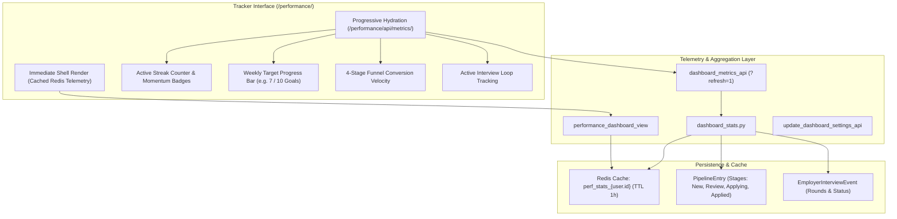

# Tab 3: Tracker — Career Momentum & Application Outcomes

The **Tracker** (`/performance/`) is the outcome and accountability hub in HireEdge (Tab 3 in the Stitch 3-Tab Model). It provides visibility into weekly job search momentum, application conversion velocity, and real-world employer interview progression.

HireEdge explicitly replaces punitive sprint deficit alerts with positive habit reinforcement, helping candidates build consistent job search velocity without cognitive fatigue.

---

## 1. Career Momentum Dashboard (`/performance/`)



---

## 2. Core Capabilities & Momentum Philosophy

### 2.1 Positive Momentum vs. Punitive Deficits
Legacy job tracking dashboards often borrow agile software sprint metrics that display red warnings when users miss arbitrary quotas (e.g., "5 applications behind schedule"). HireEdge replaces deficit alerts with constructive telemetry:
- **Interviews This Week Bar:** Anchored at the very top of the Tracker view, displaying upcoming and completed interview milestones for the active calendar week. Each row provides a direct 1-click jump link opening that specific card in the Career Cockpit.
- **Weekly Target Progress Bar & Cockpit Header Link:** Candidates set achievable weekly application goals (e.g., 5 to 10 applications/week). Progress is rendered via an emerald fill bar celebrating incremental milestones. On the Career Cockpit header, the current progress is displayed alongside a direct link to the oldest un-submitted card awaiting action in `Applying` when behind target.
- **Active Streak Telemetry:** Encourages consistency by tracking consecutive days of active job hunting (evaluating jobs, tailoring resumes, or recording interview notes).
- **Positive Momentum Signals:** Visual reinforcement highlights weekly wins, new recruiter interactions, and interview stage promotions.

### 2.2 4-Stage Conversion Funnel Velocity
Tracks candidate progression through the four pipeline stages:
1. **New (`Pipeline`):** Fresh opportunities ingested via automated searches or saved from the Sandbox.
2. **Review (`Vetting`):** High-potential roles screened with deep LLM match diagnostics and skill radar.
3. **Applying (`Applying`):** Positions undergoing customized resume tailoring and cover letter drafting.
4. **Applied (`Done`):** Submitted applications tracked through real-world employer interview loops.

### 2.3 Instant Shell Render & Progressive Hydration
To eliminate loading delays on high-volume pipelines:
- **Instant Shell Render:** The page renders immediately using cached stats from Redis (`perf_stats_{user.id}`) or skeleton placeholders.
- **Client-Side Hydration:** The browser fetches `/performance/api/metrics/` asynchronously to populate Chart.js graphs and breakdown tables without blocking the initial paint.
- **Cache Invalidation:** Appending `?refresh=1` forces recalculation across the pipeline and updates the Redis telemetry cache.
- **Personalized Goals:** Users configure weekly application targets and display preferences via `POST /performance/settings/`.

---

## 3. Employer Interview Tracking (`EmployerInterviewEvent`)

Once applications move to the **Applied** stage, HireEdge transitions candidates into post-application tracking via the `EmployerInterviewEvent` model.

### 3.1 Data Model Reference
Defined in `resume_app/models.py`:

```python
class EmployerInterviewEvent(models.Model):
    owner = models.ForeignKey(User, on_delete=models.CASCADE, related_name="interview_events")
    pipeline_entry = models.ForeignKey(PipelineEntry, on_delete=models.CASCADE, related_name="interview_events")
    round_type = models.CharField(
        max_length=32,
        choices=PipelineEntry.PostApplySubstatus.choices,
        default=PipelineEntry.PostApplySubstatus.RECRUITER_CALL,
    )
    status = models.CharField(max_length=20, choices=Status.choices, default=Status.SCHEDULED)
    scheduled_at = models.DateTimeField(null=True, blank=True)
    completed_at = models.DateTimeField(null=True, blank=True)
    interviewer_info = models.CharField(max_length=255, blank=True)
    notes = models.TextField(blank=True)
    feedback = models.TextField(blank=True)
    created_at = models.DateTimeField(auto_now_add=True)
    updated_at = models.DateTimeField(auto_now=True)
```

### 3.2 Post-Apply Substatus Stages
Interviews map cleanly to `PipelineEntry.PostApplySubstatus`:
- `RECRUITER_CALL`: Initial phone screen or recruiter discovery chat.
- `HIRING_MANAGER`: First hiring manager deep dive.
- `TECH_SCREEN`: Technical screening, coding assessment, system design, or portfolio review.
- `ON_SITE`: Final round / executive panel interviews.
- `OFFER`: Formal compensation package extended.
- `REJECTED`: Formal rejection or discontinued process.
- `WITHDRAWN`: Candidate-initiated withdrawal.

---

## 4. Key Endpoints

| Method | Path | Name | Purpose |
|--------|------|------|---------|
| `GET` | `/performance/` | `performance_dashboard` | Render Tab 3 Tracker: Career Momentum & Outcomes |
| `GET` | `/performance/api/metrics/` | `dashboard_metrics_api` | Progressive JSON telemetry endpoint (supports `?refresh=1`) |
| `POST` | `/performance/settings/` | `update_dashboard_settings_api` | Save target preferences and weekly application goals |
