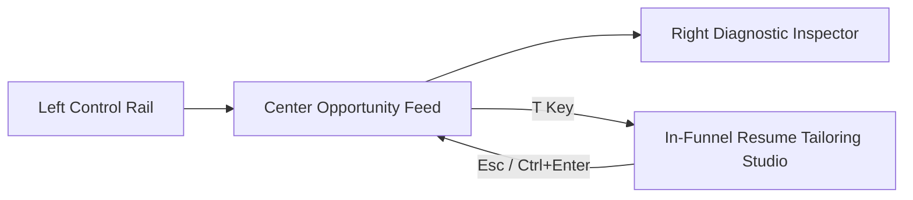

# Site Functionality

HireEdge is a unified, multi-user job search operating system that brings together executive career profiling, unbiased multi-board discovery, high-speed pipeline triage, AI resume tailoring, and interview tracking in a single workstation organized around the **Stitch 3-Tab Model**.

---

## 1. Landing Page & Public Access

**Entry point:** `/`

- **Public Marketing Page:** Provides clear calls-to-action for sign-up and sign-in, feature overviews, and product workflow demonstrations using HireEdge's forest green, navy, and mint design theme.
- **Post-Login Routing:** Authenticated users with incomplete setup go to the AI Resume Profiler (`/jobs/profiler/`). Completed users land on Career Cockpit. Legacy `/getting-started/` redirects to the Profiler (or Cockpit when setup is done).
- **Legal Compliance:** Public privacy policy (`/legal/privacy/`) and terms of service (`/legal/terms/`).

---

## 2. Onboarding (Career Profiler)

**Entry point:** `/jobs/profiler/` (post-login for incomplete accounts)

- New tenants land on the **AI Resume Profiler**: upload a resume, review suggested roles, and one-click provision a Search Profile with the resume bound.
- Onboarding is complete when the user has a library resume **and** at least one Search Profile with a bound resume.
- Legacy `/getting-started/` redirects to the Profiler (or Cockpit when setup is complete).
- Soft Cockpit banner links back to the Profiler until setup is finished.
- **Experience Modes:** Controlled by `UserExperienceSettings` (staff Account toggle: **Simple | Advanced**; code value `power` = Advanced):
  - **Simple (Normal):** Streamlined UI focused on primary workflows.
  - **Advanced:** Exposes denser diagnostics, raw scoring breakdowns, and custom workflow editors (staff accounts only).

---

## 3. Tab 1: Target & Discover

The **Target & Discover** tab serves as the dual entryway for role calibration and opportunity exploration. Users can toggle seamlessly between two complementary views via a segmented pill switcher:

### 3.1 View A: AI Resume Profiler (`/jobs/profiler/`)
Calibrates the candidate's career trajectory and market positioning:
- **Executive Positioning & Archetype:** Identifies the candidate's core seniority level and strategic narrative.
- **Target Job Titles:** Recommends primary and adjacent target role titles calibrated against resume achievements.
- **Core Competencies & Keywords:** Highlights verified core skills and industry keywords that strengthen ATS ranking.
- **Market Compensation Bands:** Provides expected 25th, 50th, and 75th percentile salary ranges for target titles.
- **One-Click Track Calibration:** Automatically creates or tunes the user's active `SearchProfile`.

### 3.2 View B: Find jobs (`/jobs/search/`)
Live search for discovering roles across the market. The page title and pill are **Find jobs**.
- **Default Unbiased Mode (No Profile):** Defaults to `None (Unbiased / No Profile)` with zero profile centroid loading, no AI vector embedding overhead, no match % badges, and no auto-elimination of jobs based on negative preference margins. Results return raw and fast.
- **Opt-In Profile Scoring:** Users can optionally select an existing search profile from the **Scoring Profile** dropdown under Advanced Filters to score matches and apply preference-margin filtering.
- **Calculation Warning Banner:** When a scoring profile is chosen, a prominent warning informs the user that computing AI vector embeddings for every result will take extra time.
- **Multi-Source Aggregation:** Concurrently searches JobSpy (Indeed, LinkedIn), direct Greenhouse boards, BuiltIn, Levels.fyi, and Dice.
- **Deduplication:** Collapses duplicate postings of the same job across aggregators into a single canonical listing.
- **Save to Cockpit:** The card button posts `POST /api/resume/jobs/{id}/save`. A new row lands in Review (`stage="vetting"`). An active pipeline row keeps its current stage. The label switches to **In Cockpit**.
- **Automated Sourcing into Cockpit:** The right rail allows users to save any query and toggle **"Automate into Cockpit"**, running the query on a scheduled cron to continuously feed matched roles into the user's Cockpit board.
- **Phrases to Avoid:** Global negative keywords auto-screen unwanted titles or companies.

---

## 4. Tab 2: Career Cockpit (Primary Workstation)

**Entry point:** `/jobs/cockpit/`

The Career Cockpit is a full-screen, high-velocity tri-pane workstation designed for 10-minute daily triage sprints. On wide screens the feed and inspector expand to fill the viewport; neither pane is width-capped.

### 4.1 Left Control Rail
- **Profile Workspace (Scoped to Active Search Profile):** Select and switch active profiles (`SearchProfile`), binding specific resumes, search terms, locations, and automated schedules.
- **On-Demand "Run Search Now":** Scrapes live boards immediately with atomic Redis pending flags and a 3-minute cooldown (180s limit, auto-resets to 0 if a run encounters an error).
- **Policy Telemetry Summary Card:** Shown only when `power_user` or `real_user_is_staff`. It displays auto-purge, auto-promotion, and retention. Normal tenants do not see this card.
- **Pipeline Automation Policies drawer:** `openAutomationDrawer()` edits purge, promotion, and retention (`action="update_pipeline_retention"`). The drawer markup is on the page for every logged-in user, and `/jobs/automation/` opens it. Esc and the close button dismiss it. The backdrop has no click listener. Search schedule and boards live in the Search Profile drawer.

### 4.2 Center Opportunity Feed
- **Connected Pipeline Stepper:** Organizes candidates into 4 linear stages:
  1. **New (`pipeline`):** Freshly ingested postings.
  2. **Review (`vetting`):** Roles advanced from New, or saved from Find jobs, for deep fit checks.
  3. **Applying (`applying`):** Roles actively undergoing resume tailoring.
  4. **Applied (`done`):** Submitted applications and active interview loops (strictly protected from automated retention cleanup).
- **Empty Cockpit Kickoff Banner:** When the pipeline has zero jobs across all stages, the feed shows **Find jobs in Target & Discover** and **Edit Search Profile**.
- **Legacy board URLs:** `/jobs/pipeline|vetting|applying|done/` redirect to `/jobs/cockpit/?stage=<stage>` and forward all query params (including `track` / `profile`).
- **Explicit Card Action Destinations:** Opportunity cards show direct destination labels:
  - **New (`pipeline`):** "Move to Review" (`E`)
  - **Review (`vetting`):** "Move to Applying" (`E`) or "Tailor Resume" (`T`)
  - **Applying (`applying`):** "Tailor Resume" (`T`) or "Mark Submitted" (`E`)
  - **Applied (`done`):** "Log Next Step" (opens interview logging drawer, pre-selecting the next logical interview round)
- **Top Header Momentum Progress:** Displays weekly target progress (e.g. `2 / 5 targets this week · 3 to goal`) with a direct 1-click link to the oldest card in `Applying` when behind target.
- **Fast Keyboard Navigation:** See complete behavior in [Career Cockpit Keyboard Hotkeys](career-cockpit.md#26-keyboard-triage-hotkeys):
  - `J` / `K` (`ArrowDown` / `ArrowUp`): Move down / up through visible opportunity cards.
  - `E`: Submits the card’s `action="save"` form (Move to Review, Move to Applying, or Mark Submitted).
  - `L`: Likes or unlikes the focused card (`action="like"` / `action="unlike"`), updating the preference centroid.
  - `X`: Submits `action="delete"` when that form is on the card, otherwise `action="dislike"`.
  - `T`: Opens `/resume/optimizer/?job_id=<id>&profile=<slug>` (plus `resume_id` when the profile has a bound resume). `optimizer_view` reads `track` or session `optimizer_track`. It does not read `profile`.
  - `Esc`: Closes open inspector, profile drawer, or automation drawer.

### 4.3 Right Diagnostic Inspector / Slide Drawer
Provides an accessible, zero-clutter slide drawer for deep evaluation of the selected opportunity:
- **Card 1: Overview & Metadata:** Salary benchmarks, location, source board, posting date, application window lifespan, and quick triage actions.
- **Card 2: Description:** Full job posting text with keyword highlights.
- **Card 3: AI Match Verdict & Diagnostics:**
  - **Match Score & Stretch Skills:** Displays match probability percentage and a full-width **Stretch Skills** block highlighting actionable skill gaps.
  - **Responsive Action Toolbar:** The `Re-Analyze` button and metadata pills are rendered with flexible wrapping (`flex flex-wrap`), eliminating button cutoff on narrow and vertical screens.
- **Card 4: Live Interview Prep:** Instant AI interview kit generating tailored screening questions and talking points.

---

## 5. Tab 3: Tracker (Momentum & Outcomes)

**Entry point:** `/performance/`

Nav label **Tracker**. Page focuses on positive execution velocity (not a CRM application list — Cockpit Applied owns apps/interviews):
- **Top Interviews This Week Bar:** Renders at the very top of the Tracker view, displaying upcoming and logged interview rounds for the current calendar week with 1-click jump links directly to those cards in the Career Cockpit.
- **Weekly Goal Progress:** Displays clear progress bars tracking submissions against the user's weekly target.
- **Active Streak Counter:** Telemetry showing consecutive active job search days.
- **Funnel Conversion Velocity:** Visualizes conversion rates from New $\rightarrow$ Review $\rightarrow$ Applying $\rightarrow$ Applied.
- **Employer Interview Tracking (telemetry):** Tracker shows upcoming milestones and conversion metrics only. Logging and prep run on **Career Cockpit Applied cards** (Tracker CTAs deep-link to `/jobs/cockpit/?stage=done&job_id=…&drawer=interview`). Tracker does not host an interview editor drawer.
- Metrics hydrate via Redis cache (`/performance/api/metrics/`).

---

## 6. In-Funnel Resume Tailoring Studio

**Entry point:** `/resume/optimizer/`

A multi-agent tailoring engine orchestrated with LangGraph (Writer → ATS Judge → Recruiter Judge):
- **Executive Mode (tenant default):** Primary path is role match, competency/infusion diffs, and Approve / Download. Workflow, ATS profile, run mode, and delay live under **Advanced Engine Settings** (open by default for staff / Power).
- **Decoupled Drafting & Submission:**
  - **Save Draft (`Ctrl+S`):** Persists customized resume markdown while keeping the job safely in `Applying` so candidate can review exports, download PDF/DOCX artifacts, and access employer postings.
  - **I Submitted This (`Ctrl+Enter`):** Advances the pipeline entry to `Applied` (`stage="done"`) once the candidate finishes submitting on the employer's portal.
  - **1-Click Employer Post:** Direct link opens the canonical external employer job application in a new tab.
- **Dynamic Return Loop:** The **"Back to Cockpit"** (`Esc`) link dynamically resolves the active `SearchProfile.slug` and the card's current pipeline stage (`stage=applying` or `stage=done`), returning the candidate precisely where they left off without brittle hardcoded fallbacks.
- **Token Budgeting:** Trims employer boilerplate with semantic slicing before LLM processing.
- **Hybrid LLM Routing:** High-quality cloud models (OpenAI, Anthropic, Groq) write bullet points; local Ollama instances can evaluate ATS and Recruiter scoring.
- **Artifacts:** Exports tailored resumes and customized cover letters to PDF or DOCX.

---

## 7. Global Navigation, Tools & Settings

### 7.1 Tools Dropdown (Role-Scoped)
- **Tenants:** Tools → Tailor Resume deep-links Cockpit Applying (`/jobs/cockpit/?stage=applying`); card Tailor still opens `/resume/optimizer/` with `job_id`. **Plan & usage** (`/billing/`) shows live plan name/price, daily meters, and storage. Stripe Checkout/Portal only when `STRIPE_SECRET_KEY` is set; otherwise a collapsed compare table (no fake shop). Fit diagnostics live in the Cockpit inspector. `/system/fit-inspector/` sends non-staff users to the Cockpit: `drawer=inspector` and `stage=vetting` when `job_id` is present; otherwise Cockpit New with no drawer. Cockpit renders flash messages and a soft quota strip when meters are ≥80% used.
- **Staff (as self):** Admin Console: Fit Inspector, Workflows, Huey Monitor, Prompt Library, **Billing** (plan catalog — single billing entry; no duplicate Plan & usage), and **Staff Console** only when the user has `can_impersonate_users`. Experience mode **Advanced** shows a nav badge.
- **Staff (hijacked):** One sticky banner: Cockpit · Automation · Release. The django-hijack bottom “stop impersonating” card is not rendered. Admin Console keeps **Fit Inspector** + **Huey (read-only)**. Global mutations (Workflows / Prompts / Billing catalog / Staff Console / Huey pause-flush) stay staff-as-self. **Plan & usage** reappears for the tenant view. Cockpit **Pipeline Policies** remain visible for the real staff user.
- **Automation:** Cockpit Automation Drawer is the tenant policy/schedule home. `/jobs/automation/` redirects to Cockpit with `drawer=automation` and preserves query params. Settings **Account defaults** (staff-as-self) edits the staff account only; during hijack that tab redirects to the Cockpit drawer.

### 7.2 Settings & Prompt Library Separation
- **Settings (`/settings/`):** Dedicated to account management, encrypted BYOK API keys, usage tracking, and quotas. Staff Account tab includes **Simple | Advanced** experience mode (persists on the real staff user). **Account defaults** (formerly App Automation) is staff-as-self only.
- **Prompt Library (`/resume/prompts/`) & Workflows:** System-wide; save confirms **Affects all tenants**.

### 7.3 Staff Console
- **Entry:** `/staff/users/` (permission `can_impersonate_users`). Owns per-user plan, status, trial, quota reset, suspend, and impersonate (defaults to Career Cockpit). Billing deep-links here for tenant ops. Full support workflow: [Staff Console & Support Workflows](features/staff-console.md).
