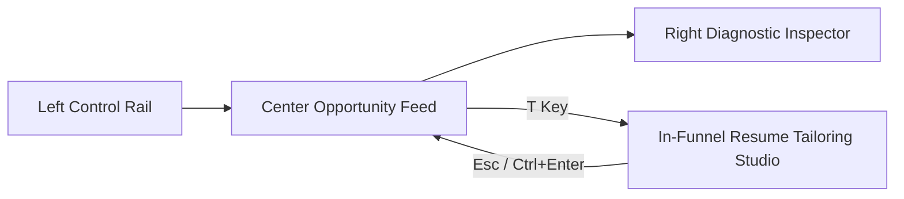

# Site Functionality

HireEdge is a unified, multi-user job search operating system that brings together executive career profiling, unbiased multi-board discovery, high-speed pipeline triage, AI resume tailoring, and interview tracking in a single workstation organized around the **Stitch 3-Tab Model**.

---

## 1. Landing Page & Public Access

**Entry point:** `/`

- **Public Marketing Page:** Provides clear calls-to-action for sign-up and sign-in, feature overviews, and product workflow demonstrations using HireEdge's forest green, navy, and mint design theme.
- **Post-Login Routing:** Authenticated users are automatically routed to Getting Started (`/getting-started/`) if their initial setup is incomplete, or directly to their active Career Cockpit board.
- **Legal Compliance:** Public privacy policy (`/legal/privacy/`) and terms of service (`/legal/terms/`).

---

## 2. Onboarding (Getting Started)

**Entry point:** `/getting-started/`

- Displays a step-by-step checklist guiding new users through connecting AI providers, uploading an initial resume, and setting up their first job search.
- **Experience Modes:** Controlled by `UserExperienceSettings`:
  - **Normal Mode:** Streamlined, simple UI focused on primary workflows.
  - **Power Mode:** Exposes advanced developer tools, raw scoring breakdowns, and custom workflow editors.

---

## 3. Tab 1: Target & Discover

The **Target & Discover** tab serves as the dual entryway for role calibration and opportunity exploration. Users can toggle seamlessly between two complementary views via a segmented pill switcher:

### 3.1 View A: AI Resume Profiler (`/jobs/profiler/`)
Calibrates the candidate's career trajectory and market positioning:
- **Executive Positioning & Archetype:** Identifies the candidate's core seniority level and strategic narrative.
- **Target Job Titles:** Recommends primary and adjacent target role titles calibrated against resume achievements.
- **Core Competencies & Keywords:** Highlights verified core skills and industry keywords that strengthen ATS ranking.
- **Market Compensation Bands:** Provides expected 25th, 50th, and 75th percentile salary ranges for target titles.
- **One-Click Track Calibration:** Automatically creates or tunes the user's active `SearchProfile`.

### 3.2 View B: Search Sandbox (Unbiased) (`/jobs/search/`)
Live, exploratory search environment for discovering roles across the market:
- **Default Unbiased Mode (No Profile):** Defaults to `None (Unbiased / No Profile)` with zero profile centroid loading, no AI vector embedding overhead, no match % badges, and no auto-elimination of jobs based on negative preference margins. Results return raw and fast.
- **Opt-In Profile Scoring:** Users can optionally select an existing search profile from the **Scoring Profile** dropdown under Advanced Filters to score matches and apply preference-margin filtering.
- **Calculation Warning Banner:** When a scoring profile is chosen, a prominent warning informs the user that computing AI vector embeddings for every result will take extra time.
- **Multi-Source Aggregation:** Concurrently searches JobSpy (Indeed, LinkedIn), direct Greenhouse boards, BuiltIn, Levels.fyi, and Dice.
- **Deduplication:** Collapses duplicate postings of the same job across aggregators into a single canonical listing.
- **1-Click "+ Add to Review" Bridge:** Clicking **"+ Add to Review"** on any sandbox card creates an active `PipelineEntry` in the user's Cockpit `Review` queue (`stage="vetting"`). Once saved, the card immediately updates to an emerald **"✓ In Review"** state.
- **Automated Sourcing into Cockpit:** The right rail allows users to save any query and toggle **"Automate into Cockpit"**, running the query on a scheduled cron to continuously feed matched roles into the user's Cockpit board.
- **Phrases to Avoid:** Global negative keywords auto-screen unwanted titles or companies.

---

## 4. Tab 2: Career Cockpit (Primary Workstation)

**Entry point:** `/jobs/cockpit/`

The Career Cockpit is a full-screen, high-velocity tri-pane workstation designed for 10-minute daily triage sprints:

### 4.1 Left Control Rail
- **Profile Workspace (Scoped to Active Search Profile):** Select and switch active profiles (`SearchProfile`), binding specific resumes, search terms, locations, and automated schedules.
- **On-Demand "Run Search Now":** Scrapes live boards immediately with atomic Redis pending flags and a 3-minute cooldown (180s limit, auto-resets to 0 if a run encounters an error).
- **Policy Telemetry Summary Card:** Displays active auto-purge thresholds, auto-promotion rules, and retention limits.
- **Slide-Over Automation Drawer:** Clicking "Configure" opens a non-disruptive slide-over modal to manage thresholds, retention days, and auto-promotion policies without leaving the board.

### 4.2 Center Opportunity Feed
- **Connected Pipeline Stepper:** Organizes candidates into 4 linear stages:
  1. **New (`pipeline`):** Freshly ingested postings.
  2. **Review (`vetting`):** Roles shortlisted or pushed from Sandbox for deep fit checks.
  3. **Applying (`applying`):** Roles actively undergoing resume tailoring.
  4. **Applied (`done`):** Submitted applications and active interview loops (strictly protected from automated retention cleanup).
- **Progressive Day-1 Onboarding Checklist:** When the pipeline has zero total jobs across all stages (`total_pipeline_jobs == 0`), the feed presents a guided 3-step checklist container:
  1. *Define Target & Profile* (links to AI Profiler at `/jobs/profiler/`).
  2. *Discover & Ingest Roles* (links to Search Sandbox at `/jobs/search/`).
  3. *Triage, Tailor & Track* (explains triage actions, AI tailoring, and outcome tracking).
- **Explicit Card Action Destinations:** Opportunity cards show direct destination labels:
  - **New (`pipeline`):** "Move to Review" (`E`)
  - **Review (`vetting`):** "Move to Applying" (`E`) or "Tailor Resume" (`T`)
  - **Applying (`applying`):** "Tailor Resume" (`T`) or "Mark Submitted" (`E`)
  - **Applied (`done`):** "Log Next Step" (opens interview logging drawer, pre-selecting the next logical interview round)
- **Top Header Momentum Progress:** Displays weekly target progress (e.g. `2 / 5 targets this week · 3 to goal`) with a direct 1-click link to the oldest card in `Applying` when behind target.
- **Fast Keyboard Navigation:** See complete behavior in [Career Cockpit Keyboard Hotkeys](career-cockpit.md#26-keyboard-triage-hotkeys):
  - `J` / `K` (`ArrowDown` / `ArrowUp`): Move down / up through visible opportunity cards.
  - `E`: Submits card shortlist/advance form, advancing the card to the next pipeline stage.
  - `L`: Likes or unlikes the focused card (`action="like"` / `action="unlike"`), updating the preference centroid.
  - `X`: Submits card delete or dislike form, removing or deprioritizing the role.
  - `T`: Opens the Resume Optimizer: `/resume/optimizer/?job_id=<id>&track=<pipeline_track>[&resume_id=<resume_id>]`.
  - `Esc`: Closes open inspector, profile drawer, or automation drawer.

### 4.3 Right Diagnostic Inspector / Slide Drawer
Provides an accessible, zero-clutter slide drawer for deep evaluation of the selected opportunity:
- **Card 1: Overview & Metadata:** Salary benchmarks, location, source board, posting date, application window lifespan, and quick triage actions.
- **Card 2: Description:** Full job posting text with keyword highlights.
- **Card 3: AI Match Verdict & Diagnostics:**
  - **Match Score & Stretch Skills:** Displays match probability percentage and a full-width **Stretch Skills** block highlighting actionable skill gaps.
  - **Responsive Action Toolbar:** The `Re-Analyze` button and metadata pills are rendered with flexible wrapping (`flex flex-wrap`), eliminating button cutoff on narrow and vertical screens.
- **Card 4: Live Interview Prep:** Instant AI interview kit generating tailored screening questions and talking points.

---

## 5. Tab 3: Tracker (Momentum & Outcomes)

**Entry point:** `/performance/`

Rebranded to **Career Momentum & Application Outcomes**, shifting the focus from punitive agile deficit alerts to positive execution velocity:
- **Top Interviews This Week Bar:** Renders at the very top of the Tracker view, displaying upcoming and logged interview rounds for the current calendar week with 1-click jump links directly to those cards in the Career Cockpit.
- **Weekly Goal Progress:** Displays clear progress bars tracking submissions against the user's weekly target.
- **Active Streak Counter:** Telemetry showing consecutive active job search days.
- **Funnel Conversion Velocity:** Visualizes conversion rates from New $\rightarrow$ Review $\rightarrow$ Applying $\rightarrow$ Applied.
- **Employer Interview Tracking (`EmployerInterviewEvent`):**
  - Logs interview stages: Recruiter Screen, Hiring Manager, Technical Screen, On-Site, Offer.
  - Records interview dates, interviewer details, notes, and outcome status.
  - Fully hydrated progressively via Redis cache (`/performance/api/metrics/`).

---

## 6. In-Funnel Resume Tailoring Studio

**Entry point:** `/resume/optimizer/`

A multi-agent tailoring engine orchestrated with LangGraph (Writer → ATS Judge → Recruiter Judge):
- **Decoupled Drafting & Submission:**
  - **Save Draft (`Ctrl+S`):** Persists customized resume markdown while keeping the job safely in `Applying` so candidate can review exports, download PDF/DOCX artifacts, and access employer postings.
  - **I Submitted This (`Ctrl+Enter`):** Advances the pipeline entry to `Applied` (`stage="done"`) once the candidate finishes submitting on the employer's portal.
  - **1-Click Employer Post:** Direct link opens the canonical external employer job application in a new tab.
- **Dynamic Return Loop:** The **"Back to Cockpit"** (`Esc`) link dynamically resolves the active `SearchProfile.slug` and the card's current pipeline stage (`stage=applying` or `stage=done`), returning the candidate precisely where they left off without brittle hardcoded fallbacks.
- **Token Budgeting:** Trims employer boilerplate with semantic slicing before LLM processing.
- **Hybrid LLM Routing:** High-quality cloud models (OpenAI, Anthropic, Groq) write bullet points; local Ollama instances can evaluate ATS and Recruiter scoring.
- **Artifacts:** Exports tailored resumes and customized cover letters to PDF or DOCX.

---

## 7. Global Navigation, Tools & Settings

### 7.1 Tools Dropdown (Role-Scoped)
- **Tenants:** Fit Inspector (`/system/fit-inspector/`), Tailor Resume (`/resume/optimizer/`), and Billing (`/billing/`). (Career Cockpit is in primary nav; administrative Workflows are hidden).
- **Staff:** Exposes Admin Console tools: Workflows (`/workspace/workflows/`), Huey Monitor (`/jobs/huey/`), Prompt Library (`/resume/prompts/`), and Staff Console (`/staff/users/`).

### 7.2 Settings & Prompt Library Separation
- **Settings (`/settings/`):** Dedicated to account management, encrypted BYOK API keys, usage tracking, and quotas. The `App Automation` tab is hidden from tenants and reserved for staff.
- **Prompt Library (`/resume/prompts/`):** The single place to manage prompt templates, bind specific LLMs (Provider + Model) to each workflow, and execute live testing with latency/token telemetry.
