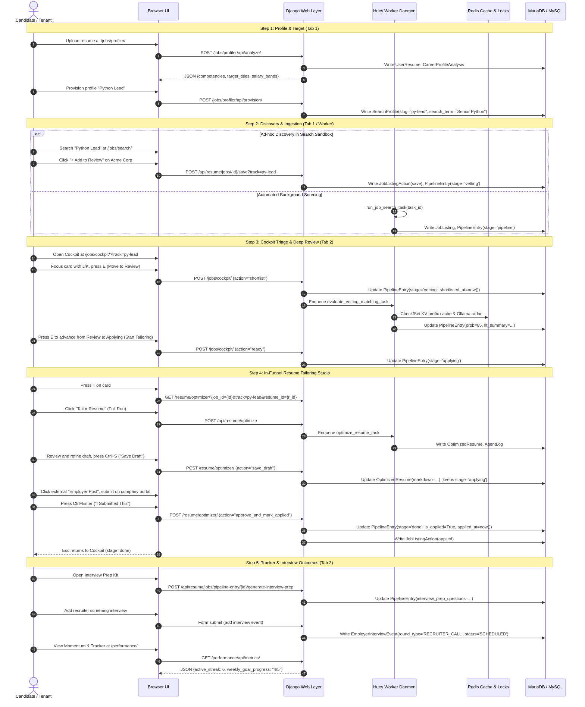

# End-to-End User Journey Trace

This document traces a single job opportunity through its complete lifecycle in HireEdge: from initial career profiling and search ingestion to pipeline triage, in-funnel resume tailoring, and final interview outcome tracking.

---

## 1. Journey Architecture Overview



---

## 2. Detailed Step-by-Step Lifecycle

### Step 1: Target Definition (`/jobs/profiler/`)
- **User Action:** Candidate uploads their master resume PDF in the AI Resume Profiler.
- **View / Handler:** `resume_views.career_profiler_view` / `career_profiler_analyze_api`.
- **Endpoint:** `POST /jobs/profiler/api/analyze/`.
- **Database Rows Written:**
  - `UserResume`: Source resume text, uploaded file path, candidate name.
  - `CareerProfileAnalysis`: Extracted core competencies, executive summary, target job titles, and salary ranges stored in `analysis_data`.
- **Provisioning Profile:**
  - Candidate selects "Senior Python Lead" and provisions the search profile.
  - **Endpoint:** `POST /jobs/profiler/api/provision/`.
  - **Database Rows Written:**
    - `SearchProfile`: `name="Python Lead"`, `slug="py-lead"`, `search_term="Senior Python Engineer"`, `location="Remote"`, `resume=UserResume`.

---

### Step 2: Discovery & Ingestion
- **Pathway A (Search Sandbox):**
  - Candidate searches live listings at `GET /jobs/search/?q=Python+Lead` (`jobs_search_view`).
  - Candidate clicks **`+ Add to Review`** on Acme Corp "Senior Python Architect".
  - **Endpoint:** `POST /api/resume/jobs/{job_id}/save?track=py-lead` (`save_job` in `jobs_api.py`).
  - **Database Rows Written:**
    - `JobListingAction`: `action_type="save"`, `user=request.user`, `job=acme_job`.
    - `PipelineEntry`: `stage="vetting"` (Review), `is_saved=True`, `saved_at=now()`, `track="py-lead"`.
- **Pathway B (Automated Huey Background Task):**
  - Huey worker executes `run_job_search_task(task_id)`.
  - Scrapes JobSpy, Greenhouse, BuiltIn, Levels.fyi, or Dice.
  - Deduplicates listing against `JobListing.clean_url`.
  - **Database Rows Written:**
    - `JobListing`: Global job description, title, company, salary.
    - `PipelineEntry`: `stage="pipeline"` (New), `track="py-lead"`, initial `focus_score`.
    - `JobSearchTaskRun`: Run metrics (`jobs_fetched`, `jobs_added_to_pipeline`).

---

### Step 3: Cockpit Triage & Deep Review (`/jobs/cockpit/`)
- **User Action:** Candidate loads the Career Cockpit: `GET /jobs/cockpit/?track=py-lead` (`career_cockpit_view`).
- **Advancement from New:**
  - Candidate navigates with `J`/`K` keys and presses `E` (Move to Review).
  - Form action submits `action="shortlist"`.
  - **Database Rows Updated:** `PipelineEntry.stage = 'vetting'`, `PipelineEntry.shortlisted_at = now()`.
- **Two-Pass Review Evaluation:**
  - **Pass 1 (Posting Authenticity Audit):** Evaluates `JobListing` against 10 deterministic compliance checks, extracting `posted_date` and `application_window` to detect artificial $\le 4$-day closing windows or statutory clauses. Persists verdict (`GENUINE_EXTERNAL`, `INTERNAL_PRESELECT`, `PHANTOM_PIPELINE`, `PERM_COMPLIANCE`) and score to `JobListing`.
  - **Pass 2 (Candidate Match & Skill Radar):** Huey task `evaluate_vetting_matching_task` runs for Review cards. Structures Candidate Resume before Job Description to leverage Ollama KV prefix cache (~2.06s inference). Extracts match score, stretch skills, and fit summary.
  - **Cache & Persistence:**
    - Redis Cache: `cockpit_ollama_skill_radar_{user_id}_{resume_id}_{job_id}` (7d TTL) and `job_authenticity_{job_id}` (7d TTL).
    - Database Fallback: `PipelineEntry.vetting_interview_probability = 85`, `PipelineEntry.vetting_interview_reasoning = "Strong Python and Kubernetes fit..."`.
- **Advancement to Applying:**
  - Candidate presses `E` (or `T`) on the Review card.
  - Form action submits `action="ready"`.
  - **Database Rows Updated:** `PipelineEntry.stage = 'applying'`.

---

### Step 4: In-Funnel Resume Tailoring Studio (`/resume/optimizer/`)
- **User Action:** Candidate presses `T` (Start Tailoring) on the applying card.
- **View:** Navigates directly to:
  ```text
  GET /resume/optimizer/?job_id={job_id}&track=py-lead&resume_id={resume_id}
  ```
- **Optimization Execution:**
  - Candidate triggers optimization: `POST /api/resume/optimize`.
  - Background Huey task `optimize_resume_task` executes 3-node LangGraph:
    1. *Writer Node:* Rewrites bullets matching Acme Corp's architectural requirements.
    2. *ATS Judge Node:* Evaluates keyword overlap (local Ollama or cloud).
    3. *Recruiter Judge Node:* Evaluates brevity and impact.
  - **Database Rows Written:**
    - `OptimizedResume`: Tailored markdown draft, `ats_score = 92`, `recruiter_score = 88`, cover letter text, `optimizer_context_snapshot`.
    - `AgentLog`: Node execution steps and raw judge feedback.
- **Draft Saving vs. Submission:**
  - **Save Draft:** Candidate refines draft and presses `Ctrl+S` (`POST /resume/optimizer/` with `action="save_draft"`). The card stays in `Applying` while exports (PDF/DOCX) are generated.
  - **Employer Submission:** Candidate clicks 1-click "Employer Post" external link, applies on the employer portal, and presses `Ctrl+Enter` ("I Submitted This").
  - **Endpoint:** `POST /resume/optimizer/?job_id={job_id}&track=py-lead` with `action="approve_and_mark_applied"`.
  - **Database Rows Updated:**
    - `PipelineEntry`: `stage = 'done'`, `is_applied = True`, `applied_at = now()`, `optimized_resume_id = opt.id`.
    - `JobListingAction`: `action_type = "applied"`.
- **Escape Return:**
  - Pressing `Esc` in the optimizer activates the top action link (`id="back-to-cockpit-link"`), returning directly to `/jobs/cockpit/?track=py-lead&stage=done` (or `stage=applying` if saved as draft), dynamically scoped to the active profile slug.

---

### Step 5: Tracker & Interview Progression (`/performance/`)
- **Interview Preparation:**
  - Candidate clicks "Prep Kit" on the applied card in Cockpit.
  - **Endpoint:** `POST /api/resume/jobs/pipeline-entry/{id}/generate-interview-prep`.
  - **Database Rows Updated:** `PipelineEntry.interview_prep_questions = [...]`.
- **Employer Interaction Logging:**
  - Recruiter reaches out; candidate logs phone screen:
  - **Database Rows Written:**
    - `EmployerInterviewEvent`:
      - `pipeline_entry = acme_entry`
      - `round_type = 'RECRUITER_CALL'`
      - `status = 'SCHEDULED'`
      - `scheduled_at = 2026-10-15 14:00:00`
      - `interviewer_info = "Sarah Connor (Recruiter)"`
- **Subsequent Interview Stages:**
  - Recruiter Call $\rightarrow$ Technical Screen (`TECH_SCREEN`) $\rightarrow$ On-Site Panel (`ON_SITE`) $\rightarrow$ Formal Offer (`OFFER`).
  - **Database Rows Updated:** `EmployerInterviewEvent.round_type = 'OFFER'`, `status = 'COMPLETED'`, `completed_at = now()`.
- **Momentum & Outcome Tracking:**
  - Candidate visits `/performance/` (`performance_dashboard_view`).
  - Renders cached shell from Redis `perf_stats_{user.id}`.
  - Client hydrates `/performance/api/metrics/`.
  - Visualizes active streak counter, emerald weekly target progress bar (e.g. 5/5 target reached), and funnel velocity with zero punitive deficit shaming.
